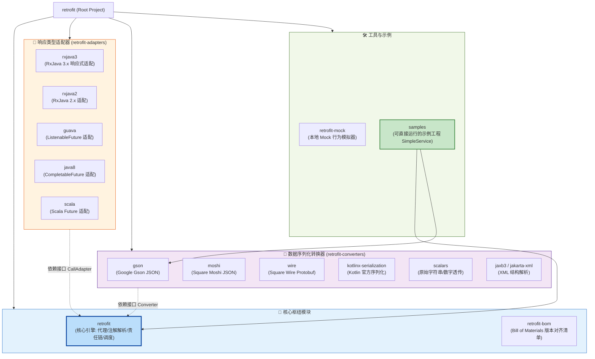
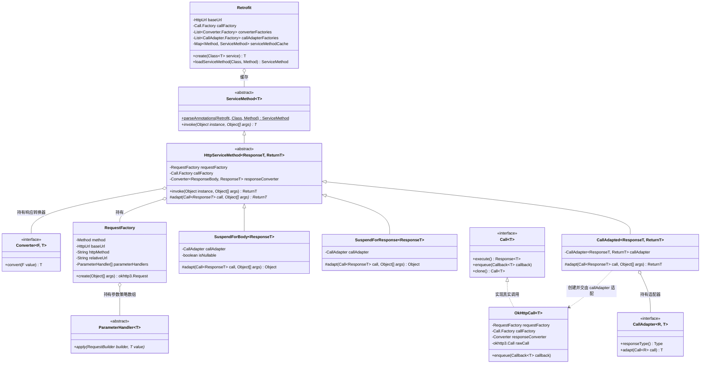
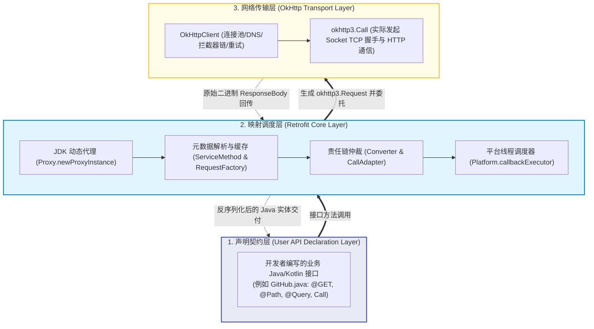
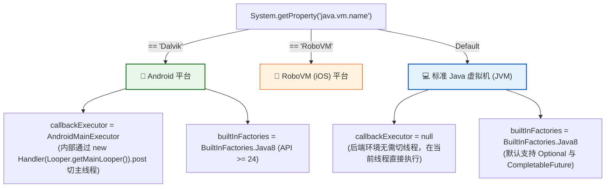
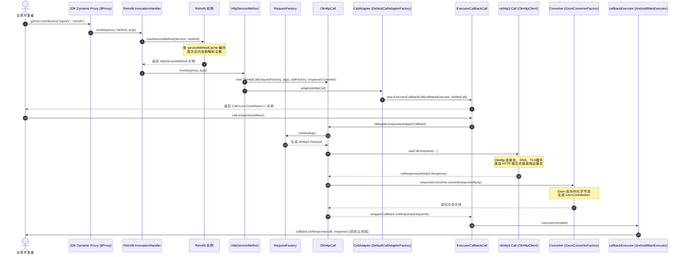
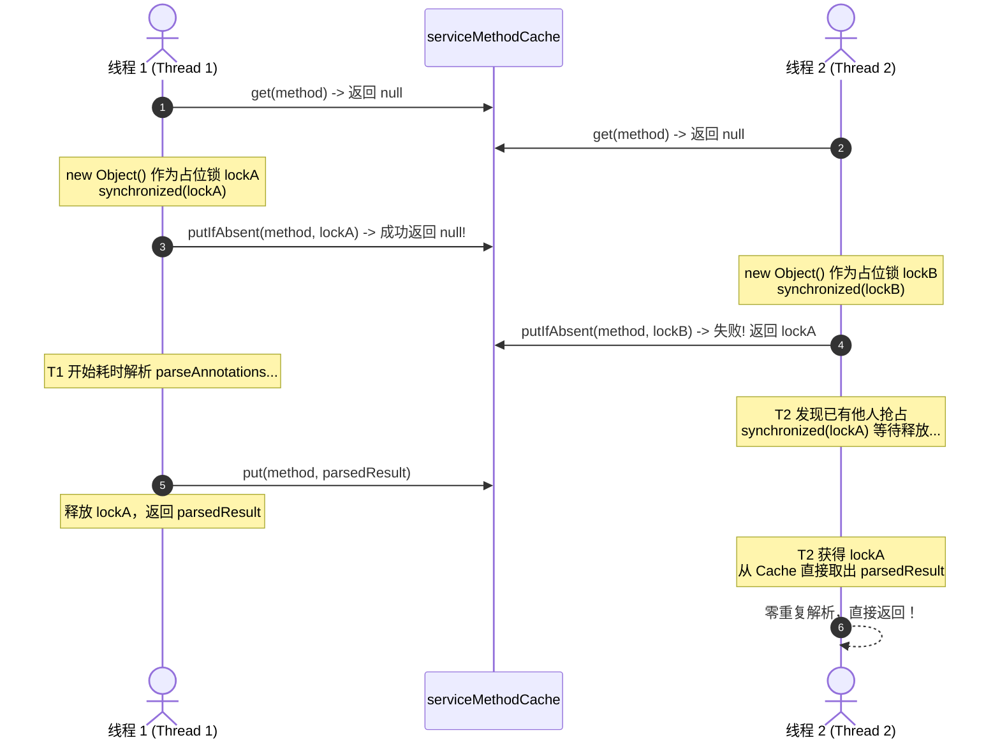
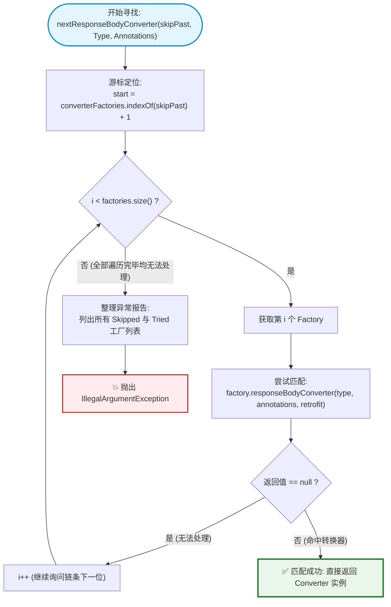

# 🧭 Retrofit 项目架构精读指南（面向新手）

> **目标读者**：刚入职的 Java / Android 初中级工程师。能熟练使用 Retrofit 编写业务网络请求代码，但从未系统阅读过优秀开源框架源码；渴望跳出“API 搬砖工”视角，建立对框架宏观架构、分层解耦、核心调用链与设计决策的系统级认知。  
> **文档主线**：**新手读图 → 跑通代码 → 追踪调用链 → 理解设计决策**。从宏观模块全景到底层核心类，逐层拆解 Retrofit 2.x/3.x 的架构奥秘。

---

## 📌 目录
- [第一部分：宏观架构全景](#第一部分宏观架构全景)
  - [1. 项目模块导览与工程拓扑](#1-项目模块导览与工程拓扑)
  - [2. 核心类关系全景图（Class Diagram）](#2-核心类关系全景图class-diagram)
  - [3. 三层分层架构设计与职责边界](#3-三层分层架构设计与职责边界)
- [第二部分：启动与初始化流程](#第二部分启动与初始化流程)
  - [4. Retrofit.Builder 配置阶段与决策剖析](#4-retrofitbuilder-配置阶段与决策剖析)
- [第三部分：核心执行流程（最重要）](#第三部分核心执行流程最重要)
  - [5. 一次 HTTP 请求的完整生命周期（端到端时序图）](#5-一次-http-请求的完整生命周期端到端时序图)
  - [6. loadServiceMethod 并发缓存与占位锁机制](#6-loadservicemethod-并发缓存与占位锁机制)
  - [7. RequestFactory 注解解析流水线](#7-requestfactory-注解解析流水线)
  - [8. CallAdapter 与 Converter 责任链协商机制](#8-calladapter-与-converter-责任链协商机制)
- [第四部分：扩展机制与现代化进阶](#第四部分扩展机制与现代化进阶)
  - [9. 自定义 Converter 实战（以 Gson 为例）](#9-自定义-converter-实战以-gson-为例)
  - [10. 自定义 CallAdapter 实战（以 CompletableFuture 为例）](#10-自定义-calladapter-实战以-completablefuture-为例)
  - [11. Kotlin 协程支持原理（CPS 与挂起函数黑科技）](#11-kotlin-协程支持原理cps-与挂起函数黑科技)
- [第五部分：动手实践与思维进阶](#第五部分动手实践与思维进阶)
  - [12. 调试环境搭建与 6 大关键断点实战](#12-调试环境搭建与-6-大关键断点实战)
  - [13. 核心源码通读推荐路径（12 个核心文件）](#13-核心源码通读推荐路径12-个核心文件)
  - [14. 架构师进阶自我检验清单（10 道深度开放问答题）](#14-架构师进阶自我检验清单10-道深度开放问答题)

---

# 第一部分：宏观架构全景

## 1. 项目模块导览与工程拓扑

在学习任何开源项目之前，最忌讳的是一头扎进具体的某一行代码里。我们需要先站在万米高空，俯瞰整个代码仓库的模块划分。

打开 `/Users/lina/Documents/GitHub/retrofit`，整个仓库采用了典型的 Gradle 多模块（Multi-module）工程拓扑结构：



### 各模块职责矩阵

| 模块目录 | 核心职责 | 是否依赖外部三方库 |
| :--- | :--- | :--- |
| [retrofit](file:///Users/lina/Documents/GitHub/retrofit/retrofit/) | 框架核心。包含动态代理、注解扫描、线程切换、内部内置转换器 | 仅依赖 `OkHttp` 和 `Okio`，零其他外部依赖 |
| [retrofit-adapters](file:///Users/lina/Documents/GitHub/retrofit/retrofit-adapters/) | 返回类型适配插件。将底层 Call 转换为 RxJava、Future 等类型 | 依赖各自分配的异步框架库（如 RxJava、Guava） |
| [retrofit-converters](file:///Users/lina/Documents/GitHub/retrofit/retrofit-converters/) | 数据序列化插件。将 HTTP 字节流与实体对象相互转换 | 依赖各自分配的序列化解析库（如 Gson、Wire） |
| [retrofit-mock](file:///Users/lina/Documents/GitHub/retrofit/retrofit-mock/) | 提供行为调用模拟（Mock）、网络延迟仿真与错误率模拟 | 单元测试与离线演示利器 |
| [samples](file:///Users/lina/Documents/GitHub/retrofit/samples/) | 官方提供的端到端可执行示例代码集合 | 用于演示与初学者学习运行 |

> [!NOTE]
> **微内核设计思想（Microkernel Architecture）**：  
> Retrofit 核心模块极其克制。Square 团队绝不把任何特定 JSON 解析库或特定响应式库打包进 `retrofit` 核心 jar 包。所有扩展均以独立的“插件式模块”存在，开发者按需引入（Pay for what you use），避免了引入臃肿无关的依赖树。

---

## 2. 核心类关系全景图（Class Diagram）

初学者看源码最容易晕头转向：一会儿是 `Retrofit`，一会儿是 `ServiceMethod`，一会儿又是 `OkHttpCall`。  
用一张 UML 类图理清它们之间的关系：



### 核心类名速记表
1. **[Retrofit](file:///Users/lina/Documents/GitHub/retrofit/retrofit/src/main/java/retrofit2/Retrofit.java)**：大管家与统一入口。负责配置管理、动态代理生成与方法元数据缓存。
2. **[ServiceMethod](file:///Users/lina/Documents/GitHub/retrofit/retrofit/src/main/java/retrofit2/ServiceMethod.java)**：方法元数据基类。代表一个接口方法的抽象执行逻辑。
3. **[HttpServiceMethod](file:///Users/lina/Documents/GitHub/retrofit/retrofit/src/main/java/retrofit2/HttpServiceMethod.java)**：负责真正 HTTP 请求逻辑的骨架抽象。分化出三种子类：常规适配 `CallAdapted`、协程响应包装 `SuspendForResponse`、协程解包 `SuspendForBody`。
4. **[RequestFactory](file:///Users/lina/Documents/GitHub/retrofit/retrofit/src/main/java/retrofit2/RequestFactory.java)**：请求工厂。将方法注解和参数注解一次性解析好，运行时通过 `create(args)` 快速拼装出 `okhttp3.Request`。
5. **[ParameterHandler](file:///Users/lina/Documents/GitHub/retrofit/retrofit/src/main/java/retrofit2/ParameterHandler.java)**：具体的参数填充策略，负责处理 `@Path`, `@Query`, `@Header`, `@Body` 等。
6. **[OkHttpCall](file:///Users/lina/Documents/GitHub/retrofit/retrofit/src/main/java/retrofit2/OkHttpCall.java)**：对底层 OkHttp `Call` 的薄包装，负责实际网络发送、状态维护与数据解析调用。
7. **[CallAdapter](file:///Users/lina/Documents/GitHub/retrofit/retrofit/src/main/java/retrofit2/CallAdapter.java)**：将 `Call<R>` 转换为上层需要的各种类型（RxJava/Future/协程）。
8. **[Converter](file:///Users/lina/Documents/GitHub/retrofit/retrofit/src/main/java/retrofit2/Converter.java)**：数据格式转换器（例如把 `ResponseBody` 反序列化为 Java 对象）。

---

## 3. 三层分层架构设计与职责边界

在设计模式中，高内聚低耦合的关键在于清晰的“分层职责边界”。Retrofit 整体自顶向下分为三层：



### 各层职责剖析
- **声明契约层**：属于纯业务代码。这一层**只做定义，不做实现**。开发者无需手写网络连接逻辑，只需通过注解声明 HTTP 方法、路径、入参与出参格式。
- **映射调度层**：Retrofit 的灵魂所在。通过动态代理拦截接口调用，将 Java 语义（方法名、注解、参数值）转换为标准的 HTTP 报文请求；在收到响应后，又通过责任链将原始字节流反序列化为 Java 实体，并通过 Dispatcher 派发回调用方所在线程。
- **网络传输层**：由 OkHttp 全权负责。专注于底层的 HTTP 协议解析、TCP 握手重用、TLS 握手、HTTP/2 多路复用、连接池管理以及缓存策略。Retrofit 绝不重复造轮子。

> [!IMPORTANT]
> **Retrofit 本质上是一个“类型安全的 HTTP 请求适配器与数据转换引擎”，它本身不做任何 Socket 网络 I/O！** 所有的底层 I/O 均下沉至 OkHttp。这种高度聚焦的职责划分是它轻量、稳定、易读的根本原因。

---

# 第二部分：启动与初始化流程

## 4. Retrofit.Builder 配置阶段与决策剖析

一个框架的设计水准，往往从其初始化构造方法中就能窥见一斑。让我们深入 [Retrofit.java](file:///Users/lina/Documents/GitHub/retrofit/retrofit/src/main/java/retrofit2/Retrofit.java#L670-L715) 的 `build()` 方法，逐行剖析其中的设计决策。

### 4.1 build() 核心源码逐行精读

```java
public Retrofit build() {
  // [决策 1] 必填校验：Base URL 缺失立即抛出异常
  if (baseUrl == null) {
    throw new IllegalStateException("Base URL required.");
  }

  // [决策 2] 网络引擎兜底：若未传入自定义 OkHttpClient，自动实例化默认 Client
  okhttp3.Call.Factory callFactory = this.callFactory;
  if (callFactory == null) {
    callFactory = new OkHttpClient();
  }

  // [决策 3] 平台调度器自适应：若未指定 callbackExecutor，自动读取平台的默认实现
  Executor callbackExecutor = this.callbackExecutor;
  if (callbackExecutor == null) {
    callbackExecutor = Platform.callbackExecutor;
  }

  BuiltInFactories builtInFactories = Platform.builtInFactories;

  // [决策 4] CallAdapter 工厂列表装配与顺序决策
  List<CallAdapter.Factory> callAdapterFactories = new ArrayList<>(this.callAdapterFactories);
  List<? extends CallAdapter.Factory> defaultCallAdapterFactories =
      builtInFactories.createDefaultCallAdapterFactories(callbackExecutor);
  callAdapterFactories.addAll(defaultCallAdapterFactories);

  // [决策 5] Converter 工厂列表装配与顺序决策
  List<? extends Converter.Factory> defaultConverterFactories =
      builtInFactories.createDefaultConverterFactories();
  int defaultConverterFactoriesSize = defaultConverterFactories.size();
  List<Converter.Factory> converterFactories =
      new ArrayList<>(1 + this.converterFactories.size() + defaultConverterFactoriesSize);

  // ⚠️ 极其关键：BuiltInConverters 必须排在首位！
  converterFactories.add(new BuiltInConverters());
  converterFactories.addAll(this.converterFactories);
  converterFactories.addAll(defaultConverterFactories);

  // [决策 6] 防御性包装：生成最终不可变的只读列表
  return new Retrofit(
      callFactory,
      baseUrl,
      unmodifiableList(converterFactories),
      defaultConverterFactoriesSize,
      unmodifiableList(callAdapterFactories),
      defaultCallAdapterFactories.size(),
      callbackExecutor,
      validateEagerly);
}
```

---

### 4.2 四大关键架构设计决策深度剖析

#### 决策一：为什么 `defaultCallAdapterFactories` 必须放在用户自定义工厂之后？
在 `callAdapterFactories.addAll(...)` 中，用户自定义的工厂排在最前面，系统默认的 `defaultCallAdapterFactories` 排在最后面。
- **为什么？**
  `CallAdapter.Factory` 内部采用责任链模式进行查找匹配。系统默认添加的 `DefaultCallAdapterFactory` 是一个**“兜底拦截器”**（Fall-through fallback）：只要返回类型是 `Call<T>`，它就会全盘接管！
  如果把系统默认工厂排在用户自定义工厂前面，那么当用户写了一个想要对 `Call<T>` 进行自定义增强的适配器时，请求会被默认工厂提前截胡，用户的工厂将**永远没有机会被执行**！
- **反例后果**：用户自定义扩展全面失效，框架无法支持针对原生 Call 的定制化增强。

---

#### 决策二：为什么 `BuiltInConverters` 必须强制排在第一位（Index 0）？
源码中明确写道：`converterFactories.add(new BuiltInConverters());` 紧接着才是 `addAll(this.converterFactories);`。
- **为什么？**
  [BuiltInConverters](file:///Users/lina/Documents/GitHub/retrofit/retrofit/src/main/java/retrofit2/BuiltInConverters.java) 负责处理最基础、最底层的原生 HTTP 实体：例如 `ResponseBody`、`Void`、`Unit` 以及加了 `@Streaming` 注解的大文件下载流。
  如果把它放在用户自定义工厂（例如 GsonConverterFactory）之后，由于大部分第三方 JSON 解析器内部都是直接通过 `gson.getAdapter(type)` 匹配所有类型的对象，很多贪婪（Greedy）的 Converter 会尝试把 `ResponseBody` 当成一个普通的 JavaBean 去用反射解析字段，最终导致大文件下载流直接崩溃或被提前消费！
- **反例后果**：`Call<ResponseBody>` 下载大文件时直接抛出 `JsonSyntaxException`，甚至直接 OOM 内存溢出。

---

#### 决策三：为什么必须用 `Collections.unmodifiableList` 封包？
在返回 `new Retrofit(...)` 时，所有的集合都经过了 `unmodifiableList` 封包。
- **为什么？**
  Retrofit 实例被设计为**无状态的不可变单例对象（Thread-safe Immutable Object）**。在典型的 Android 或 Spring 生产环境中，全局往往共享同一个 `Retrofit` 实例。如果内部的 `converterFactories` 是可变的普通 `ArrayList`，在多线程高并发请求下，如果任何一个模块尝试修改列表，就会引发严重的 `ConcurrentModificationException`，甚至由于竞争导致数据转换错乱。
- **反例后果**：在高并发场景下出现偶发、极难复现的集合并发修改崩溃。

---

#### 决策四：[Platform.java](file:///Users/lina/Documents/GitHub/retrofit/retrofit/src/main/java/retrofit2/Platform.java) 的平台智能自适应机制
Retrofit 是如何做到一套代码既能在 Android 上完美切主线程，又能在普通 Java 8+ / 17+ 后端环境中轻量运行的？
让我们阅读 [Platform.java](file:///Users/lina/Documents/GitHub/retrofit/retrofit/src/main/java/retrofit2/Platform.java#L23-L54)：

```java
final class Platform {
  static final @Nullable Executor callbackExecutor;
  static final Reflection reflection;
  static final BuiltInFactories builtInFactories;

  static {
    switch (System.getProperty("java.vm.name")) {
      case "Dalvik": // 探测到 Android 运行时环境
        callbackExecutor = new AndroidMainExecutor();
        if (SDK_INT >= 24) {
          reflection = new Reflection.Android24();
          builtInFactories = new BuiltInFactories.Java8();
        } else {
          reflection = new Reflection();
          builtInFactories = new BuiltInFactories();
        }
        break;

      case "RoboVM": // 探测到 iOS RoboVM 环境
        callbackExecutor = null;
        reflection = new Reflection();
        builtInFactories = new BuiltInFactories();
        break;

      default: // 标准 JVM 环境 (Java 8+, Spring Boot 等)
        callbackExecutor = null;
        reflection = new Reflection.Java8();
        builtInFactories = new BuiltInFactories.Java8();
        break;
    }
  }
}
```



> [!TIP]
> **优雅解耦的最佳实践**：  
> Retrofit 没有在业务代码中到处写 `if (isAndroid)`，而是通过静态代码块在类加载时一次性完成平台探测与策略绑定。这种方式使得业务主干逻辑纯净如水，完全感觉不到平台差异的存在。

---

# 第三部分：核心执行流程（最重要）

## 5. 一次 HTTP 请求的完整生命周期（端到端时序图）

理解一个框架最有效的方法，就是“抓牢一条调用链走到底”。  
假设我们使用官方示例 [SimpleService.java](file:///Users/lina/Documents/GitHub/retrofit/samples/src/main/java/com/example/retrofit/SimpleService.java) 发起一次请求：
```java
GitHub github = retrofit.create(GitHub.class);
Call<List<Contributor>> call = github.contributors("square", "retrofit");
call.enqueue(new Callback<List<Contributor>>() { ... });
```
从调用 `create()` 到最终在 Android 主线程（或 JVM）拿到回调数据，底层究竟发生了什么？

让我们通过一张端到端完整时序图彻底看懂整个生命周期：



### 整个执行过程的四大战略阶段：
1. **拦截阶段（Proxy Interception）**：JDK 动态代理拦截业务接口调用，将 Java 方法调用重定向到 `loadServiceMethod`。
2. **装配阶段（Assembly & Adaptation）**：从缓存获取或解析生成 `HttpServiceMethod`，创建底层的 `OkHttpCall`，并通过 `CallAdapter` 装饰为带线程切换能力的 `ExecutorCallbackCall`。
3. **执行阶段（Network Transport）**：业务调用 `enqueue()`，`RequestFactory` 遍历 `ParameterHandler` 策略数组完成 HTTP 报文组装，交由 OkHttp 进行真正的网络 I/O。
4. **交付阶段（Parsing & Dispatching）**：OkHttp 收到响应字节流后，交给责任链选出的 `Converter` 完成反序列化，最后由 `callbackExecutor` 派发回调用方所在线程。

---

## 6. loadServiceMethod 并发缓存与占位锁机制

在真实的生产应用中，同一个接口方法（例如 `getUser`）会被成百上千次并发调用。反射解析注解是非常昂贵的操作，因此 Retrofit 必须对其进行缓存。

打开 [Retrofit.java](file:///Users/lina/Documents/GitHub/retrofit/retrofit/src/main/java/retrofit2/Retrofit.java#L215-L265)，其 `loadServiceMethod` 的并发缓存设计被誉为 **Java 并发编程的殿堂级教科书**！

### 6.1 核心源码深度剖析

```java
ServiceMethod<?> loadServiceMethod(Class<?> service, Method method) {
  while (true) {
    // 1. 快路径：先查 ConcurrentHashMap 缓存
    Object lookup = serviceMethodCache.get(method);

    if (lookup instanceof ServiceMethod<?>) {
      // 命中缓存：直接强转并返回（无锁，极其高效）
      return (ServiceMethod<?>) lookup;
    }

    if (lookup == null) {
      // 2. 缓存未命中：创建一个崭新的 Object 锁作为“占位符”
      Object lock = new Object();
      synchronized (lock) {
        // 原子操作：尝试抢先将占位锁放入缓存
        lookup = serviceMethodCache.putIfAbsent(method, lock);
        if (lookup == null) {
          // 抢锁成功！当前线程负责解析注解工作
          ServiceMethod<Object> result;
          try {
            result = ServiceMethod.parseAnnotations(this, service, method);
          } catch (Throwable e) {
            // 解析失败：立刻移除占位锁，允许其他线程后续重试
            serviceMethodCache.remove(method);
            throw e;
          }
          // 解析成功：用解析完成的 ServiceMethod 替换掉占位锁
          serviceMethodCache.put(method, result);
          return result;
        }
      }
    }

    // 3. 慢路径：并发冲突！另一个线程先一步抢占了该方法的解析锁
    // 当前线程只需在对方放入的 lock 对象上等待（synchronized）
    synchronized (lookup) {
      Object result = serviceMethodCache.get(method);
      if (result == null) {
        // 对方解析失败移除了锁，继续循环重试
        continue;
      }
      return (ServiceMethod<?>) result;
    }
  }
}
```

### 6.2 为什么不直接用 `computeIfAbsent`？
很多新手可能会问：Java 8 的 `ConcurrentHashMap` 不是自带 `computeIfAbsent` 吗？一行代码就能搞定：
```java
return serviceMethodCache.computeIfAbsent(method, m -> ServiceMethod.parseAnnotations(...));
```
**为什么 Retrofit 不这么写？**
1. **Android 低版本兼容性（MinSdk）**：在 Android API 24 之前，Android 运行时的 `ConcurrentHashMap.computeIfAbsent` 存在严重的死锁和并发 Bug（Google Issue 37042460）。由于 Retrofit 需要兼容低版本 Android，不能直接依赖系统该方法的行为。
2. **锁粒度极致优化（Fine-grained Locking）**：如果直接在整个 `ConcurrentHashMap` 的 bucket 节点上执行耗时的反射解析，会导致哈希冲突在同一个桶上的其他完全不相关的接口方法也被长时间阻塞！通过**为每一个 Method 动态创建一个独立的 `Object lock` 占位锁**，Retrofit 实现了**方法级粒度的精准锁竞争**。不同接口方法的解析可以完全并发进行，互不干扰！



> [!NOTE]
> **如果不加占位锁会发生什么？**  
> 如果只用简单的 `get` 和 `put`，在高并发冷启动阶段，10 个并发线程同时调用同一个接口，会导致 `ServiceMethod.parseAnnotations` 被无辜重复执行 10 次！不仅浪费大量 CPU，还会重复生成多余的对象导致 GC 抖动。

---

## 7. RequestFactory 注解解析流水线

接口上的所有注解究竟是在什么时候、如何被解析成 HTTP 报文规则的？  
答案是：[RequestFactory.java](file:///Users/lina/Documents/GitHub/retrofit/retrofit/src/main/java/retrofit2/RequestFactory.java)。

### 7.1 流水线处理架构

```mermaid
flowchart TD
    Method["反射 Method 对象"] --> Stage1["1. 解析方法级注解<br/>(parseMethodAnnotation)"]
    Stage1 --> Sub1["提取 HTTP Method<br/>(@GET, @POST, @DELETE...)"]
    Stage1 --> Sub2["提取相对路径<br/>(@GET('/users/{id}'))"]
    Stage1 --> Sub3["提取固定请求头<br/>(@Headers({'Accept: json'}))"]
    Stage1 --> Sub4["提取编码与类型<br/>(@FormUrlEncoded, @Multipart)"]

    Method --> Stage2["2. 解析参数级注解<br/>(parseParameter)"]
    Stage2 --> ParamLoop["逐个遍历方法入参<br/>for (int p = 0; p < paramCount; p++)"]
    ParamLoop --> StrategyFactory{"根据注解类型匹配策略"}

    StrategyFactory -->|@Path| H_Path["new ParameterHandler.Path()"]
    StrategyFactory -->|@Query| H_Query["new ParameterHandler.Query()"]
    StrategyFactory -->|@Header| H_Header["new ParameterHandler.Header()"]
    StrategyFactory -->|@Body| H_Body["new ParameterHandler.Body()"]
    StrategyFactory -->|@Field| H_Field["new ParameterHandler.Field()"]

    H_Path --> Array["装填进 ParameterHandler[] 数组"]
    H_Query --> Array
    H_Header --> Array
    H_Body --> Array
    H_Field --> Array

    Sub1 --> FinalRF["封包为不可变 RequestFactory 实例"]
    Sub2 --> FinalRF
    Sub3 --> FinalRF
    Sub4 --> FinalRF
    Array --> FinalRF

    style Method fill:#e1f5fe,stroke:#0288d1,stroke-width:2px
    style FinalRF fill:#e8f5e9,stroke:#2e7d32,stroke-width:3px
    style StrategyFactory fill:#fff8e1,stroke:#f57f17,stroke-width:2px
```

### 7.2 运行期高速装填（Zero Reflection at Runtime）
`RequestFactory` 最核心的设计精髓是：**将所有高昂的反射操作前置到初始化阶段，运行期实现“零反射”**！

在 [RequestFactory.java](file:///Users/lina/Documents/GitHub/retrofit/retrofit/src/main/java/retrofit2/RequestFactory.java#L100-L138) 中：
```java
okhttp3.Request create(Object[] args) throws IOException {
  // 运行期直接拿到初始化好的策略数组
  ParameterHandler<Object>[] handlers = (ParameterHandler<Object>[]) parameterHandlers;

  int argumentCount = args.length;
  RequestBuilder requestBuilder = new RequestBuilder(
      httpMethod, baseUrl, relativeUrl, headers, contentType, hasBody, isFormEncoded, isMultipart);

  // 纯粹的数组遍历多态调用，无任何反射与分支判断！
  for (int p = 0; p < argumentCount; p++) {
    handlers[p].apply(requestBuilder, args[p]);
  }

  return requestBuilder.get().build();
}
```
通过将注解一次性预编译为 `ParameterHandler[]`，之后的每次调用都退化为纯粹的数组下标访问与多态调用，执行耗时微秒级，性能极高。

---

## 8. CallAdapter 与 Converter 责任链协商机制

Retrofit 如何知道由谁来反序列化返回值？又由谁来把 `Call` 转换为业务想要的类型？这全靠两大责任链协商机制。

### 8.1 责任链查找流程图



### 8.2 深度剖析：`skipPast` 游标设计的灵魂所在
在 [Retrofit.java](file:///Users/lina/Documents/GitHub/retrofit/retrofit/src/main/java/retrofit2/Retrofit.java#L355-L365) 中：
```java
public <T> Converter<ResponseBody, T> nextResponseBodyConverter(
    @Nullable Converter.Factory skipPast, Type type, Annotation[] annotations) {
  
  // 💡 游标偏移计算：若 skipPast 为 null，indexOf 返回 -1，-1 + 1 = 0 (从头开始)；
  // 若传了 skipPast，从该工厂的下一个位置开始往后找！
  int start = converterFactories.indexOf(skipPast) + 1;
  for (int i = start, count = converterFactories.size(); i < count; i++) {
    Converter<ResponseBody, ?> converter =
        converterFactories.get(i).responseBodyConverter(type, annotations, this);
    if (converter != null) {
      return (Converter<ResponseBody, T>) converter;
    }
  }
  // ...
}
```

#### 为什么必须要有 `skipPast`？
假设你想编写一个通用的“解密转换器工厂” `DecryptionConverterFactory`：
1. 它的职责不是真正反序列化 JSON，而是**先把加密的字节流解密成普通明文**；
2. 明文解密完成后，它需要继续交由后面的真正 JSON 转换器（如 GsonConverterFactory）反序列化为实体类。

如果没有 `skipPast`：
当它在自己的 `responseBodyConverter` 内部尝试调用 `retrofit.responseBodyConverter(...)` 委托其他转换器时，查找流程又会**从头（Index 0）开始**，再次匹配到 `DecryptionConverterFactory` 自己，从而引发**无限递归，最终 StackOverflowError 爆栈崩溃**！

通过传入 `skipPast = this`，Retrofit 明确告知责任链：**“从我之后的位置继续往后找”**。这一机制为框架的高阶包装和多层中间件提供了无与伦比的优雅支持。

---

# 第四部分：扩展机制与现代化进阶

## 9. 自定义 Converter 实战（以 Gson 为例）

数据转换器（Converter）是负责打通“网络二进制字节流”与“内存强类型 Java 对象”的咽喉要道。  
以官方的 `retrofit-converters/gson` 为例，我们来看看如何亲手实现一个工业级的 `Converter.Factory`。

### 9.1 结构剖析：GsonConverterFactory
[GsonConverterFactory](file:///Users/lina/Documents/GitHub/retrofit/retrofit-converters/gson/src/main/java/retrofit2/converter/gson/GsonConverterFactory.java) 继承自抽象工厂 `Converter.Factory`：

```java
public final class GsonConverterFactory extends Converter.Factory {
  private final Gson gson;

  public static GsonConverterFactory create() {
    return create(new Gson());
  }

  public static GsonConverterFactory create(Gson gson) {
    Objects.requireNonNull(gson, "gson == null");
    return new GsonConverterFactory(gson);
  }

  private GsonConverterFactory(Gson gson) {
    this.gson = gson;
  }

  // 1. 响应体转换器：ResponseBody -> Java Object
  @Override
  public Converter<ResponseBody, ?> responseBodyConverter(
      Type type, Annotation[] annotations, Retrofit retrofit) {
    TypeAdapter<?> adapter = gson.getAdapter(TypeToken.get(type));
    return new GsonResponseBodyConverter<>(gson, adapter);
  }

  // 2. 请求体转换器：Java Object -> RequestBody
  @Override
  public Converter<?, RequestBody> requestBodyConverter(
      Type type,
      Annotation[] parameterAnnotations,
      Annotation[] methodAnnotations,
      Retrofit retrofit) {
    TypeAdapter<?> adapter = gson.getAdapter(TypeToken.get(type));
    return new GsonRequestBodyConverter<>(gson, adapter);
  }
}
```

### 9.2 响应转换核心：GsonResponseBodyConverter
来看它如何精细操作 Okio 数据流：
```java
final class GsonResponseBodyConverter<T> implements Converter<ResponseBody, T> {
  private final Gson gson;
  private final TypeAdapter<T> adapter;

  GsonResponseBodyConverter(Gson gson, TypeAdapter<T> adapter) {
    this.gson = gson;
    this.adapter = adapter;
  }

  @Override
  public T convert(ResponseBody value) throws IOException {
    JsonReader jsonReader = gson.newJsonReader(value.charStream());
    try {
      T result = adapter.read(jsonReader);
      if (jsonReader.peek() != JsonToken.END_DOCUMENT) {
        throw new JsonIOException("JSON document was not fully consumed.");
      }
      return result;
    } finally {
      // ⚠️ 极其关键：必须在 finally 中关闭 ResponseBody 流，否则会造成 Socket 连接泄漏！
      value.close();
    }
  }
}
```

> [!CAUTION]
> **资源泄漏陷阱**：  
> 自定义 Converter 时，反序列化完必须无条件调用 `value.close()`！因为底层 OkHttp 的 ResponseBody 背负着未读取完毕的 Socket 数据。如果不关闭，连接池将无法回收该 TCP 连接，最终导致网络连接池枯竭，所有后续请求永久挂起。

---

## 10. 自定义 CallAdapter 实战（以 CompletableFuture 为例）

如果你希望业务接口支持 Java 8 的 `CompletableFuture<T>`，如何实现适配器？  
官方源码 [CompletableFutureCallAdapterFactory.java](file:///Users/lina/Documents/GitHub/retrofit/retrofit/src/main/java/retrofit2/CompletableFutureCallAdapterFactory.java) 给出了标准范例。

### 10.1 工厂类实现：校验类型与提取泛型
```java
final class CompletableFutureCallAdapterFactory extends CallAdapter.Factory {
  @Override
  public @Nullable CallAdapter<?, ?> get(
      Type returnType, Annotation[] annotations, Retrofit retrofit) {
    // 1. 契约校验：如果不属于当前工厂关心的类型，直接返回 null，交由责任链下一位
    if (getRawType(returnType) != CompletableFuture.class) {
      return null;
    }
    // 2. 泛型校验：必须声明为 CompletableFuture<T>，不能是原生 Raw 类型
    if (!(returnType instanceof ParameterizedType)) {
      throw new IllegalStateException(
          "CompletableFuture return type must be parameterized"
              + " as CompletableFuture<Foo> or CompletableFuture<? extends Foo>");
    }

    Type innerType = getParameterUpperBound(0, (ParameterizedType) returnType);
    if (getRawType(innerType) != Response.class) {
      // 场景 A：直接返回实体，如 CompletableFuture<User>
      return new BodyCallAdapter<>(innerType);
    }

    // 场景 B：包含状态码与响应头的包装，如 CompletableFuture<Response<User>>
    Type responseType = getParameterUpperBound(0, (ParameterizedType) innerType);
    return new ResponseCallAdapter<>(responseType);
  }
}
```

### 10.2 适配器逻辑：桥接异步回调
```java
private static final class BodyCallAdapter<R> implements CallAdapter<R, CompletableFuture<R>> {
  private final Type responseType;

  BodyCallAdapter(Type responseType) {
    this.responseType = responseType;
  }

  @Override
  public Type responseType() {
    return responseType;
  }

  @Override
  public CompletableFuture<R> adapt(final Call<R> call) {
    // 💡 创建一个带联动取消能力的 CompletableFuture
    CompletableFuture<R> future = new CompletableFuture<R>() {
      @Override
      public boolean cancel(boolean mayInterruptIfRunning) {
        if (mayInterruptIfRunning) {
          call.cancel(); // 业务取消 Future 时，自动联动取消底层的 OkHttp 请求！
        }
        return super.cancel(mayInterruptIfRunning);
      }
    };

    // 异步执行底层 Call，并将网络结果通知到 Future
    call.enqueue(new Callback<R>() {
      @Override
      public void onResponse(Call<R> call, Response<R> response) {
        if (response.isSuccessful()) {
          future.complete(response.body());
        } else {
          future.completeExceptionally(new HttpException(response));
        }
      }

      @Override
      public void onFailure(Call<R> call, Throwable t) {
        future.completeExceptionally(t);
      }
    });

    return future;
  }
}
```

---

## 11. Kotlin 协程支持原理（CPS 与挂起函数黑科技）

Retrofit 2.6.0+ 原生支持了 Kotlin 挂起函数（`suspend fun`），这是现代 Android 开发中最受欢迎的特性：
```kotlin
// 声明为挂起函数，直接返回实体，无任何 Call 包装
@GET("users/{name}")
suspend fun getUser(@Path("name") name: String): User
```
在底层，Retrofit 并没有为 Kotlin 协程写一套全新的网络执行引擎，而是通过**编译器 CPS 变换探测 + 协程扩展桥接**实现了不可思议的优雅兼容！

### 11.1 CPS 变换与隐藏的 `Continuation` 参数
在 Kotlin 编译为 JVM 字节码时，所有挂起函数都会被执行 **CPS（Continuation Passing Style）变换**：
- 编译器会在方法的**最后一个参数位置，悄悄插入一个 `Continuation<? super T>` 参数**！
- 原方法的返回值会被改成 `Object`（用于在挂起时返回特定的挂起标记 `COROUTINE_SUSPENDED`）。

在 [RequestFactory.java](file:///Users/lina/Documents/GitHub/retrofit/retrofit/src/main/java/retrofit2/RequestFactory.java#L230-L245) 的构建器中，Retrofit 敏锐地捕获了这个隐藏参数：

```java
// RequestFactory.java
Type[] parameterTypes = method.getGenericParameterTypes();
if (parameterTypes.length > 0) {
  Type lastType = parameterTypes[parameterTypes.length - 1];
  // 💡 检测最后一个参数是否为 kotlin.coroutines.Continuation
  if (Utils.getRawType(lastType) == Continuation.class) {
    isKotlinSuspendFunction = true;
    continuationWantsResponse = ...;
  }
}
```

当检测到是 Kotlin 挂起函数时，Retrofit 不再创建普通的 `CallAdapted`，而是创建 [HttpServiceMethod.SuspendForBody](file:///Users/lina/Documents/GitHub/retrofit/retrofit/src/main/java/retrofit2/HttpServiceMethod.java#L210-L260)！

### 11.2 桥接核心：[KotlinExtensions.kt](file:///Users/lina/Documents/GitHub/retrofit/retrofit/src/main/java/retrofit2/KotlinExtensions.kt) 的 `await()` 实现

```kotlin
suspend fun <T : Any> Call<T>.await(): T {
  // 💡 1. 利用 suspendCancellableCoroutine 将基于回调的异步 API 转换为挂起协程
  return suspendCancellableCoroutine { continuation ->
    // 💡 2. 协程取消联动：当外部协程被 cancel() 时，自动取消底层 OkHttp 物理请求！
    continuation.invokeOnCancellation {
      cancel()
    }

    enqueue(object : Callback<T> {
      override fun onResponse(call: Call<T>, response: Response<T>) {
        if (response.isSuccessful) {
          val body = response.body()
          if (body == null) {
            // 对非空类型做防御：声明非空但返回 null 时抛出 NPE
            val invocation = call.request().tag(Invocation::class.java)!!
            val e = KotlinNullPointerException("Response was null but response body type was declared as non-null")
            continuation.resumeWithException(e)
          } else {
            // 恢复协程并交付实体对象
            continuation.resume(body)
          }
        } else {
          // HTTP 非 2xx 响应，转换为 HttpException 抛给协程
          continuation.resumeWithException(HttpException(response))
        }
      }

      override fun onFailure(call: Call<T>, t: Throwable) {
        // 网络失败（如超时/断网），直接恢复异常
        continuation.resumeWithException(t)
      }
    })
  }
}
```

### 11.3 绝妙的异常避坑设计：`suspendAndThrow`
在 [KotlinExtensions.kt](file:///Users/lina/Documents/GitHub/retrofit/retrofit/src/main/java/retrofit2/KotlinExtensions.kt#L125-L140) 结尾，有一个极其深奥的内部方法：
```kotlin
internal suspend fun Throwable.suspendAndThrow(): Nothing {
  suspendCoroutineUninterceptedOrReturn<Nothing> { continuation ->
    Dispatchers.Default.dispatch(continuation.context) {
      continuation.intercepted().resumeWithException(this@suspendAndThrow)
    }
    COROUTINE_SUSPENDED
  }
}
```

> [!NOTE]
> **为什么需要 `suspendAndThrow`？**  
> 因为 Retrofit 底层基于 JDK 动态代理（`java.lang.reflect.Proxy`）。  
> 根据 JDK 动态代理规范：**如果 `InvocationHandler.invoke` 同步抛出了一个受检异常（Checked Exception），但该异常没有在接口方法声明的 `throws` 列表中，JVM 会强行将它包装成 `UndeclaredThrowableException`！**  
> 如果挂起函数抛出的异常被包装成 `UndeclaredThrowableException`，上层的协程 `try-catch (e: IOException)` 将全部失效！  
> 为了解决这个 JVM 原生限制，Retrofit 强制让当前协程先挂起（返回 `COROUTINE_SUSPENDED`），然后异步在一个独立任务中调用 `resumeWithException` 恢复异常。通过这种黑科技，异常绕过了 JDK 动态代理的同步拦截，直接安全送达业务代码的 `try-catch`！

---

# 第五部分：动手实践与思维进阶

## 12. 调试环境搭建与 6 大关键断点实战

纸上得来终觉浅，绝知此事要躬行。只有亲自打上断点，看变量在堆栈中跳跃，你才能真正拥有对框架的“透视眼”。

### 12.1 启动官方示例工程
1. 在 IntelliJ IDEA 或 Android Studio 中打开项目根目录：`/Users/lina/Documents/GitHub/retrofit`；
2. 定位到示例类：[samples/.../SimpleService.java](file:///Users/lina/Documents/GitHub/retrofit/samples/src/main/java/com/example/retrofit/SimpleService.java)；
3. 右键点击 `SimpleService.main()`，选择 **Debug 'SimpleService.main()'**。

### 12.2 必杀技：6 大黄金断点设伏表

| 序号 | 设伏类与方法 | 源码文件路径 | 断点触发时机 | 核心观察变量与调用栈 |
| :---: | :--- | :--- | :--- | :--- |
| **BP 1** | `Retrofit.Builder.build()` | [Retrofit.java:670](file:///Users/lina/Documents/GitHub/retrofit/retrofit/src/main/java/retrofit2/Retrofit.java#L670) | 执行 `builder.build()` 时 | 观察 `converterFactories` 列表，确认 `BuiltInConverters` 是否排在 Index 0；观察 `Platform.builtInFactories` 的注入。 |
| **BP 2** | `Retrofit.create()` | [Retrofit.java:150](file:///Users/lina/Documents/GitHub/retrofit/retrofit/src/main/java/retrofit2/Retrofit.java#L150) | `retrofit.create(GitHub.class)` | 观察动态代理生成过程，单步进入 `InvocationHandler.invoke`，观察方法对象 `method.getName()`。 |
| **BP 3** | `Retrofit.loadServiceMethod()` | [Retrofit.java:215](file:///Users/lina/Documents/GitHub/retrofit/retrofit/src/main/java/retrofit2/Retrofit.java#L215) | 第一次调用业务接口方法时 | 观察 `serviceMethodCache` 的占位锁争夺，观察首次反射调用 `ServiceMethod.parseAnnotations(...)`。 |
| **BP 4** | `RequestFactory.Builder.build()` | [RequestFactory.java:140](file:///Users/lina/Documents/GitHub/retrofit/retrofit/src/main/java/retrofit2/RequestFactory.java#L140) | 注解解析阶段 | 观察注解遍历过程，查看 `parameterHandlers` 数组如何被逐个填充为 `Path`、`Query` 等策略对象。 |
| **BP 5** | `Retrofit.nextResponseBodyConverter()`| [Retrofit.java:350](file:///Users/lina/Documents/GitHub/retrofit/retrofit/src/main/java/retrofit2/Retrofit.java#L350) | 构建解析器阶段 | 观察责任链如何逐个询问 `BuiltInConverters`、`GsonConverterFactory`，观察何时命中并返回。 |
| **BP 6** | `OkHttpCall.enqueue()` | [OkHttpCall.java:100](file:///Users/lina/Documents/GitHub/retrofit/retrofit/src/main/java/retrofit2/OkHttpCall.java#L100) | 请求正式发起时 | 观察 `requestFactory.create(args)` 如何拼装出真实的 OkHttp `Request` URL，观察 `rawCall` 的执行与响应返回。 |

---

## 13. 核心源码通读推荐路径（12 个核心文件）

如果你打算完整通读 Retrofit 核心模块的源码，**切忌按字母顺序阅读**！推荐按照以下经过实践检验的“新手友好梯度”循序渐进：

```mermaid
flowchart LR
    F1["1. Platform.java<br/>(环境嗅探)"] --> F2["2. Retrofit.java<br/>(构建与门面)"]
    F2 --> F3["3. ServiceMethod.java<br/>(方法契约抽象)"]
    F3 --> F4["4. RequestFactory.java<br/>(注解解析流水线)"]
    F4 --> F5["5. ParameterHandler.java<br/>(参数策略组)"]
    F5 --> F6["6. Converter.java<br/>(序列化产品族)"]
    F6 --> F7["7. BuiltInConverters.java<br/>(核心内置转换)"]
    F7 --> F8["8. CallAdapter.java<br/>(响应类型适配)"]
    F8 --> F9["9. OkHttpCall.java<br/>(网络执行与原型)"]
    F9 --> F10["10. DefaultCallAdapterFactory.java<br/>(线程切换装饰器)"]
    F10 --> F11["11. HttpServiceMethod.java<br/>(三类请求派发骨架)"]
    F11 --> F12["12. KotlinExtensions.kt<br/>(协程桥接与 CPS)"]

    style F1 fill:#e1f5fe,stroke:#0288d1,stroke-width:1px
    style F2 fill:#e1f5fe,stroke:#0288d1,stroke-width:2px
    style F4 fill:#fff8e1,stroke:#f57f17,stroke-width:2px
    style F9 fill:#fce4ec,stroke:#c2185b,stroke-width:2px
    style F11 fill:#e8f5e9,stroke:#2e7d32,stroke-width:2px
    style F12 fill:#f3e5f5,stroke:#7b1fa2,stroke-width:2px
```



### 12 个核心文件阅读关注点索引

1. [Platform.java](file:///Users/lina/Documents/GitHub/retrofit/retrofit/src/main/java/retrofit2/Platform.java)：关注 Dalvik 与 JVM 的反射与调度器探测机制。
2. [Retrofit.java](file:///Users/lina/Documents/GitHub/retrofit/retrofit/src/main/java/retrofit2/Retrofit.java)：关注 `Builder.build()`、`create()` 动态代理以及 `loadServiceMethod` 占位锁缓存。
3. [ServiceMethod.java](file:///Users/lina/Documents/GitHub/retrofit/retrofit/src/main/java/retrofit2/ServiceMethod.java)：关注 `parseAnnotations` 静态入口。
4. [RequestFactory.java](file:///Users/lina/Documents/GitHub/retrofit/retrofit/src/main/java/retrofit2/RequestFactory.java)：关注正则表达式匹配 URL 占位符、参数注解扫描与 `create(args)` 高速组装。
5. [ParameterHandler.java](file:///Users/lina/Documents/GitHub/retrofit/retrofit/src/main/java/retrofit2/ParameterHandler.java)：关注策略模式与 `iterable()`/`array()` 装饰器的实现。
6. [Converter.java](file:///Users/lina/Documents/GitHub/retrofit/retrofit/src/main/java/retrofit2/Converter.java)：关注抽象工厂 `Converter.Factory` 的三向生产方法。
7. [BuiltInConverters.java](file:///Users/lina/Documents/GitHub/retrofit/retrofit/src/main/java/retrofit2/BuiltInConverters.java)：关注为什么原生 `ResponseBody` 和 `@Streaming` 必须优先处理。
8. [CallAdapter.java](file:///Users/lina/Documents/GitHub/retrofit/retrofit/src/main/java/retrofit2/CallAdapter.java)：关注 `responseType()` 与 `adapt(call)` 接口契约。
9. [OkHttpCall.java](file:///Users/lina/Documents/GitHub/retrofit/retrofit/src/main/java/retrofit2/OkHttpCall.java)：关注 `clone()` 原型重置逻辑、`execute()` 与 `enqueue()` 的状态校验及 `parseResponse()`。
10. [DefaultCallAdapterFactory.java](file:///Users/lina/Documents/GitHub/retrofit/retrofit/src/main/java/retrofit2/DefaultCallAdapterFactory.java)：关注 `ExecutorCallbackCall` 装饰器如何通过 `callbackExecutor` 派发事件。
11. [HttpServiceMethod.java](file:///Users/lina/Documents/GitHub/retrofit/retrofit/src/main/java/retrofit2/HttpServiceMethod.java)：关注 `CallAdapted`、`SuspendForResponse` 和 `SuspendForBody` 的职责分工。
12. [KotlinExtensions.kt](file:///Users/lina/Documents/GitHub/retrofit/retrofit/src/main/java/retrofit2/KotlinExtensions.kt)：关注 `suspendCancellableCoroutine` 的取消联动以及 `suspendAndThrow` 的底层原理。

---

## 14. 架构师进阶自我检验清单（10 道深度开放问答题）

以下 10 道思考题绝非死记硬背的八股文。如果你能完全脱离本指南，用自己的话清晰有条理地回答它们，说明你已经真正吃透了 Retrofit 的架构精髓，具备了独立设计工业级基础 SDK 的架构思维！

### 开放题 1：Retrofit 是如何实现“零反射”发起网络请求的？
<details>
<summary>💡 查看解析思路</summary>
Retrofit 并没有在每次调用接口方法时都去反射解析注解。它通过“解析前置 + 运行时查缓存”的设计：首次调用时通过 <code>RequestFactory</code> 将所有方法级与参数级注解预编译解析为一个定长的 <code>ParameterHandler[]</code> 策略数组，并缓存在 <code>HttpServiceMethod</code> 中；在后续的高频调用中，只从缓存直接取出策略数组，进行纯粹的数组遍历与多态调用，完全不需要再调用任何反射 API，从而实现了近乎零反射的高性能运行。
</details>

### 开放题 2：为什么 `loadServiceMethod` 采用自定义 Object 占位锁，而不是直接对整个 Map 加锁或使用方法同步（synchronized）？
<details>
<summary>💡 查看解析思路</summary>
如果使用方法同步（如 <code>synchronized loadServiceMethod</code>），那么在多线程并发场景下，解析接口 A 会强行阻塞其他线程解析完全无关的接口 B，造成严重的线程串行化瓶颈。Retrofit 使用 <code>ConcurrentHashMap.putIfAbsent(method, new Object())</code>，实现了针对单个 <code>Method</code> 对象粒度的细粒度占位锁。不仅最大化释放了多核并发性能，还规避了低版本 Android 运行时 <code>computeIfAbsent</code> 的系统死锁缺陷。
</details>

### 开放题 3：为什么 `BuiltInConverters` 必须强制排在 Converter 责任链的第一位？
<details>
<summary>💡 查看解析思路</summary>
因为大部分第三方序列化库（如 Gson、Jackson）是“贪婪匹配”（Greedy Matching）的，它们通常能接受任意 Object 类型并尝试反射其所有属性。如果把 Gson 放在前面，当接口返回原始的 <code>Call<ResponseBody></code>（如大文件下载）时，Gson 会错误地介入并尝试将二进制输入流反序列化为 JavaBean，导致流被提前读取或直接崩溃。将 <code>BuiltInConverters</code> 置于 Index 0，能确保系统级原生类型（<code>ResponseBody</code>、<code>Void</code>、<code>Unit</code>）被优先安全拦截。
</details>

### 开放题 4：为什么 `OkHttpCall` 必须实现 `clone()` 原型方法？如果不实现会带来什么工程后果？
<details>
<summary>💡 查看解析思路</summary>
底层 OkHttp 的 <code>Call</code> 具有严格的状态机限制，一旦被执行或入队过，<code>executed</code> 标记即置为 true，再次执行会直接抛出 <code>IllegalStateException</code>。网络重试是强需求，如果没有 <code>clone()</code>，重试就必须重新调用业务接口并重新走一遍反射拦截流程；通过 <code>clone()</code> 原型模式，可以在共享只读的 <code>RequestFactory</code>、<code>Converter</code> 等重型元数据的前提下，以 O(1) 极低开销重新复活一个状态为 <code>executed = false</code> 的全新执行实例。
</details>

### 开放题 5：责任链模式中的 `skipPast` 游标到底解决了什么根本问题？
<details>
<summary>💡 查看解析思路</summary>
解决了“中间件/装饰型转换器”在委托下游处理时的<b>死循环与无限递归爆栈</b>问题。当一个转换器工厂（如解密工厂或日志工厂）只想预处理数据，并把真正的反序列化交给链条中的下一个工厂时，它在调用 <code>retrofit.nextResponseBodyConverter(this, ...)</code> 时将自身传入 <code>skipPast</code>。Retrofit 从 <code>indexOf(this) + 1</code> 的游标开始查找，直接跳过了当前工厂及其前面的所有工厂，精准找到下游真正的转换器，避免重新匹配到自己。
</details>

### 开放题 6：装饰器模式在 `DefaultCallAdapterFactory` 中是如何巧妙应用的？
<details>
<summary>💡 查看解析思路</summary>
通过 <code>ExecutorCallbackCall</code> 包装了底层的 <code>OkHttpCall</code>。两者实现完全相同的 <code>Call<T></code> 接口。<code>ExecutorCallbackCall</code> 内部持有一个平台专属的 <code>callbackExecutor</code>（如 Android 的 <code>AndroidMainExecutor</code>）。它将所有普通调用原封不动委托给底层 Call，仅在 <code>enqueue</code> 的回调处通过 <code>callbackExecutor.execute(...)</code> 将网络响应无缝派发回 Android 主线程，实现了线程调度能力与底层网络 I/O 的完全解耦。
</details>

### 开放题 7：在 Kotlin 协程支持中，Retrofit 是如何感知一个方法是否为 `suspend` 挂起函数的？
<details>
<summary>💡 查看解析思路</summary>
利用了 Kotlin 编译器的 CPS（Continuation Passing Style）变换规范。Kotlin 编译器在编译挂起函数时，会在字节码的方法参数列表末尾自动追加一个隐藏参数 <code>kotlin.coroutines.Continuation</code>。Retrofit 在 <code>RequestFactory</code> 解析参数注解时，检查方法的最后一个参数类型是否为 <code>Continuation.class</code>。如果是，则将其判定为协程挂起函数，并切换为 <code>SuspendForBody</code> 或 <code>SuspendForResponse</code> 执行模型。
</details>

### 开放题 8：KotlinExtensions.kt 内部的 `suspendAndThrow` 为什么要先将协程挂起再在异步任务中抛出异常？
<details>
<summary>💡 查看解析思路</summary>
为了绕过 JDK 动态代理（<code>Proxy.newProxyInstance</code>）的系统限制。如果 <code>InvocationHandler.invoke</code> 同步抛出了一个受检异常（Checked Exception），但该异常未在接口声明的 <code>throws</code> 列表中，JVM 会强行用 <code>UndeclaredThrowableException</code> 将其包装，导致上层协程代码中的 <code>catch (e: IOException)</code> 无法捕获。通过先返回 <code>COROUTINE_SUSPENDED</code> 挂起协程，再通过 <code>resumeWithException</code> 异步恢复抛出，巧妙避开了 JDK 代理的同步抛错包装逻辑。
</details>

### 开放题 9：为什么 Retrofit 在构建完成后要使用 `unmodifiableList` 封包所有工厂列表？
<details>
<summary>💡 查看解析思路</summary>
为了践行<b>不可变对象模式（Immutable Object Pattern）</b>与保障<b>多线程并发安全</b>。<code>Retrofit</code> 实例在生产环境中通常作为全局共享单例使用，成千上万个线程可能同时调用 <code>create()</code> 发起请求。如果工厂列表是可变集合，一旦外部调用者或某些第三方插件在运行期动态执行 <code>add()</code> 或 <code>remove()</code>，会直接引发并发修改异常（CME）或导致责任链查找错乱。
</details>

### 开放题 10：如果你要为一个自研的 RPC 框架设计类似 Retrofit 的扩展机制，你会如何借鉴它的设计？
<details>
<summary>💡 查看解析思路</summary>
可全面借鉴其三大设计精髓：
1. <b>核心微内核化</b>：RPC 核心只负责动态代理拦截与通信生命周期编排，底层的二进制传输（Netty/gRPC）、序列化协议（Protobuf/Hessian）均设计为插件接口（类似 <code>CallAdapter</code> 与 <code>Converter</code>）；
2. <b>前置元数据解析</b>：服务启动时预先解析方法注解与参数映射，构建只读的执行流水线缓存，避免运行时高频反射；
3. <b>责任链协商与双向解耦</b>：通过责任链与抽象工厂机制，统一序列化协议的产品族生命周期管理，并提供游标协商机制支持多协议并存与平滑迁移。
</details>

---
