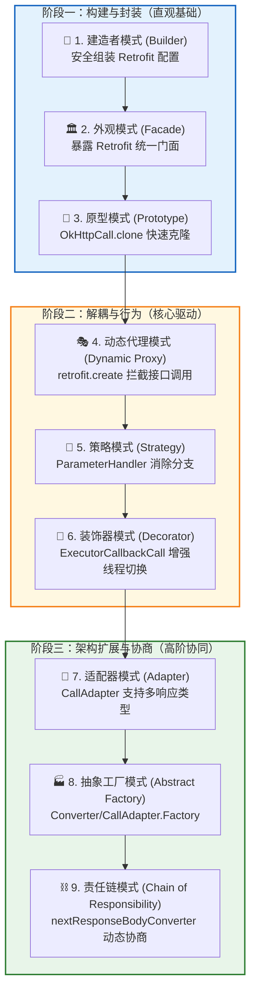
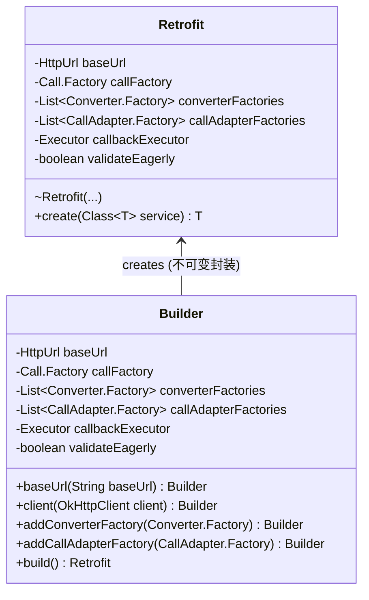
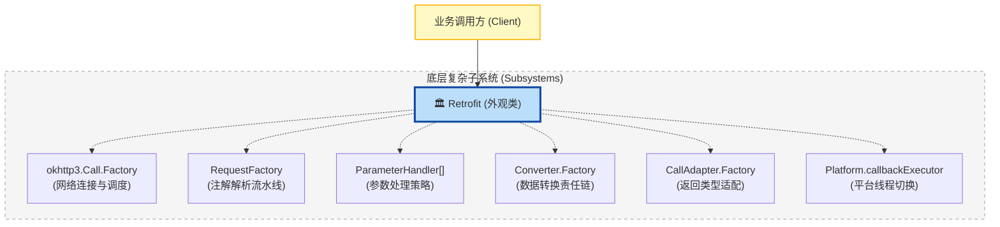
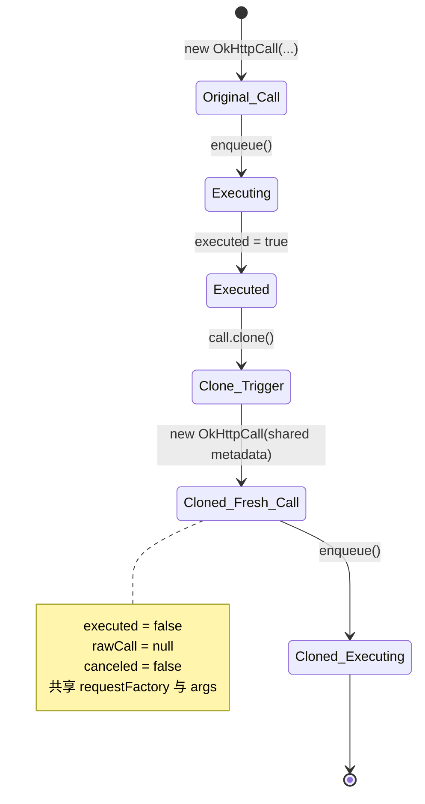
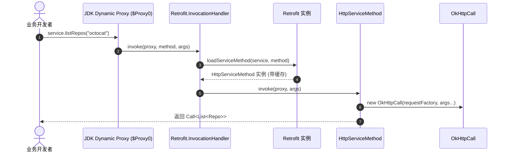
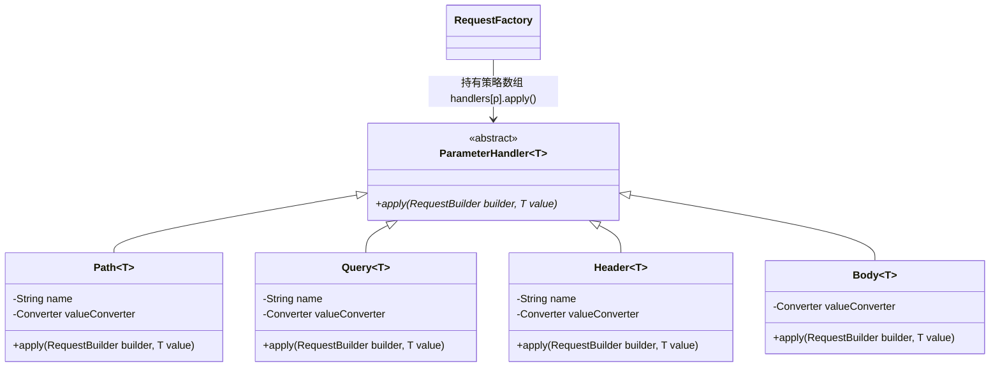
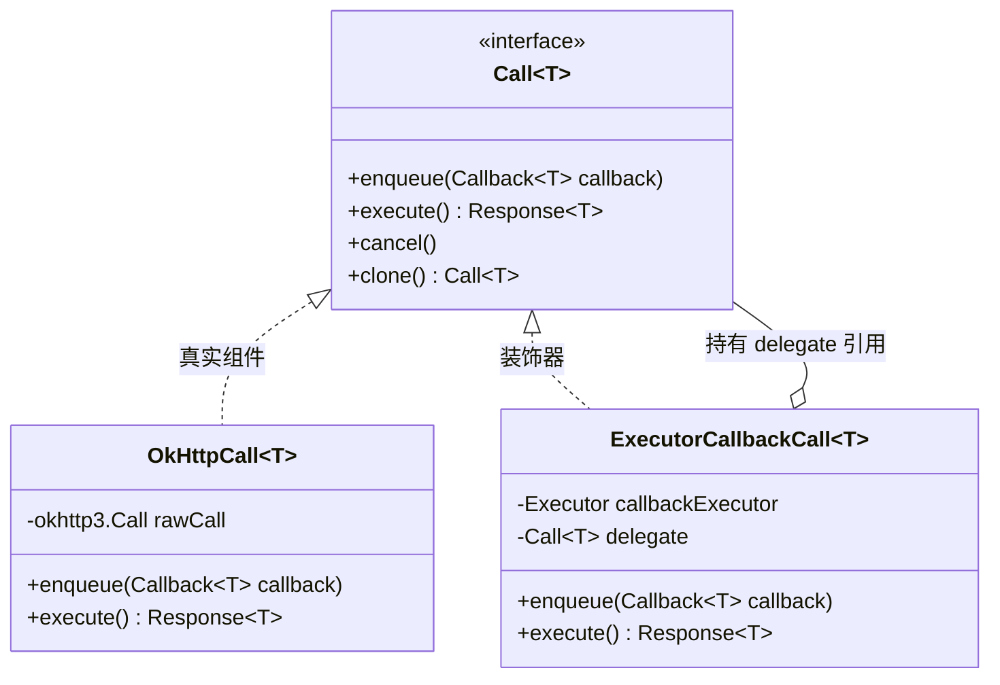
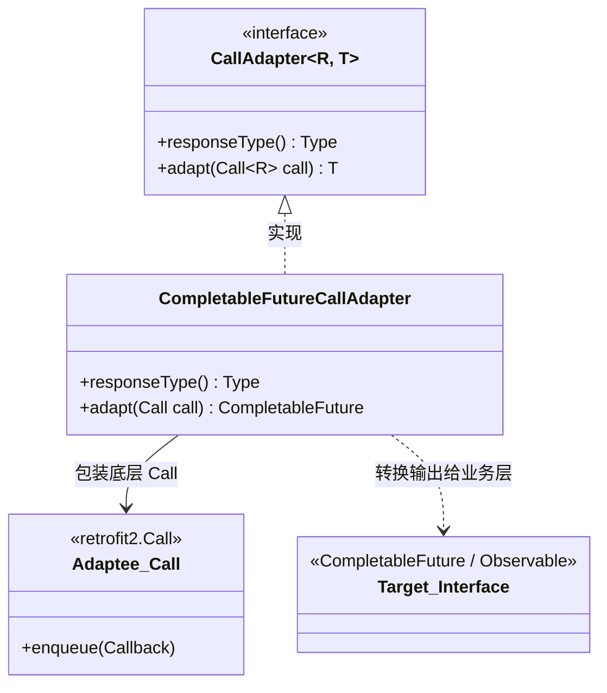
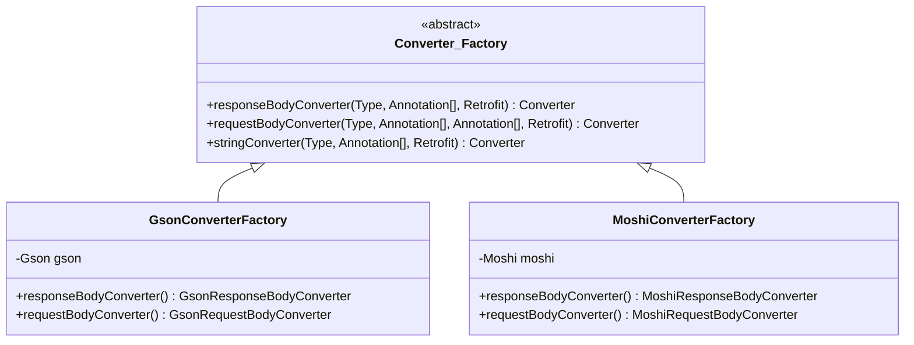
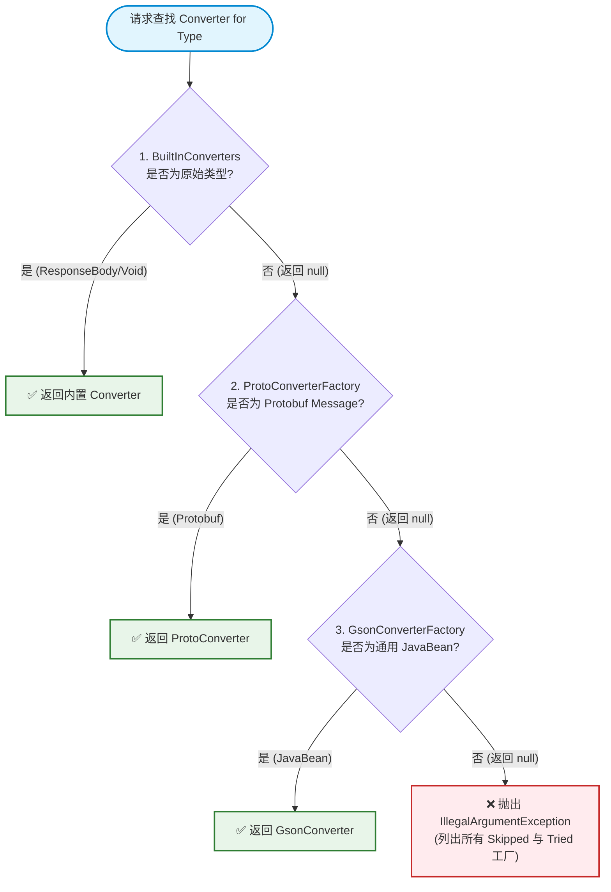

# 🎨 Retrofit 设计模式实战精读指南（面向新手）

> **目标读者**：刚学完 Java 基础语法（掌握类、接口、继承、泛型），知道“设计模式”这个词，但在实际项目中不知道何时用、怎么用、怎么写出高内聚低耦合代码的初学者。  
> **文档定位**：以 Square 顶级开源网络框架 [Retrofit](https://github.com/square/retrofit)（2.x/3.x）为真实案例，**拆解 9 种经典设计模式**。不讲死记硬背的八股文，而是通过真实痛点、反例对比、源码剖析与迁移实战，建立系统化的架构设计思维。

---

## 📌 目录
- [💡 引言：为什么要用 Retrofit 学习设计模式？](#-引言为什么要用-retrofit-学习设计模式)
- [🗺️ 9 大设计模式进阶路线图](#️-9-大设计模式进阶路线图)
- [第 1 章 🔨 建造者模式（Builder Pattern）—— 复杂对象的安全装配](#第-1-章--建造者模式builder-pattern-复杂对象的安全装配)
- [第 2 章 🏛️ 外观模式（Facade Pattern）—— 统一入口与细节隐藏](#第-2-章-️-外观模式facade-pattern-统一入口与细节隐藏)
- [第 3 章 🧬 原型模式（Prototype Pattern）—— 请求对象的低成本复活](#第-3-章--原型模式prototype-pattern-请求对象的低成本复活)
- [第 4 章 🎭 动态代理模式（Dynamic Proxy Pattern）—— 无中生有的调用拦截](#第-4-章--动态代理模式dynamic-proxy-pattern-无中生有的调用拦截)
- [第 5 章 🎯 策略模式（Strategy Pattern）—— 告别臃肿的参数分支](#第-5-章--策略模式strategy-pattern-告别臃肿的参数分支)
- [第 6 章 🎁 装饰器模式（Decorator Pattern）—— 无侵入式的线程与数据增强](#第-6-章--装饰器模式decorator-pattern-无侵入式的线程与数据增强)
- [第 7 章 🔌 适配器模式（Adapter Pattern）—— 跨越类型鸿沟的桥梁](#第-7-章--适配器模式adapter-pattern-跨越类型鸿沟的桥梁)
- [第 8 章 🏭 抽象工厂模式（Abstract Factory Pattern）—— 成套组件的生命周期解耦](#第-8-章--抽象工厂模式abstract-factory-pattern-成套组件的生命周期解耦)
- [第 9 章 ⛓️ 责任链模式（Chain of Responsibility Pattern）—— 优雅的协议与协商仲裁](#第-9-章-️-责任链模式chain-of-responsibility-pattern-优雅的协议与协商仲裁)
- [🏆 综合实战演练：Mini 插件化支付网关系统](#-综合实战演练mini-插件化支付网关系统)
- [📑 附录：9 大设计模式速查表](#-附录9-大设计模式速查表)

---

## 💡 引言：为什么要用 Retrofit 学习设计模式？

很多初学者在学习“GoF 23 种设计模式”时，通常会遇到三个典型困境：
1. **示例脱离实际**：书本上充斥着“鸭子会飞”、“披萨工厂”或“画图形”的简单示例，看完觉得懂了，一面对真实的业务工程又无从下手。
2. **源码过度庞大**：尝试阅读 Spring 或 Tomcat 源码，动辄几十万行代码、十几层嵌套抽象，断点跟踪两次就彻底迷失在调用栈的海洋中。
3. **容易走极端**：刚学会工厂模式就到处建工厂，刚学会单例就到处加静态，导致代码过度设计（Over-engineering）。

**而 Retrofit 是全球公认最适合初学者阅读的“殿堂级架构教科书”：**
- **代码极致精简**：核心模块仅有 20 多个类、数千行代码，没有任何冗余抽象，普通开发者利用数天时间就能逐行读懂。
- **模式密度与纯度极高**：在这一套轻巧的代码中，自洽地融合了 **创建型**（Builder, Abstract Factory, Prototype）、**结构型**（Facade, Dynamic Proxy, Decorator, Adapter）以及 **行为型**（Strategy, Chain of Responsibility）共 9 种主流设计模式。
- **教科书般的面向对象原则践行**：单一职责原则（SRP）、开闭原则（OCP）、依赖倒置原则（DIP）在 Retrofit 的源码细节中随处可见。

每一个模式章节，我们都按照以下标准化节奏展开：
```
1. 问题引入（痛点场景） 
   ↳ 2. 模式定义（通俗白话） 
      ↳ 3. Retrofit 真实源码（真实路径） 
         ↳ 4. 反例对比（没有该模式时的灾难代码） 
            ↳ 5. 正例讲解（模式带来的工程价值） 
               ↳ 6. 迁移练习（新手动手题）
```

---

## 🗺️ 9 大设计模式进阶路线图

为了让学习过程循序渐进，我们将 9 种模式按照**“从简单直观到抽象精巧”**的认知规律进行排序：



---

## 第 1 章 🔨 建造者模式（Builder Pattern）—— 复杂对象的安全装配

### 1.1 问题引入（新手的痛点场景）
假设你要创建一个网络核心配置类 `Retrofit`。这个类需要支持很多配置项：
- 服务器基准地址 `baseUrl`（必填）
- 底层 HTTP 客户端 `callFactory`（选填，默认 OkHttpClient）
- 数据转换工厂列表 `converterFactories`（选填，可能包含多个）
- 网络调用适配工厂列表 `callAdapterFactories`（选填，可能包含多个）
- 回调调度器 `callbackExecutor`（选填，Android 下默认为主线程）
- 是否在启动时预先校验所有接口方法 `validateEagerly`（选填，默认 false）

如果是新手写，通常有两种写法：
1. **伸缩式构造函数（Telescoping Constructor）**：重载多个构造函数。如果需要支持不同配置，往往需要写 5~8 个重载构造函数。调用时全是 `null, null, false`，参数位置一旦传错（例如两个相邻的 String 或 List），编译器根本不报错，运行时莫名崩溃。
2. **JavaBeans 模式（无参构造 + getter/setter）**：先 `new Retrofit()`，然后调用各种 `setBaseUrl(...)`。这会导致对象在设置过程中处于**“半初始化”（Partially Initialized）**的不一致状态；更致命的是，setter 让对象变成了**可变对象（Mutable Object）**，在多线程并发环境下，任何线程都可以随时修改 `baseUrl` 或清空集合，存在严重的并发安全隐患！

### 1.2 模式定义（通俗白话）
> **建造者模式（Builder Pattern）**：将一个复杂对象的构建过程与其表示分离，使得同样的构建过程可以创建不同的表示。  
> **核心思想**：通过一个专门的静态内部类（Builder），利用流式调用（Fluent API）收集各项配置，最后在 `build()` 方法中统一完成校验、默认值兜底和不可变对象封装。

### 1.3 Retrofit 真实源码
在 Retrofit 中，`Retrofit` 对象的构造函数是 `package-private`（包级私有）的，外部无法直接 `new Retrofit(...)`，必须通过 [Retrofit.Builder](file:///Users/lina/Documents/GitHub/retrofit/retrofit/src/main/java/retrofit2/Retrofit.java#L580-L715) 构建。

让我们精读 [Retrofit.java](file:///Users/lina/Documents/GitHub/retrofit/retrofit/src/main/java/retrofit2/Retrofit.java#L670-L715) 中的核心 `build()` 方法：

```java
public static final class Builder {
  private final Platform platform;
  private @Nullable okhttp3.Call.Factory callFactory;
  private @Nullable HttpUrl baseUrl;
  private final List<Converter.Factory> converterFactories = new ArrayList<>();
  private final List<CallAdapter.Factory> callAdapterFactories = new ArrayList<>();
  private @Nullable Executor callbackExecutor;
  private boolean validateEagerly;

  public Builder() {
    this(Platform.get());
  }

  public Builder baseUrl(String baseUrl) {
    Objects.requireNonNull(baseUrl, "baseUrl == null");
    return baseUrl(HttpUrl.get(baseUrl));
  }

  public Builder addConverterFactory(Converter.Factory factory) {
    converterFactories.add(Objects.requireNonNull(factory, "factory == null"));
    return this; // 返回 this 实现链式调用
  }

  public Retrofit build() {
    // 1. 必填参数校验：没有设置 baseUrl 直接抛出异常，快速失败（Fail-Fast）
    if (baseUrl == null) {
      throw new IllegalStateException("Base URL required.");
    }

    // 2. 默认值兜底：如果不传 callFactory，自动创建默认的 OkHttpClient
    okhttp3.Call.Factory callFactory = this.callFactory;
    if (callFactory == null) {
      callFactory = new OkHttpClient();
    }

    // 3. 平台智能自适应：如果不传 callbackExecutor，自动读取平台的默认调度器（Android 主线程）
    Executor callbackExecutor = this.callbackExecutor;
    if (callbackExecutor == null) {
      callbackExecutor = Platform.callbackExecutor;
    }

    BuiltInFactories builtInFactories = Platform.builtInFactories;

    // 4. 防御性拷贝（Defensive Copy）：拷贝一份用户添加的 adapters，避免 build 之后外部继续篡改
    List<CallAdapter.Factory> callAdapterFactories = new ArrayList<>(this.callAdapterFactories);
    callAdapterFactories.addAll(builtInFactories.createDefaultCallAdapterFactories(callbackExecutor));

    // 5. 内置转换器兜底：首位必须加入 BuiltInConverters，保证核心数据类型（如 ResponseBody）解析正常
    List<? extends Converter.Factory> defaultConverterFactories =
        builtInFactories.createDefaultConverterFactories();
    int defaultConverterFactoriesSize = defaultConverterFactories.size();
    List<Converter.Factory> converterFactories =
        new ArrayList<>(1 + this.converterFactories.size() + defaultConverterFactoriesSize);
    converterFactories.add(new BuiltInConverters());
    converterFactories.addAll(this.converterFactories);
    converterFactories.addAll(defaultConverterFactories);

    // 6. 构造真正的不可变 Retrofit 实例，所有集合用 Collections.unmodifiableList 封包
    return new Retrofit(
        callFactory,
        baseUrl,
        unmodifiableList(converterFactories),
        defaultConverterFactoriesSize,
        unmodifiableList(callAdapterFactories),
        defaultCallAdapterFactories.size(),
        callbackExecutor,
        validateEagerly);
  }
}
```

### 1.4 反例对比（没有模式时会怎样写）
如果没有建造者模式，我们要么面临极具灾难性的伸缩构造函数，要么面临线程安全漏洞百出的 setter：

```java
// ❌ 灾难反例 1：伸缩构造函数（参数地狱）
Retrofit retrofit = new Retrofit(
    null,                                      // callFactory 忘了要不要传
    HttpUrl.parse("https://api.github.com/"),  // baseUrl
    null,                                      // converterFactories 只能传 null
    null,                                      // callAdapterFactories 只能传 null
    null,                                      // callbackExecutor 容易传错顺序
    false                                      // validateEagerly
);
// 痛点：调用代码完全无法阅读，重构增加一个参数，全局几十处报错！

// ❌ 灾难反例 2：JavaBean setter（半初始化与可变性风险）
Retrofit retrofit = new Retrofit();
retrofit.setBaseUrl("https://api.github.com/");
// 如果此时线程 A 正在这里，线程 B 拿到了 retrofit 对象并发起请求，此时 converterFactories 还是空的！
// 发生 NullPointerException 或数据丢失！
retrofit.setConverterFactories(new ArrayList<>());
```

### 1.5 正例讲解（源码体现的模式优雅之处）
Retrofit 的 Builder 设计堪称工业级典范，具体体现在以下三点：
1. **流式 API 与强制校验（Fail-Fast）**：每个设置方法都返回 `this`，支持流畅的链式拼接；在 `build()` 的第一行即校验 `baseUrl == null`，绝不把残缺状态保留到运行期。
2. **静默兜底与平台自适应**：用户不配 `callFactory`？自动 `new OkHttpClient()`；用户不配 `callbackExecutor`？自动根据当前运行环境（Android 或 JVM）注入主线程 Executor。**既给高级用户提供了最大灵活性，又给新手提供了零门槛的开箱即用体验**。
3. **彻底的防御性拷贝与不可变性（Immutability）**：
   - 在将集合传给 `new Retrofit(...)` 之前，先执行 `new ArrayList<>(this.converterFactories)`，阻断了外部对原集合的修改；
   - 最终用 `unmodifiableList(...)` 包装，任何人在得到 Retrofit 实例后尝试 `retrofit.converterFactories().add(...)` 都会立即抛出 `UnsupportedOperationException`。**一旦构建完成，对象在任何多线程并发访问下都是 100% 线程安全的**。



### 1.6 迁移练习（新手动手题）
**【练习要求】**：  
请为你的业务系统设计一个不可变配置类 `HttpRequestConfig` 与对应的静态内部类 `HttpRequestConfig.Builder`。  
**要求**：
1. 包含属性：`String url`（必填）、`String method`（选填，默认 "GET"）、`Map<String, String> headers`（选填）、`int timeoutMs`（选填，默认 5000）。
2. 在 `build()` 时必须校验 `url` 不能为空且必须以 `http://` 或 `https://` 开头。
3. `headers` 必须进行防御性拷贝并用只读集合封装，确保 `HttpRequestConfig` 构建后绝对只读且不可变。

<details>
<summary>💡 点击展开参考答案代码</summary>

```java
public final class HttpRequestConfig {
  private final String url;
  private final String method;
  private final Map<String, String> headers;
  private final int timeoutMs;

  private HttpRequestConfig(Builder builder) {
    this.url = builder.url;
    this.method = builder.method;
    this.headers = Collections.unmodifiableMap(new HashMap<>(builder.headers));
    this.timeoutMs = builder.timeoutMs;
  }

  public String getUrl() { return url; }
  public String getMethod() { return method; }
  public Map<String, String> getHeaders() { return headers; }
  public int getTimeoutMs() { return timeoutMs; }

  public static final class Builder {
    private String url;
    private String method = "GET";
    private final Map<String, String> headers = new HashMap<>();
    private int timeoutMs = 5000;

    public Builder url(String url) {
      this.url = url;
      return this;
    }

    public Builder method(String method) {
      this.method = method;
      return this;
    }

    public Builder addHeader(String key, String value) {
      this.headers.put(key, value);
      return this;
    }

    public Builder timeoutMs(int timeoutMs) {
      this.timeoutMs = timeoutMs;
      return this;
    }

    public HttpRequestConfig build() {
      if (url == null || (!url.startsWith("http://") && !url.startsWith("https://"))) {
        throw new IllegalArgumentException("Invalid URL: " + url);
      }
      return new HttpRequestConfig(this);
    }
  }
}
```
</details>

---

## 第 2 章 🏛️ 外观模式（Facade Pattern）—— 统一入口与细节隐藏

### 2.1 问题引入（新手的痛点场景）
网络请求在底层是一个极其庞大、组件错综复杂的子系统：
- 报文发送需要 `OkHttpClient` 连接池与调度器；
- 接口元数据需要 `RequestFactory` 逐个反射并提取注解；
- 参数填充需要几十个 `ParameterHandler` 协调运作；
- 数据反序列化需要遍历 `Converter.Factory` 责任链；
- 线程切换需要 `Platform.callbackExecutor`；
- 返回值包装需要 `CallAdapter.Factory`。

如果 Retrofit 没有提供一个统一的外观门面，每一个要发起 HTTP 请求的业务同学都必须写出如下代码：
```java
// 如果没有外观模式，新手必须直接面对十几个内部子系统类：
RequestFactory requestFactory = RequestFactory.parseAnnotations(retrofit, method);
OkHttpClient client = new OkHttpClient();
CallAdapter callAdapter = ...;
Converter converter = ...;
// 业务代码直接与几十个内部底层实现细节产生强耦合！
```
一旦内部任何一个组件升级（比如换了 RequestFactory 的参数），所有业务代码全线瘫痪。

### 2.2 模式定义（通俗白话）
> **外观模式（Facade Pattern）**：提供一个统一的高层接口，用来访问子系统中的群组接口。外观模式定义了一个更高层的接口，让子系统更易于使用。  
> **核心思想**：如同医院的“前台接待窗口”，病人看病无需逐个了解化验科、放射科、药房内部的流水线运作，只需在接待窗口挂号登记，由前台统一协调所有科室。

### 2.3 Retrofit 真实源码
在 Retrofit 框架中，[Retrofit](file:///Users/lina/Documents/GitHub/retrofit/retrofit/src/main/java/retrofit2/Retrofit.java) 类本身就是整个网络子系统的最顶级外观对象。

它将所有错综复杂的子系统包装在背后，只向业务层暴露极度纯粹的入口：

```java
public final class Retrofit {
  // 内部协调管理的众多子系统对象（外部调用者完全无感知）
  final okhttp3.Call.Factory callFactory;
  final HttpUrl baseUrl;
  final List<Converter.Factory> converterFactories;
  final List<CallAdapter.Factory> callAdapterFactories;
  final @Nullable Executor callbackExecutor;
  final boolean validateEagerly;
  private final Map<Method, ServiceMethod<?>> serviceMethodCache = new ConcurrentHashMap<>();

  // 对外暴露的最核心、最极简的外观 API
  public <T> T create(final Class<T> service) {
    validateServiceInterface(service);
    return (T)
        Proxy.newProxyInstance(
            service.getClassLoader(),
            new Class<?>[] {service},
            new InvocationHandler() {
              @Override
              public @Nullable Object invoke(Object proxy, Method method, @Nullable Object[] args)
                  throws Throwable {
                // 内部自动调用 loadServiceMethod、RequestFactory、OkHttpCall
                return loadServiceMethod(service, method).invoke(proxy, args != null ? args : emptyArgs);
              }
            });
  }

  // 辅助外观方法
  public HttpUrl baseUrl() { return baseUrl; }
  public okhttp3.Call.Factory callFactory() { return callFactory; }
}
```

### 2.4 反例对比（没有模式时会怎样写）
没有外观模式时，业务代码直接穿透进子系统的深水区：

```java
// ❌ 灾难反例：业务调用方直接与子系统底层网状依赖
public class UserService {
  public void getUser(int userId) {
    // 1. 业务方需要自己构建 OkHttp 请求
    okhttp3.Request request = new okhttp3.Request.Builder()
        .url("https://api.github.com/users/" + userId)
        .build();
    // 2. 业务方自己找 client 执行
    OkHttpClient client = HttpClientHolder.getClient();
    client.newCall(request).enqueue(new okhttp3.Callback() {
      @Override
      public void onResponse(okhttp3.Call call, okhttp3.Response response) throws IOException {
        // 3. 业务方自己解析 JSON
        Gson gson = new Gson();
        User user = gson.fromJson(response.body().charStream(), User.class);
        // 4. 业务方自己切换到 Android 主线程
        new Handler(Looper.getMainLooper()).post(() -> updateUi(user));
      }
      @Override
      public void onFailure(okhttp3.Call call, IOException e) { ... }
    });
  }
}
// 弊端：只要更换一个 JSON 库，或者修改线程切换策略，全局上千处业务代码都要重构！
```

### 2.5 正例讲解（源码体现的模式优雅之处）
外观模式完美践行了**迪米特法则（Law of Demeter，最少知识原则）**：
- 客户端只需认知一个类：`Retrofit`。
- 无论内部的 `RequestFactory` 怎么解析注解、`ParameterHandler` 怎么拼装字节、`OkHttpCall` 怎么执行底层 TCP 握手、`Converter` 怎么反序列化，对外界都是黑盒。
- 业务方只需编写一个声明式的 Java 接口，调用一行 `retrofit.create(GitHubService.class)` 即可享受到整个庞大网络系统的全部功能。



### 2.6 迁移练习（新手动手题）
**【练习要求】**：  
请设计一个图片加载门面类 `ImageLoader`。底层包含三个子系统：`MemoryCache`（内存缓存）、`DiskCache`（磁盘缓存）、`HttpDownloader`（网络下载器）。  
**要求**：
1. 封装子系统细节，对外部仅暴露唯一的直观方法：`public void loadImage(String url, Consumer<Bitmap> callback)`。
2. 内部逻辑：先查内存缓存，命中直接回调；未命中查磁盘缓存，命中写入内存缓存并回调；均未命中则调用网络下载器下载，写入磁盘与内存缓存后回调。

<details>
<summary>💡 点击展开参考答案代码</summary>

```java
public class ImageLoader {
  private final MemoryCache memoryCache = new MemoryCache();
  private final DiskCache diskCache = new DiskCache();
  private final HttpDownloader httpDownloader = new HttpDownloader();

  public void loadImage(String url, Consumer<Bitmap> callback) {
    // 1. 尝试内存缓存
    Bitmap bitmap = memoryCache.get(url);
    if (bitmap != null) {
      callback.accept(bitmap);
      return;
    }
    // 2. 尝试磁盘缓存
    bitmap = diskCache.get(url);
    if (bitmap != null) {
      memoryCache.put(url, bitmap);
      callback.accept(bitmap);
      return;
    }
    // 3. 网络下载
    httpDownloader.download(url, downloadedBitmap -> {
      if (downloadedBitmap != null) {
        diskCache.put(url, downloadedBitmap);
        memoryCache.put(url, downloadedBitmap);
      }
      callback.accept(downloadedBitmap);
    });
  }
}
```
</details>

---

## 第 3 章 🧬 原型模式（Prototype Pattern）—— 请求对象的低成本复活

### 3.1 问题引入（新手的痛点场景）
在网络编程中，OkHttp 的 `okhttp3.Call` 遵循**“一次性消耗品”**设计原则：
```java
okhttp3.Call rawCall = okHttpClient.newCall(request);
rawCall.execute(); // 执行成功
rawCall.execute(); // 💥 抛出 IllegalStateException("Already Executed")
```
这意味着：**同一个 Call 实例一旦被执行或入队，其内部状态就会变为 executed = true，不可再次使用**。

但在真实业务场景中，**请求重试（Retry）**、**弱网刷新**是极其普遍的需求。如果一个网络请求失败了，想要重新再发一次，该怎么办？
- 难道要把整个方法重新调用一遍，重新走一遍动态代理拦截、重新走一遍反射解析注解、重新扫描所有参数？
- 这意味着成百上千次的反射开销与内存分配，成本极其昂贵！

### 3.2 模式定义（通俗白话）
> **原型模式（Prototype Pattern）**：用原型实例指定创建对象的种类，并且通过拷贝这些原型创建新的对象。  
> **核心思想**：复制现有的对象（克隆），同时**重置其内部的运行期状态标记**，在零反射开销下瞬间“满血复活”一个新的执行实例。

### 3.3 Retrofit 真实源码
在 Retrofit 中，负责真正网络调用的核心类是 [OkHttpCall](file:///Users/lina/Documents/GitHub/retrofit/retrofit/src/main/java/retrofit2/OkHttpCall.java)。它实现了 `retrofit2.Call<T>` 接口，而该接口定义了 `clone()` 方法：

```java
// retrofit2/Call.java
public interface Call<T> extends Cloneable {
  Response<T> execute() throws IOException;
  void enqueue(Callback<T> callback);
  boolean isExecuted();
  void cancel();
  boolean isCanceled();
  Call<T> clone(); // 原型模式核心方法
}
```

让我们精读 [OkHttpCall.java](file:///Users/lina/Documents/GitHub/retrofit/retrofit/src/main/java/retrofit2/OkHttpCall.java#L50-L65) 的实现细节：

```java
final class OkHttpCall<T> implements Call<T> {
  // 重量级不可变元数据（多实例完全共享）
  private final RequestFactory requestFactory;
  private final @Nullable Object instance;
  private final Object[] args;
  private final okhttp3.Call.Factory callFactory;
  private final Converter<ResponseBody, T> responseConverter;

  // 运行期易变状态（每个实例独有）
  private volatile boolean canceled;
  private @GuardedBy("this") @Nullable okhttp3.Call rawCall;
  private @GuardedBy("this") @Nullable Throwable creationFailure;
  private @GuardedBy("this") boolean executed;

  OkHttpCall(
      RequestFactory requestFactory,
      @Nullable Object instance,
      Object[] args,
      okhttp3.Call.Factory callFactory,
      Converter<ResponseBody, T> responseConverter) {
    this.requestFactory = requestFactory;
    this.instance = instance;
    this.args = args;
    this.callFactory = callFactory;
    this.responseConverter = responseConverter;
  }

  @SuppressWarnings("CloneDoesntCallSuperClone") // 采用 new 替代 super.clone()，状态重置更清晰
  @Override
  public OkHttpCall<T> clone() {
    // 💡 核心：把所有重量级只读元数据原封不动传给新实例，但全新实例的 executed 自动复位为 false！
    return new OkHttpCall<>(requestFactory, instance, args, callFactory, responseConverter);
  }

  @Override
  public synchronized okhttp3.Request request() {
    try {
      return getRawCall().request();
    } catch (IOException e) {
      throw new RuntimeException("Unable to create request.", e);
    }
  }

  @Override
  public void enqueue(final Callback<T> callback) {
    okhttp3.Call call;
    synchronized (this) {
      if (executed) throw new IllegalStateException("Already executed.");
      executed = true; // 状态标记为已执行
      call = rawCall = createRawCall();
    }
    // 执行底层真实调用...
  }
}
```

### 3.4 反例对比（没有模式时会怎样写）
如果没有原型模式，网络重试将变成一场工程噩梦：

```java
// ❌ 灾难反例：外部手动重新触发反射
Call<User> call = githubService.getUser("octocat");
call.enqueue(new Callback<User>() {
  @Override
  public void onFailure(Call<User> call, Throwable t) {
    // 想要重试该怎么做？
    // 方案 A：call.enqueue(...) 💥 抛出 IllegalStateException("Already executed.")
    
    // 方案 B：只能在闭包里把 githubService.getUser("octocat") 从头到尾再调用一次！
    // 弊端：如果这个方法有 10 个参数，重试代码需要把所有参数都捕获并重新传一遍；
    // 并且重新走了动态代理拦截、方法缓存查找，性能开销白白翻倍！
  }
});
```

### 3.5 正例讲解（源码体现的模式优雅之处）
有了 `clone()` 原型方法，重试变得无比自然优雅：

```java
// ✅ 正例：一行 call.clone() 搞定完美重试
call.enqueue(new Callback<User>() {
  @Override
  public void onFailure(Call<User> call, Throwable t) {
    if (needRetry()) {
      call.clone().enqueue(this); // 直接克隆出一个状态为 executed=false 的全新对象，并继续挂载回调！
    }
  }
});
```

**为什么源码不调用 `super.clone()`？**  
Java 原生的 `Object.clone()` 属于字段逐个二进制拷贝。如果用 `super.clone()`，原对象的 `executed = true` 和 `rawCall != null` 也会被克隆过来，还需要在子类中小心翼翼地把它们重置为 false 和 null。  
Retrofit 直接通过 `new OkHttpCall<>(...)` 并传入原不可变元数据，既保证了只读元数据的复用（浅拷贝共享），又百分之百保证了运行期状态的彻底纯净（深层状态重置）。



### 3.6 迁移练习（新手动手题）
**【练习要求】**：  
请设计一个支持克隆与重试的任务模型 `BatchSyncTask`。  
**要求**：
1. 类中包含不可变属性：`String taskId`, `List<String> recordsToSync`；
2. 类中包含运行期可变状态：`boolean isRunning`, `int retryCount`；
3. 实现 `public BatchSyncTask clone()` 方法，克隆后的新任务拥有相同的 `taskId` 和只读数据列表，但 `isRunning` 重置为 false，`retryCount` 自动递增 1。

<details>
<summary>💡 点击展开参考答案代码</summary>

```java
public final class BatchSyncTask implements Cloneable {
  private final String taskId;
  private final List<String> recordsToSync;
  private boolean isRunning;
  private final int retryCount;

  public BatchSyncTask(String taskId, List<String> recordsToSync) {
    this(taskId, recordsToSync, 0);
  }

  private BatchSyncTask(String taskId, List<String> recordsToSync, int retryCount) {
    this.taskId = taskId;
    this.recordsToSync = Collections.unmodifiableList(new ArrayList<>(recordsToSync));
    this.isRunning = false;
    this.retryCount = retryCount;
  }

  public synchronized void execute() {
    if (isRunning) throw new IllegalStateException("Task is already running!");
    this.isRunning = true;
    System.out.println("Executing task " + taskId + " (attempt " + (retryCount + 1) + ")");
  }

  @Override
  public BatchSyncTask clone() {
    return new BatchSyncTask(this.taskId, this.recordsToSync, this.retryCount + 1);
  }
}
```
</details>

---

## 第 4 章 🎭 动态代理模式（Dynamic Proxy Pattern）—— 无中生有的调用拦截

### 4.1 问题引入（新手的痛点场景）
初学者第一次使用 Retrofit 时，都会被震撼到：
```java
public interface GitHubService {
  @GET("users/{user}/repos")
  Call<List<Repo>> listRepos(@Path("user") String user);
}

// 只有接口！没有任何实现类！
GitHubService service = retrofit.create(GitHubService.class);
Call<List<Repo>> repos = service.listRepos("octocat"); // 竟然能直接运行！
```
在传统 Java 编程认知中，**接口是不能实例化的（Cannot instantiate interface）**。如果没有动态代理，想要实现相同的功能，开发者必须为每一个接口手动写一个实现类：
```java
public class GitHubServiceImpl implements GitHubService {
  @Override
  public Call<List<Repo>> listRepos(String user) {
    // 手动拼 URL、手动调 OkHttp...
  }
}
```
如果你系统里有 50 个微服务接口，你就得手写 50 个繁琐冗余的实现类，一旦接口新增一个方法，所有实现类都要被迫修改！

### 4.2 模式定义（通俗白话）
> **动态代理模式（Dynamic Proxy Pattern）**：为其他对象提供一种代理以控制对这个对象的访问。动态代理在程序运行期间，由 JVM 动态生成代理类的字节码，无需程序员编写 `.java` 源文件。  
> **核心思想**：“无中生有”。让 JVM 动态捏造出一个实现了目标接口的代理对象，并将该对象上的所有方法调用无差别拦截到一个统一的处理器（`InvocationHandler`）中。

### 4.3 Retrofit 真实源码
在 Retrofit 中，[Retrofit.java](file:///Users/lina/Documents/GitHub/retrofit/retrofit/src/main/java/retrofit2/Retrofit.java#L145-L213) 的 `create()` 方法是整个框架最神奇的枢纽：

```java
public <T> T create(final Class<T> service) {
  validateServiceInterface(service); // 校验必须是接口，且不能继承其他接口
  
  return (T)
      Proxy.newProxyInstance(
          service.getClassLoader(),
          new Class<?>[] {service},
          new InvocationHandler() {
            private final Platform platform = Platform.get();
            private final Object[] emptyArgs = new Object[0];

            @Override
            public @Nullable Object invoke(Object proxy, Method method, @Nullable Object[] args)
                throws Throwable {
              // 1. 如果是 Object 本身定义的方法（如 toString, equals, hashCode），直接原样反射调用
              if (method.getDeclaringClass() == Object.class) {
                return method.invoke(this, args);
              }
              
              // 2. 将数组为 null 规范化为空数组
              args = args != null ? args : emptyArgs;
              
              // 3. 平台自适应：如果是 Java 8+ 的接口 default 默认方法，调用平台专属的反射机制执行默认实现
              return platform.isDefaultMethod(method)
                  ? platform.invokeDefaultMethod(method, service, proxy, args)
                  // 4. 关键核心：将接口方法解析为 ServiceMethod，并触发真实 HTTP 流程！
                  : loadServiceMethod(service, method).invoke(proxy, args);
            }
          });
}
```

### 4.4 反例对比（没有模式时会怎样写）
没有动态代理时，网络请求层会沦为手写实现类的“搬砖苦力现场”：

```java
// ❌ 灾难反例：为每个接口编写手写实现类
public class GitHubServiceImpl implements GitHubService {
  private final OkHttpClient client;
  private final Gson gson;

  public GitHubServiceImpl(OkHttpClient client, Gson gson) {
    this.client = client;
    this.gson = gson;
  }

  @Override
  public Call<List<Repo>> listRepos(String user) {
    // 每一个接口都要手写几十行一模一样的样板代码（Boilerplate Code）：
    String url = "https://api.github.com/users/" + user + "/repos";
    Request request = new Request.Builder().url(url).build();
    // 包装成统一 Call 并反序列化...
    return new CustomCallAdapter<>(client.newCall(request), ...);
  }
}
// 弊端：100 个接口要写 100 个实现类，方法注解毫无用武之地，代码冗余度超过 80%！
```

### 4.5 正例讲解（源码体现的模式优雅之处）
Retrofit 运用动态代理达成了**声明式编程（Declarative Programming）**的极境：
1. **接口即文档，接口即协议**：开发者只需关注业务本身的入参、路径和返回值，完全解耦底层网络发送逻辑。
2. **拦截与元数据绑定的绝妙闭环**：
   - 开发者调用 `service.listRepos("octocat")`；
   - JDK 动态代理在底层生成 `$Proxy0` 类，拦截到该调用，捕获了目标方法对象 `method` 以及实参数组 `args = ["octocat"]`；
   - `loadServiceMethod(service, method)` 负责将 `method` 上的注解（`@GET`, `@Path`）解析成可复用的 `RequestFactory`；
   - 最终把入参 `"octocat"` 填充进模版 URL，构造出完整的 HTTP 请求。



### 4.6 迁移练习（新手动手题）
**【练习要求】**：  
请使用 JDK `Proxy.newProxyInstance` 编写一个极简版的数据访问层代理 `SimpleDaoFactory`。  
**要求**：
1. 定义自定义注解 `@Select(String sql)`；
2. 定义一个查询接口 `UserDao`，包含方法 `@Select("SELECT * FROM users WHERE id = ?") User findById(int id);`；
3. 编写 `SimpleDaoFactory.create(Class<T> daoClass)`，通过动态代理拦截接口调用，读取 `@Select` 注解中的 SQL，并打印出：`"模拟执行 SQL: " + sql + " | 绑定参数: " + Arrays.toString(args)`，最后返回 null 或 mock 对象。

<details>
<summary>💡 点击展开参考答案代码</summary>

```java
import java.lang.annotation.*;
import java.lang.reflect.*;
import java.util.Arrays;

@Retention(RetentionPolicy.RUNTIME)
@Target(ElementType.METHOD)
@interface Select {
  String value();
}

interface UserDao {
  @Select("SELECT * FROM users WHERE id = ?")
  String findById(int id);
}

public class SimpleDaoFactory {
  @SuppressWarnings("unchecked")
  public static <T> T create(Class<T> daoClass) {
    return (T) Proxy.newProxyInstance(
        daoClass.getClassLoader(),
        new Class<?>[] { daoClass },
        (proxy, method, args) -> {
          Select select = method.getAnnotation(Select.class);
          if (select != null) {
            String sql = select.value();
            System.out.println("模拟执行 SQL: " + sql + " | 绑定参数: " + Arrays.toString(args));
            return "MockUser{id=" + args[0] + "}";
          }
          return null;
        }
    );
  }

  public static void main(String[] args) {
    UserDao dao = SimpleDaoFactory.create(UserDao.class);
    String user = dao.findById(10086);
    System.out.println("返回结果: " + user);
  }
}
```
</details>

---

## 第 5 章 🎯 策略模式（Strategy Pattern）—— 告别臃肿的参数分支

### 5.1 问题引入（新手的痛点场景）
HTTP 请求的参数形态极其丰富复杂：
- `@Query("sort") String sort` 需要拼接到 URL 查询串；
- `@Path("id") int id` 需要替换 URL 中的占位符 `{id}`；
- `@Header("Authorization") String token` 需要注入请求头；
- `@Field("username") String name` 需要编码进表单；
- `@Part("avatar") MultipartBody.Part file` 需要组装为二进制文件流；
- `@Body User user` 需要转换为 JSON 载荷。

如果不使用设计模式，负责组装请求的方法中将出现数百行可怕的 `if-else` 或 `switch` 语句：
```java
// 传统新手的典型分支地狱：
for (Parameter p : parameters) {
  if (p.hasAnnotation(Path.class)) {
    // 替换 path
  } else if (p.hasAnnotation(Query.class)) {
    // 拼接 query
  } else if (p.hasAnnotation(Header.class)) {
    // 塞入 header
  } ... 几十个 else if 嵌套
}
```
**痛点所在**：每当需要支持一个新的注解（比如新增 `@Tag` 或 `@HeaderMap`），你都必须修改这段庞大的核心逻辑。这直接违反了面向对象中最核心的**开闭原则（Open-Closed Principle，对扩展开放，对修改关闭）**！

### 5.2 模式定义（通俗白话）
> **策略模式（Strategy Pattern）**：定义了一族算法（行为），并将每一个算法封装起来，使它们可以互相替换。策略模式让算法独立于使用它的客户端而变化。  
> **核心思想**：抽出抽象接口，每种具体的参数注解对应一个独立的策略子类。在执行拼接时，调用方不再关心当前是哪个注解，只面向抽象策略接口循环调用！

### 5.3 Retrofit 真实源码
在 Retrofit 中，负责处理参数的核心架构是抽象类 [ParameterHandler](file:///Users/lina/Documents/GitHub/retrofit/retrofit/src/main/java/retrofit2/ParameterHandler.java)：

```java
// retrofit2/ParameterHandler.java
abstract class ParameterHandler<T> {
  // 核心策略接口：定义算法契约
  abstract void apply(RequestBuilder builder, @Nullable T value) throws IOException;

  // 针对 @Header 的具体策略
  static final class Header<T> extends ParameterHandler<T> {
    private final String name;
    private final Converter<T, String> valueConverter;

    Header(String name, Converter<T, String> valueConverter) {
      this.name = Objects.requireNonNull(name, "name == null");
      this.valueConverter = valueConverter;
    }

    @Override
    void apply(RequestBuilder builder, @Nullable T value) throws IOException {
      if (value == null) return;
      String headerValue = valueConverter.convert(value);
      if (headerValue == null) return;
      builder.addHeader(name, headerValue);
    }
  }

  // 针对 @Query 的具体策略
  static final class Query<T> extends ParameterHandler<T> {
    private final String name;
    private final Converter<T, String> valueConverter;
    private final boolean encoded;

    Query(String name, Converter<T, String> valueConverter, boolean encoded) {
      this.name = Objects.requireNonNull(name, "name == null");
      this.valueConverter = valueConverter;
      this.encoded = encoded;
    }

    @Override
    void apply(RequestBuilder builder, @Nullable T value) throws IOException {
      if (value == null) return;
      String queryValue = valueConverter.convert(value);
      if (queryValue == null) return;
      builder.addQueryParam(name, queryValue, encoded);
    }
  }

  // 针对 @Path 的具体策略
  static final class Path<T> extends ParameterHandler<T> {
    private final Method method;
    private final int p;
    private final String name;
    private final Converter<T, String> valueConverter;
    private final boolean encoded;
    // ...
    @Override
    void apply(RequestBuilder builder, @Nullable T value) throws IOException {
      if (value == null) {
        throw Utils.parameterError(method, p, "Path parameter \"" + name + "\" value must not be null.");
      }
      builder.addPathParam(name, valueConverter.convert(value), encoded);
    }
  }
}
```

现在看 [RequestFactory.java](file:///Users/lina/Documents/GitHub/retrofit/retrofit/src/main/java/retrofit2/RequestFactory.java#L125-L135) 在发起请求时是如何消费这些策略的：

```java
// 策略消费端：纯粹的多态调用，没有任何一个 if-else！
okhttp3.Request create(Object[] args) throws IOException {
  ParameterHandler<Object>[] handlers = (ParameterHandler<Object>[]) this.parameterHandlers;
  RequestBuilder requestBuilder = new RequestBuilder(...);

  int argumentCount = args.length;
  for (int p = 0; p < argumentCount; p++) {
    // 💡 策略模式的多态之美：直接调用 apply，具体怎么拼由各个策略类自己决定！
    handlers[p].apply(requestBuilder, args[p]);
  }

  return requestBuilder.get().build();
}
```

### 5.4 反例对比（没有模式时会怎样写）
```java
// ❌ 灾难反例：分支逻辑与主流程深度绞杀
public void buildRequest(RequestBuilder builder, Annotation[][] annotations, Object[] args) {
  for (int i = 0; i < args.length; i++) {
    for (Annotation a : annotations[i]) {
      if (a instanceof Path) {
        Path path = (Path) a;
        builder.addPathParam(path.value(), args[i].toString());
      } else if (a instanceof Query) {
        Query query = (Query) a;
        builder.addQueryParam(query.value(), args[i].toString());
      } else if (a instanceof Header) {
        Header header = (Header) a;
        builder.addHeader(header.value(), args[i].toString());
      }
      // 如果将来支持 @Field, @Part, @Body，这个方法会迅速膨胀到上千行！
      // 任何一次手抖修改，都可能导致其他注解的逻辑被破坏。
    }
  }
}
```

### 5.5 正例讲解（源码体现的模式优雅之处）
1. **彻底解耦**：每个具体的 `ParameterHandler` 子类只有短短 20~30 行代码，各自独立，逻辑高内聚。
2. **易于单测与维护**：测试 `@Path` 的编码逻辑时，只需单独对 `ParameterHandler.Path` 编写单元测试，不需要启动整个 Retrofit 容器。
3. **扩展极致平滑**：如果 Square 团队明天要新增一个 `@CacheControl` 注解，他们只需要新建一个 `ParameterHandler.CacheControl` 子类，并让 `RequestFactory.parseParameterAnnotation` 实例化它即可，`RequestFactory.create()` 的循环拼接逻辑一整行都不需要改动！



### 5.6 迁移练习（新手动手题）
**【练习要求】**：  
请设计一个多格式数据导出引擎的策略模式。  
**要求**：
1. 定义策略接口 `ExportStrategy`，包含方法 `String export(List<Map<String, Object>> data)`；
2. 实现两个具体策略：`CsvExportStrategy`（将数据拼接为逗号分隔字符串）与 `JsonExportStrategy`（将数据格式化为 JSON 字符串）；
3. 编写上下文类 `DataExporter`，支持通过构造函数或方法切换策略，并输出格式化内容。

<details>
<summary>💡 点击展开参考答案代码</summary>

```java
import java.util.*;

interface ExportStrategy {
  String export(List<Map<String, Object>> data);
}

class CsvExportStrategy implements ExportStrategy {
  @Override
  public String export(List<Map<String, Object>> data) {
    if (data.isEmpty()) return "";
    StringBuilder sb = new StringBuilder();
    sb.append(String.join(",", data.get(0).keySet())).append("
");
    for (Map<String, Object> row : data) {
      List<String> values = new ArrayList<>();
      for (Object val : row.values()) values.add(String.valueOf(val));
      sb.append(String.join(",", values)).append("
");
    }
    return sb.toString();
  }
}

class JsonExportStrategy implements ExportStrategy {
  @Override
  public String export(List<Map<String, Object>> data) {
    // 简易格式化
    StringBuilder sb = new StringBuilder("[
");
    for (Map<String, Object> row : data) {
      sb.append("  ").append(row.toString()).append(",
");
    }
    sb.append("]");
    return sb.toString();
  }
}

public class DataExporter {
  private ExportStrategy strategy;

  public DataExporter(ExportStrategy strategy) {
    this.strategy = strategy;
  }

  public void setStrategy(ExportStrategy strategy) {
    this.strategy = strategy;
  }

  public String doExport(List<Map<String, Object>> data) {
    return strategy.export(data);
  }
}
```
</details>

---

## 第 6 章 🎁 装饰器模式（Decorator Pattern）—— 无侵入式的线程与数据增强

### 6.1 问题引入（新手的痛点场景）
在移动端开发中（如 Android），网络操作必须在子线程异步执行，但是更新 UI（如显示用户姓名）**必须在主线程（Main Thread）**进行：
```java
// 如果回调在后台线程返回，Android 会直接崩溃：
// CalledFromWrongThreadException: Only the original thread that created a view hierarchy can touch its views.
```

现在面临一个严肃的架构问题：**由谁来负责把网络回调切回主线程？**
1. **方案 A：让底层 OkHttpCall 直接负责线程切换**。
   - 致命缺陷：Retrofit 不仅用于 Android，还广泛用于普通 Java 后端微服务、命令行程序。如果把 Android 特有的 `Handler` 写进 `OkHttpCall`，后端程序运行时会直接抛出 `ClassNotFoundException: android.os.Handler`！
2. **方案 B：让每个业务调用的地方自己切线程**。
   - 致命缺陷：业务代码里充斥着大量的 `new Handler(Looper.getMainLooper()).post(...)`，繁琐且极易遗漏。

如何在**完全不修改 OkHttpCall 底层代码**、且**调用方无感知**的前提下，让网络回调在返回时自动切换到指定线程？

### 6.2 模式定义（通俗白话）
> **装饰器模式（Decorator Pattern）**：动态地给一个对象添加一些额外的职责。就增加功能来说，装饰器模式相比生成子类更为灵活。  
> **核心思想**：“套娃”。装饰器与被装饰对象实现相同的接口，装饰器内部持有一个被装饰对象的引用。外部操作委托给被装饰对象，但在关键节点悄悄注入“增强逻辑”。

### 6.3 Retrofit 真实源码
在 Retrofit 中，[DefaultCallAdapterFactory.java](file:///Users/lina/Documents/GitHub/retrofit/retrofit/src/main/java/retrofit2/DefaultCallAdapterFactory.java#L67-L140) 里的静态内部类 `ExecutorCallbackCall` 是装饰器模式的绝妙案例：

```java
final class DefaultCallAdapterFactory extends CallAdapter.Factory {
  // ...
  static final class ExecutorCallbackCall<T> implements Call<T> {
    final Executor callbackExecutor; // 增强能力：指定的调度线程池（例如 Android 主线程调度器）
    final Call<T> delegate;          // 被装饰的原始对象（底层真实的 OkHttpCall）

    ExecutorCallbackCall(Executor callbackExecutor, Call<T> delegate) {
      this.callbackExecutor = callbackExecutor;
      this.delegate = delegate;
    }

    @Override
    public void enqueue(final Callback<T> callback) {
      Objects.requireNonNull(callback, "callback == null");

      // 💡 委托给底层真实的 OkHttpCall 发起异步请求
      delegate.enqueue(
          new Callback<T>() {
            @Override
            public void onResponse(Call<T> call, final Response<T> response) {
              // 💡 装饰器注入的核心增强：通过 callbackExecutor 派发回主线程再回调业务层！
              callbackExecutor.execute(
                  () -> {
                    if (delegate.isCanceled()) {
                      callback.onFailure(ExecutorCallbackCall.this, new IOException("Canceled"));
                    } else {
                      callback.onResponse(ExecutorCallbackCall.this, response);
                    }
                  });
            }

            @Override
            public void onFailure(Call<T> call, final Throwable t) {
              // 💡 失败回调同样通过 callbackExecutor 派发
              callbackExecutor.execute(() -> callback.onFailure(ExecutorCallbackCall.this, t));
            }
          });
    }

    // 其它所有方法原封不动委托给底层 delegate
    @Override public boolean isExecuted() { return delegate.isExecuted(); }
    @Override public Response<T> execute() throws IOException { return delegate.execute(); }
    @Override public void cancel() { delegate.cancel(); }
    @Override public boolean isCanceled() { return delegate.isCanceled(); }
    @Override public Call<T> clone() {
      return new ExecutorCallbackCall<>(callbackExecutor, delegate.clone());
    }
    @Override public Request request() { return delegate.request(); }
    @Override public Timeout timeout() { return delegate.timeout(); }
  }
}
```

不仅如此，Retrofit 在 [ParameterHandler.java](file:///Users/lina/Documents/GitHub/retrofit/retrofit/src/main/java/retrofit2/ParameterHandler.java#L35-L65) 中也巧妙运用了装饰器来支持数组和集合：
```java
// 当参数是 List<String> 时，把原本只能处理单个 String 的 ParameterHandler 装饰成能遍历 Iterable 的 Handler！
final ParameterHandler<Iterable<T>> iterable() {
  return new ParameterHandler<Iterable<T>>() {
    @Override
    void apply(RequestBuilder builder, @Nullable Iterable<T> values) throws IOException {
      if (values == null) return;
      for (T value : values) {
        ParameterHandler.this.apply(builder, value); // 循环委托调用单个处理逻辑
      }
    }
  };
}
```

### 6.4 反例对比（没有模式时会怎样写）
```java
// ❌ 灾难反例 1：通过类继承来实现功能扩展
class AndroidOkHttpCall<T> extends OkHttpCall<T> {
  // 如果明天需要一个支持“日志打印”的 Call，就要写 LoggingOkHttpCall；
  // 如果既要主线程调度又要日志打印，难道写 AndroidLoggingOkHttpCall？
  // 子类爆炸（Class Explosion）问题立刻浮现！
}

// ❌ 灾难反例 2：在核心类里硬写分支耦合
class OkHttpCall<T> {
  void enqueue(Callback<T> callback) {
    if (Platform.isAndroid()) {
      // 强行依赖 Android SDK 内部类，导致该库在普通 Java 环境无法运行
    }
  }
}
```

### 6.5 正例讲解（源码体现的模式优雅之处）
1. **开闭原则的极致体现**：`OkHttpCall` 只专注于**网络调用的底层细节**，`ExecutorCallbackCall` 只专注于**结果回调的线程调度**。单一职责，毫不耦合。
2. **多态透明性**：`ExecutorCallbackCall` 同样实现了 `Call<T>` 接口。在调用方看来，它拿到的就是一个标准的 `Call`，不管是直接调用 `execute()` 同步执行，还是 `enqueue()` 异步执行，调用方的代码结构完全相同。
3. **支持任意灵活叠加**：通过装饰器，未来即使再套一层 `LoggingCall` 或 `MetricsCall`，也只需 `new LoggingCall(new ExecutorCallbackCall(new OkHttpCall(...)))`，随意装配！



### 6.6 迁移练习（新手动手题）
**【练习要求】**：  
请为业务层的数据持久化接口 `UserService` 设计装饰器。  
**要求**：
1. 接口 `UserService` 包含方法 `void saveUser(String name)`；
2. 基础实现类 `RealUserService` 模拟写入数据库耗时 200ms；
3. 编写装饰器 `PerformanceMetricsDecorator`，装饰任意 `UserService` 实例，在不修改原实现的前提下，自动测量并打印 `saveUser` 方法的执行耗时（毫秒）。

<details>
<summary>💡 点击展开参考答案代码</summary>

```java
interface UserService {
  void saveUser(String name);
}

class RealUserService implements UserService {
  @Override
  public void saveUser(String name) {
    try {
      Thread.sleep(200); // 模拟入库耗时
      System.out.println("成功保存用户: " + name);
    } catch (InterruptedException e) {
      Thread.currentThread().interrupt();
    }
  }
}

class PerformanceMetricsDecorator implements UserService {
  private final UserService delegate;

  public PerformanceMetricsDecorator(UserService delegate) {
    this.delegate = delegate;
  }

  @Override
  public void saveUser(String name) {
    long start = System.currentTimeMillis();
    try {
      delegate.saveUser(name); // 委托执行
    } finally {
      long duration = System.currentTimeMillis() - start;
      System.out.println("[性能统计] saveUser 执行耗时: " + duration + " ms");
    }
  }

  public static void main(String[] args) {
    UserService service = new PerformanceMetricsDecorator(new RealUserService());
    service.saveUser("Alice");
  }
}
```
</details>

---

## 第 7 章 🔌 适配器模式（Adapter Pattern）—— 跨越类型鸿沟的桥梁

### 7.1 问题引入（新手的痛点场景）
Retrofit 最底层执行 HTTP 请求返回的核心模型是 `retrofit2.Call<R>`。  
然而在实际的现代企业级开发中，不同团队的技术栈习惯差异极大：
- 传统回调派喜欢用 `Call<User>`；
- Java 8 异步派喜欢用 `CompletableFuture<User>`；
- 响应式流派喜欢用 RxJava 的 `Observable<User>`, `Flowable<User>` 或 `Single<User>`；
- Kotlin 现代开发者喜欢用协程挂起函数直接返回 `User` 或 `Response<User>`。

**痛点所在**：底层的 `Call` 接口与上层开发者想要的接口格式完全不兼容！如果 Retrofit 想要支持这些形形色色的返回类型，应该怎么做？
- 难道在 Retrofit 内部写死对 RxJava、CompletableFuture 的依赖？
- 如果开发者明天写了一个自研的异步类型 `MyPromise<User>`，Retrofit 是不是就束手无策了？

### 7.2 模式定义（通俗白话）
> **适配器模式（Adapter Pattern）**：将一个类的接口转换成客户希望的另外一个接口。适配器模式让那些原本由于接口不兼容而不能一起工作的类可以协同工作。  
> **核心思想**：“电源转接头”。无论底层的插口是什么形状（`Call<R>`），只要加装一个转换器（`CallAdapter`），就能适配接入客户想要的标准插孔（`Observable<R>`、`CompletableFuture<R>`）。

### 7.3 Retrofit 真实源码
在 Retrofit 中，[CallAdapter.java](file:///Users/lina/Documents/GitHub/retrofit/retrofit/src/main/java/retrofit2/CallAdapter.java#L35-L65) 是适配器模式的核心契约：

```java
public interface CallAdapter<R, T> {
  // 1. 告诉 Retrofit：底层网络请求应该将 HTTP 数据反序列化成什么类型 R（例如 User）
  Type responseType();

  // 2. 核心适配方法：将底层的 Call<R> 适配转换为调用方想要的类型 T（例如 CompletableFuture<R>）
  T adapt(Call<R> call);
}
```

以 JDK 8 的 [CompletableFutureCallAdapterFactory.java](file:///Users/lina/Documents/GitHub/retrofit/retrofit/src/main/java/retrofit2/CompletableFutureCallAdapterFactory.java) 为例，看它是如何完成适配的：

```java
final class CompletableFutureCallAdapterFactory extends CallAdapter.Factory {
  @Override
  public @Nullable CallAdapter<?, ?> get(
      Type returnType, Annotation[] annotations, Retrofit retrofit) {
    if (getRawType(returnType) != CompletableFuture.class) {
      return null;
    }
    // 提取泛型实参，例如 CompletableFuture<User> 中的 User
    Type responseType = getParameterUpperBound(0, (ParameterizedType) returnType);

    // 返回具体的适配器实现
    return new CallAdapter<Object, CompletableFuture<Object>>() {
      @Override
      public Type responseType() {
        return responseType;
      }

      @Override
      public CompletableFuture<Object> adapt(Call<Object> call) {
        // 💡 适配核心：创建 CompletableFuture，并在底层 Call 的回调中对 Future 进行 complete！
        CompletableFuture<Object> future = new CompletableFuture<Object>() {
          @Override
          public boolean cancel(boolean mayInterruptIfRunning) {
            if (mayInterruptIfRunning) {
              call.cancel();
            }
            return super.cancel(mayInterruptIfRunning);
          }
        };

        call.enqueue(new Callback<Object>() {
          @Override
          public void onResponse(Call<Object> call, Response<Object> response) {
            if (response.isSuccessful()) {
              future.complete(response.body());
            } else {
              future.completeExceptionally(new HttpException(response));
            }
          }

          @Override
          public void onFailure(Call<Object> call, Throwable t) {
            future.completeExceptionally(t);
          }
        });

        return future; // 完美返回上层需要的 CompletableFuture！
      }
    };
  }
}
```

### 7.4 反例对比（没有模式时会怎样写）
```java
// ❌ 灾难反例：在框架核心中硬编码所有三方异步库
class HttpServiceMethod {
  Object invoke(Call<Object> call, Type returnType) {
    if (returnType.getTypeName().startsWith("io.reactivex.Observable")) {
      // 强依赖 RxJava 库，代码耦合严重
      return io.reactivex.Observable.create(emitter -> ...);
    } else if (returnType.getTypeName().startsWith("java.util.concurrent.CompletableFuture")) {
      // 各种硬编码分支
    }
    // 弊端：Retrofit 核心包体积暴增数十倍，强行捆绑用户不需要的第三方库，且完全无法支持自定义异步类型！
  }
}
```

### 7.5 正例讲解（源码体现的模式优雅之处）
1. **核心包零三方依赖**：Retrofit 核心模块（`retrofit`）只依赖 OkHttp 和 Okio，连 RxJava 的包名都没出现过。
2. **极高的可插拔性（Pluggable Architecture）**：如果你要用 RxJava 3，只需要引入官方提供的扩展模块 `retrofit-adapters:rxjava3`；如果要用 Guava 的 `ListenableFuture`，引入 `retrofit-adapters:guava`。
3. **彻底贯彻依赖倒置原则（DIP）**：高层业务逻辑（用户的接口定义）与低层网络通信（OkHttpCall）之间，全部依赖抽象的 `CallAdapter` 契约，两端可以自由变化。



### 7.6 迁移练习（新手动手题）
**【练习要求】**：  
请手写一个极简的适配器，将 Java 的 `Iterator<T>` 适配为更现代的 `Enumeration<T>`（或者将 `Runnable` 适配为 `Callable<Void>`）。  
我们以 `CallableAdapter` 为例：编写一个适配器类 `RunnableToCallableAdapter`，它实现 `Callable<Void>`，接收并包装一个现有的 `Runnable` 任务。

<details>
<summary>💡 点击展开参考答案代码</summary>

```java
import java.util.concurrent.Callable;

public class RunnableToCallableAdapter implements Callable<Void> {
  private final Runnable runnable;

  public RunnableToCallableAdapter(Runnable runnable) {
    this.runnable = runnable;
  }

  @Override
  public Void call() throws Exception {
    runnable.run();
    return null;
  }

  public static void main(String[] args) throws Exception {
    Runnable legacyTask = () -> System.out.println("正在执行旧的 Runnable 任务");
    Callable<Void> modernTask = new RunnableToCallableAdapter(legacyTask);
    modernTask.call();
  }
}
```
</details>

---

## 第 8 章 🏭 抽象工厂模式（Abstract Factory Pattern）—— 成套组件的生命周期解耦

### 8.1 问题引入（新手的痛点场景）
在网络序列化与反序列化中，处理一种数据格式（如 JSON、XML、Protobuf）往往需要一整套相互关联的工具组件：
- **请求方向**：把 Java 实体类（如 `User`）序列化为 `RequestBody`（JSON 字符串）；
- **响应方向**：把服务器返回的 `ResponseBody` 反序列化为 Java 实体类；
- **URL 参数方向**：把复杂对象（如 `Date` 或枚举）格式化为 String 以便放进 `@Query`。

如果让用户手动逐个创建这些类：
```java
retrofit.addRequestBodyConverter(new GsonRequestBodyConverter());
retrofit.addResponseBodyConverter(new GsonResponseBodyConverter());
retrofit.addStringConverter(new GsonStringConverter());
```
**痛点所在**：
1. **组件孤立分散**：每个转换器都需要持有 `Gson` 实例，散装创建会导致各个转换器内部各自 `new Gson()`，浪费大量内存，且序列化配置（如日期格式 `yyyy-MM-dd`）难以统一。
2. **缺乏类型动态感知**：不同的接口方法可能返回不同类型（`List<Repo>`、`User`、`String`），转换器必须根据运行时传入的泛型 `Type` 和方法注解 `Annotation[]` 动态生产具体的实例，而不是硬编码固定的单例。

### 8.2 模式定义（通俗白话）
> **抽象工厂模式（Abstract Factory Pattern）**：提供一个创建一系列相关或相互依赖对象的接口，而无须指定它们具体的类。  
> **核心思想**：“成套生产车间”。一个工厂负责生产属于同一产品族（Product Family）的所有相关组件（例如请求转换器、响应转换器、字符串转换器），保证配套组件之间的无缝协作。

### 8.3 Retrofit 真实源码
在 Retrofit 中，[Converter.java](file:///Users/lina/Documents/GitHub/retrofit/retrofit/src/main/java/retrofit2/Converter.java#L60-L115) 内部的抽象工厂 `Converter.Factory` 是绝佳范例：

```java
public interface Converter<F, T> {
  @Nullable T convert(F value) throws IOException;

  // 💡 抽象工厂：定义一个产品族的生产规范
  abstract class Factory {
    // 产品 1：生产响应体转换器 (ResponseBody -> Object)
    public @Nullable Converter<ResponseBody, ?> responseBodyConverter(
        Type type, Annotation[] annotations, Retrofit retrofit) {
      return null;
    }

    // 产品 2：生产请求体转换器 (Object -> RequestBody)
    public @Nullable Converter<?, RequestBody> requestBodyConverter(
        Type type,
        Annotation[] parameterAnnotations,
        Annotation[] methodAnnotations,
        Retrofit retrofit) {
      return null;
    }

    // 产品 3：生产字符串转换器 (Object -> String, 用于 @Query, @Header)
    public @Nullable Converter<?, String> stringConverter(
        Type type, Annotation[] annotations, Retrofit retrofit) {
      return null;
    }
  }
}
```

以官方的 `GsonConverterFactory` 为例，一个具体的抽象工厂如何统一管理产品族：

```java
public final class GsonConverterFactory extends Converter.Factory {
  private final Gson gson; // 统一共享的核心实例

  public static GsonConverterFactory create(Gson gson) {
    return new GsonConverterFactory(gson);
  }

  private GsonConverterFactory(Gson gson) {
    this.gson = Objects.requireNonNull(gson, "gson == null");
  }

  @Override
  public Converter<ResponseBody, ?> responseBodyConverter(
      Type type, Annotation[] annotations, Retrofit retrofit) {
    TypeAdapter<?> adapter = gson.getAdapter(TypeToken.get(type));
    // 生产具体的响应转换器产品，注入统一的 gson 和 adapter
    return new GsonResponseBodyConverter<>(gson, adapter);
  }

  @Override
  public Converter<?, RequestBody> requestBodyConverter(
      Type type, Annotation[] parameterAnnotations, Annotation[] methodAnnotations, Retrofit retrofit) {
    TypeAdapter<?> adapter = gson.getAdapter(TypeToken.get(type));
    // 生产具体的请求转换器产品
    return new GsonRequestBodyConverter<>(gson, adapter);
  }
}
```

### 8.4 反例对比（没有模式时会怎样写）
```java
// ❌ 灾难反例：简单工厂或散装创建
public class BadRetrofit {
  // 必须对每个组件提供独立的配置方法
  public void setRequestBodyConverter(Converter<Object, RequestBody> c) { ... }
  public void setResponseBodyConverter(Converter<ResponseBody, Object> c) { ... }
}
// 使用端痛苦不堪：
BadRetrofit r = new BadRetrofit();
Gson gson = new Gson();
r.setRequestBodyConverter(new GsonReqConverter(gson));
r.setResponseBodyConverter(new GsonRespConverter(gson));
// 一旦某位同学手抖换了一个没有配齐的 Converter，请求能发出去，响应解析却因为配置不一致崩溃！
```

### 8.5 正例讲解（源码体现的模式优雅之处）
1. **产品族约束（Family Consistency）**：只要通过 `retrofitBuilder.addConverterFactory(GsonConverterFactory.create(gson))` 注册一次工厂，无论请求体编码还是响应体解码，全都严格基于同一个 `gson` 实例的规则运转，保证两端行为高度一致。
2. **生命周期与缓存复用**：`Gson` 内部包含昂贵的反射元数据缓存（`TypeAdapter` 缓存池）。通过抽象工厂统一管理，所有由该工厂生产出来的产品都能复用这套缓存，内存和 CPU 效率大幅提升。
3. **动态感知上下文**：工厂方法接收 `Type type` 和 `Annotation[] annotations`。工厂可以判断：如果用户的方法带有自定义的 `@Encrypt` 注解，就生产一个带加密逻辑的 `EncryptConverter`；如果没有，就生产常规转换器。工厂具备高度的上下文动态装配能力！



### 8.6 迁移练习（新手动手题）
**【练习要求】**：  
请设计一个多主题 UI 组件的抽象工厂 `ThemeFactory`。  
**要求**：
1. 产品接口：`Button`（包含方法 `void render()`）和 `TextField`（包含方法 `void display()`）；
2. 抽象工厂 `ThemeFactory`：定义 `Button createButton()` 和 `TextField createTextField()`；
3. 实现两个具体工厂：`DarkThemeFactory`（生产暗黑按钮与输入框）与 `LightThemeFactory`（生产明亮按钮与输入框）；
4. 编写客户端代码，仅根据传入的工厂即可完整渲染整套配套界面的组件。

<details>
<summary>💡 点击展开参考答案代码</summary>

```java
interface Button { void render(); }
interface TextField { void display(); }

class DarkButton implements Button {
  public void render() { System.out.println("渲染 [暗黑风格] 按钮"); }
}
class DarkTextField implements TextField {
  public void display() { System.out.println("渲染 [暗黑风格] 输入框"); }
}

class LightButton implements Button {
  public void render() { System.out.println("渲染 [亮白风格] 按钮"); }
}
class LightTextField implements TextField {
  public void display() { System.out.println("渲染 [亮白风格] 输入框"); }
}

interface ThemeFactory {
  Button createButton();
  TextField createTextField();
}

class DarkThemeFactory implements ThemeFactory {
  public Button createButton() { return new DarkButton(); }
  public TextField createTextField() { return new DarkTextField(); }
}

class LightThemeFactory implements ThemeFactory {
  public Button createButton() { return new LightButton(); }
  public TextField createTextField() { return new LightTextField(); }
}
```
</details>

---

## 第 9 章 ⛓️ 责任链模式（Chain of Responsibility Pattern）—— 优雅的协议与协商仲裁

### 9.1 问题引入（新手的痛点场景）
在一个成熟的 Retrofit 项目中，用户可能会添加多个数据转换工厂：
```java
Retrofit retrofit = new Retrofit.Builder()
    .baseUrl("https://api.example.com/")
    .addConverterFactory(new ProtoConverterFactory()) // 支持二进制 Protobuf 格式
    .addConverterFactory(GsonConverterFactory.create()) // 支持通用 JSON 格式
    .build();
```
同时，Retrofit 内部还强制默认加入了内置转换工厂 `BuiltInConverters`（用于处理 `ResponseBody`, `Void`, `Unit` 等原始类型）。

现在一个接口方法被调用了：
```java
@GET("download")
Call<ResponseBody> downloadFile(); // 返回原始 ResponseBody

@GET("user/proto")
Call<UserProto> getUserProto();    // 返回 Protobuf 实体

@GET("user/json")
Call<UserJson> getUserJson();      // 返回普通 JSON 实体
```
**痛点所在**：**Retrofit 怎么知道应该由哪个 ConverterFactory 来处理当前的返回值？**
- 如果直接写死某个固定的工厂，其他格式就全部无法解析；
- 如果让前面的工厂硬着头皮去解析它不认识的数据，会直接抛出类型转换异常；
- 如果某个工厂想要对结果进行包装，并将剩余的解析任务转交给“下一个能够处理的工厂”，如何优雅地流转而不陷入死循环？

### 9.2 模式定义（通俗白话）
> **责任链模式（Chain of Responsibility Pattern）**：使多个对象都有机会处理请求，从而避免请求的发送者和接收者之间的耦合关系。将这些对象连成一条链，并沿着这条链传递该请求，直到有一个对象处理它为止。  
> **核心思想**：“能办就办，办不了交接给下一位”。当一个类型需要转换时，依次询问责任链上的工厂；工厂能处理就返回转换器，不能处理就返回 `null`，框架自动将请求推移给链条上的下一位。

### 9.3 Retrofit 真实源码
在 Retrofit 中，[Retrofit.java](file:///Users/lina/Documents/GitHub/retrofit/retrofit/src/main/java/retrofit2/Retrofit.java#L350-L400) 的 `nextResponseBodyConverter` 方法是责任链模式极其精巧的工业级实现：

```java
public <T> Converter<ResponseBody, T> nextResponseBodyConverter(
    @Nullable Converter.Factory skipPast, Type type, Annotation[] annotations) {
  Objects.requireNonNull(type, "type == null");
  Objects.requireNonNull(annotations, "annotations == null");

  // 💡 责任链游标核心：如果指定了 skipPast，从它的下一个位置开始查找；否则从索引 0 开始
  int start = converterFactories.indexOf(skipPast) + 1;
  for (int i = start, count = converterFactories.size(); i < count; i++) {
    Converter<ResponseBody, ?> converter =
        converterFactories.get(i).responseBodyConverter(type, annotations, this);
    if (converter != null) {
      // 💡 链上的某个节点宣布：“我能处理！”，责任链顺利终止并返回成果
      //noinspection unchecked
      return (Converter<ResponseBody, T>) converter;
    }
  }

  // 💡 责任链全部走完，没有任何工厂能处理：构建详尽的排查日志并抛出异常
  StringBuilder builder =
      new StringBuilder("Could not locate ResponseBody converter for ")
          .append(type)
          .append(".\n");
  if (skipPast != null) {
    builder.append("  Skipped:");
    for (int i = 0; i < start; i++) {
      builder.append("\n   * ").append(converterFactories.get(i).getClass().getName());
    }
    builder.append('\n');
  }
  builder.append("  Tried:");
  for (int i = start, count = converterFactories.size(); i < count; i++) {
    builder.append("\n   * ").append(converterFactories.get(i).getClass().getName());
  }
  throw new IllegalArgumentException(builder.toString());
}
```

### 9.4 反例对比（没有模式时会怎样写）
```java
// ❌ 灾难反例：多层硬编码试错与嵌套异常
public Converter getConverter(Type type) {
  try {
    return protoFactory.get(type);
  } catch (CannotHandleException e1) {
    try {
      return gsonFactory.get(type);
    } catch (CannotHandleException e2) {
      // 每新增一个三方库，就要来这里加一层 try-catch！
      // 没有任何协商机制，无法支持用户在运行期动态插拔和调整优先级。
    }
  }
}
```

### 9.5 正例讲解（源码体现的模式优雅之处）
1. **约定优于配置的协商契约**：Retrofit 规定，当一个 `Converter.Factory` 发现自己无法处理传入的 `Type` 时，**必须且只能返回 `null`，绝不可随意抛出异常**。这一极简约定让责任链的向下传递变得极其丝滑。
2. **`skipPast` 机制彻底避免死循环**：
   - 设想一个场景：你想写一个 `LoggingConverterFactory`，它自己不做实际的反序列化，只是想在反序列化前后打印日志。
   - 它如何拿到真正能干活的转换器？它只需在自己的 `responseBodyConverter` 中调用：  
     `retrofit.nextResponseBodyConverter(this, type, annotations);`
   - 通过将 `this` 传给 `skipPast`，Retrofit 会直接从当前工厂的**后一位**继续查找，既重用了后面的处理节点，又绝对不会再次命中自己而导致无限递归爆栈！
3. **报错信息极度友好**：当责任链到底未命中时，Retrofit 会把链条上跳过的（Skipped）和尝试过的（Tried）所有工厂完整打印出来，开发者看一眼报错日志就能 1 秒定位是哪个插件漏掉了。



### 9.6 迁移练习（新手动手题）
**【练习要求】**：  
请设计一个敏感文本校验的责任链系统。  
**要求**：
1. 定义校验器抽象类 `TextValidator`，包含抽象方法 `boolean validate(String text)`，以及支持通过 `setNext(TextValidator next)` 串联责任链；
2. 实现具体校验器：`LengthValidator`（校验长度不能超过 50 字）、`SensitiveWordValidator`（校验不能包含敏感词 "kill"）、`SqlInjectionValidator`（校验不能包含 "SELECT"）；
3. 文本通过链条逐个检验，任一环节失败直接返回 false，全部通过返回 true。

<details>
<summary>💡 点击展开参考答案代码</summary>

```java
abstract class TextValidator {
  private TextValidator next;

  public TextValidator setNext(TextValidator next) {
    this.next = next;
    return next;
  }

  public boolean check(String text) {
    if (!validate(text)) {
      return false; // 当前节点拦截
    }
    if (next != null) {
      return next.check(text); // 沿责任链向后传递
    }
    return true; // 全链条通过
  }

  protected abstract boolean validate(String text);
}

class LengthValidator extends TextValidator {
  @Override
  protected boolean validate(String text) {
    if (text.length() > 50) {
      System.out.println("❌ 长度校验失败：文本超过 50 字符");
      return false;
    }
    return true;
  }
}

class SensitiveWordValidator extends TextValidator {
  @Override
  protected boolean validate(String text) {
    if (text.toLowerCase().contains("kill")) {
      System.out.println("❌ 敏感词校验失败：包含非法词汇");
      return false;
    }
    return true;
  }
}

class SqlInjectionValidator extends TextValidator {
  @Override
  protected boolean validate(String text) {
    if (text.toUpperCase().contains("SELECT")) {
      System.out.println("❌ 安全校验失败：疑似包含 SQL 注入语句");
      return false;
    }
    return true;
  }
}
```
</details>

---

## 🏆 综合实战演练：Mini 插件化支付网关系统

学完了以上 9 种设计模式，现在让我们把它们串联起来，来一场真正的“大练兵”！  
我们将编写一个包含 **建造者模式 + 策略模式 + 装饰器模式 + 抽象工厂模式** 的微型插件化支付系统 `MiniPaymentGateway`。

### 业务场景说明
1. **建造者模式**：安全构建网关配置 `GatewayConfig`（商户号、密钥、超时时间）；
2. **策略模式**：不同渠道的支付算法（`WeChatPayStrategy`, `AliPayStrategy`）独立实现；
3. **装饰器模式**：为支付策略无侵入增加性能监控与操作日志（`LoggingPayDecorator`）；
4. **抽象工厂模式**：成套创建支付渠道专属的组件族（`PayStrategy` 与 `RefundStrategy`）。

### 完整可运行代码示例

```java
import java.util.*;

// ==========================================
// 1. 建造者模式：配置对象的不可变安全装配
// ==========================================
final class GatewayConfig {
  private final String merchantId;
  private final String secretKey;
  private final int timeoutSeconds;

  private GatewayConfig(Builder b) {
    this.merchantId = b.merchantId;
    this.secretKey = b.secretKey;
    this.timeoutSeconds = b.timeoutSeconds;
  }

  public String getMerchantId() { return merchantId; }

  public static class Builder {
    private String merchantId;
    private String secretKey;
    private int timeoutSeconds = 10;

    public Builder merchantId(String id) { this.merchantId = id; return this; }
    public Builder secretKey(String key) { this.secretKey = key; return this; }
    public Builder timeout(int seconds) { this.timeoutSeconds = seconds; return this; }

    public GatewayConfig build() {
      if (merchantId == null || secretKey == null) {
        throw new IllegalStateException("商户号与密钥必填！");
      }
      return new GatewayConfig(this);
    }
  }
}

// ==========================================
// 2. 策略模式：支付算法契约与具体渠道
// ==========================================
interface PayStrategy {
  boolean pay(String orderId, double amount);
}

class WeChatPayStrategy implements PayStrategy {
  @Override
  public boolean pay(String orderId, double amount) {
    System.out.println("[微信支付] 调起微信 SDK -> 订单号: " + orderId + "，金额: " + amount + " 元");
    return true;
  }
}

class AliPayStrategy implements PayStrategy {
  @Override
  public boolean pay(String orderId, double amount) {
    System.out.println("[支付宝支付] 调起支付宝 SDK -> 订单号: " + orderId + "，金额: " + amount + " 元");
    return true;
  }
}

// ==========================================
// 3. 装饰器模式：无侵入式耗时与日志增强
// ==========================================
class LoggingPayDecorator implements PayStrategy {
  private final PayStrategy delegate;

  public LoggingPayDecorator(PayStrategy delegate) {
    this.delegate = delegate;
  }

  @Override
  public boolean pay(String orderId, double amount) {
    System.out.println(">>> [安全审计] 开始发起支付事务 -> 订单: " + orderId);
    long start = System.currentTimeMillis();
    try {
      return delegate.pay(orderId, amount); // 委托真实渠道执行
    } finally {
      long cost = System.currentTimeMillis() - start;
      System.out.println("<<< [安全审计] 支付事务结束，总耗时: " + cost + " ms");
    }
  }
}

// ==========================================
// 4. 抽象工厂模式：支付渠道全套组件族创建
// ==========================================
interface RefundStrategy {
  void refund(String orderId, double amount);
}

interface PaymentChannelFactory {
  PayStrategy createPayStrategy();
  RefundStrategy createRefundStrategy();
}

class WeChatChannelFactory implements PaymentChannelFactory {
  @Override public PayStrategy createPayStrategy() { return new WeChatPayStrategy(); }
  @Override public RefundStrategy createRefundStrategy() {
    return (id, amt) -> System.out.println("[微信退款] 订单 " + id + " 成功退款: " + amt + " 元");
  }
}

// ==========================================
// 5. 组合运行演示
// ==========================================
public class MiniPaymentGatewayDemo {
  public static void main(String[] args) {
    System.out.println("======== 1. 建造者模式安全构建配置 ========");
    GatewayConfig config = new GatewayConfig.Builder()
        .merchantId("MCH_88889999")
        .secretKey("RSA_PUBLIC_KEY_ABCDEF")
        .timeout(15)
        .build();
    System.out.println("网关初始化完成，商户号: " + config.getMerchantId());

    System.out.println("
======== 2. 抽象工厂 + 策略模式生产渠道 ========");
    PaymentChannelFactory factory = new WeChatChannelFactory();
    PayStrategy rawStrategy = factory.createPayStrategy();

    System.out.println("
======== 3. 装饰器模式无侵入增强 ========");
    PayStrategy enhancedPay = new LoggingPayDecorator(rawStrategy);

    System.out.println("
======== 4. 真正发起业务支付 ========");
    enhancedPay.pay("ORD_20261026001", 99.8);
  }
}
```

---

## 📑 附录：9 大设计模式速查表

| 模式名称 | GoF 分类 | Retrofit 核心落地点 | 解决的核心工程痛点 | 一句话设计精髓 |
| :--- | :--- | :--- | :--- | :--- |
| **🔨 建造者模式** (Builder) | 创建型 | `Retrofit.Builder` | 参数爆炸、重载过多、半初始化、可变性安全 | 链式配置收集意图，在 `build()` 终态完成校验并生成不可变安全对象 |
| **🏛️ 外观模式** (Facade) | 结构型 | `Retrofit` 类本身 | 底层网络/转换/适配几十个子系统直接暴露给业务的灾难 | 统一前台高层门面，最少知识原则，调用方无需了解子系统实现细节 |
| **🧬 原型模式** (Prototype) | 创建型 | `OkHttpCall.clone()` | OkHttp Call 一次性执行限制，重试时代价高昂的二次反射 | 复制只读元数据，彻底重置运行期状态，O(1) 成本满血复活新请求 |
| **🎭 动态代理模式** (Proxy) | 结构型 | `retrofit.create()` | 只有接口声明没有实现类，手写数百个网络实现类冗余繁重 | 运行时动态生成代理拦截所有方法，将方法与注解映射为 HTTP 请求 |
| **🎯 策略模式** (Strategy) | 行为型 | `ParameterHandler` 体系 | 几十种参数注解混杂导致的庞大 `if-else` 分支地狱 | 面向抽象基类多态处理，每种注解一个独立策略，彻底遵循开闭原则 |
| **🎁 装饰器模式** (Decorator) | 结构型 | `ExecutorCallbackCall` | 回调切 Android 主线程的需求不能污染底层纯净的网络核心 | 接口一致、持有被装饰者引用，在委托调用的边缘悄悄注入线程调度 |
| **🔌 适配器模式** (Adapter) | 结构型 | `CallAdapter` 体系 | 底层 `Call` 与上层多样化异步类型（RxJava/Future/协程）不兼容 | 桥接两套不兼容接口，使 Retrofit 核心包零三方依赖，支持插拔扩展 |
| **🏭 抽象工厂模式** (Abstract Factory) | 创建型 | `Converter.Factory` / `CallAdapter.Factory` | 序列化产品族孤立分散、配置不一致、无法动态感知方法元数据 | 统一管理成套组件族，共享底层缓存（如 Gson），按需动态派生实例 |
| **⛓️ 责任链模式** (Chain of Responsibility) | 行为型 | `nextResponseBodyConverter()` | 多插件共存时的优先级仲裁，以及多层包装时的平滑委托 | 约定能办就办、办不了返回 null 自动下传，通过 `skipPast` 避开死循环 |

---
