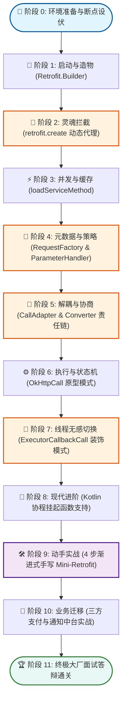

# 🚀 Retrofit 源码与设计模式手把手实战精读指南
> **专为希望掌握高内聚、低耦合架构设计的开发者打造的沉浸式通关教程**  
> *基于 Retrofit 2.x/3.x 官方源码库工程与真实源码路径编写*

---

## 🧭 导学：如何把 Retrofit 当成你的个人架构教练？

当你从“能写业务代码的初级工程师”迈向“能设计复杂系统的高级工程师/架构师”时，最大的门槛不是记住了多少 API，而是**对面向对象设计原则（SOLID）和经典设计模式（GoF）的深刻领悟与工程实践能力**。

很多工程师在学习设计模式时陷入过痛苦：
- **概念背得滚瓜烂熟**，但一写实际业务代码依然是万行巨型类、几十个 `if-else` 的面条逻辑；
- **读庞大源码抓不住脉络**，Spring、Tomcat 动辄百万行代码，断点跳两下就迷失在漫无边际的调用栈里。

**Retrofit 是目前工业界公认最完美的“架构教科书”：**
1. **小而精悍**：核心代码只有 20 来个核心类、几千行代码，没有任何冗余抽象，两三天即可通读。
2. **模式密度极高**：在这一套精炼代码里，**动态代理、外观、建造者、抽象工厂、策略、责任链、装饰器、适配器、原型** 9 种经典模式环环相扣，毫无生搬硬套的痕迹。
3. **接口设计的艺术典范**：把复杂的底层 HTTP 报文拼接、连接池管理、线程切换、反序列化全部抽象成了极其优雅的“Java 接口 + 注解”。

本指南采用**手把手交互式、通关路线式**的设计，不再仅仅泛泛而谈模式名词，而是**带着你定位到具体文件的具体代码行、在 IDE 中设置断点、观察调用栈跳跃、分析边界防御设计，最后亲手写出一个 Mini-Retrofit，并将这套架构思维落地到日常业务开发中**！

---

## 🗺️ 学习路线全景图与闯关指引



---

## 🏁 阶段 0：环境准备 —— 跑通工程与埋下第一批断点

### 0.1 核心体验样例：`SimpleService.java`
在本仓库中，官方提供了一个极简、免额外配置的示例类：
👉 [SimpleService.java](file:///c:/Users/liuju/Documents/GitHub/retrofit/samples/src/main/java/com/example/retrofit/SimpleService.java)

我们先看它的完整业务用法：
```java
// 1. 定义网络接口与注解
public interface GitHub {
  @GET("/repos/{owner}/{repo}/contributors")
  Call<List<Contributor>> contributors(@Path("owner") String owner, @Path("repo") String repo);
}

public static void main(String... args) throws IOException {
  // 2. 组装 Retrofit
  Retrofit retrofit = new Retrofit.Builder()
      .baseUrl("https://api.github.com")
      .addConverterFactory(GsonConverterFactory.create())
      .build();

  // 3. 动态生成接口实例（核心魔法点）
  GitHub github = retrofit.create(GitHub.class);

  // 4. 调用接口方法，获得 Call 对象
  Call<List<Contributor>> call = github.contributors("square", "retrofit");

  // 5. 执行请求并获得反序列化结果
  List<Contributor> contributors = call.execute().body();
}
```

### 0.2 在 IDE 中埋下 6 个关键断点
在 IDEA 或 Android Studio 中打开本项目，请按顺序打上以下断点：

| 序号 | 目标类与代码位置 | 断点目的 | 核心观察变量 |
| :--- | :--- | :--- | :--- |
| **断点 1** | [`Retrofit.java`](file:///c:/Users/liuju/Documents/GitHub/retrofit/retrofit/src/main/java/retrofit2/Retrofit.java#L158) `create()` | 观察动态代理是如何实例化的 | `service`, `Proxy.newProxyInstance` |
| **断点 2** | [`Retrofit.java`](file:///c:/Users/liuju/Documents/GitHub/retrofit/retrofit/src/main/java/retrofit2/Retrofit.java#L178) `invoke()` | 观察接口方法被调用时的瞬间拦截 | `method`, `args`, `serviceMethodCache` |
| **断点 3** | [`Retrofit.java`](file:///c:/Users/liuju/Documents/GitHub/retrofit/retrofit/src/main/java/retrofit2/Retrofit.java#L228) `loadServiceMethod()` | 观察方法解析缓存与并发锁机制 | `lookup`, `serviceMethodCache` |
| **断点 4** | [`RequestFactory.java`](file:///c:/Users/liuju/Documents/GitHub/retrofit/retrofit/src/main/java/retrofit2/RequestFactory.java#L68) `parseAnnotations()` | 观察注解如何被解析并转化为参数策略数组 | `parameterHandlers`, `httpMethod` |
| **断点 5** | [`HttpServiceMethod.java`](file:///c:/Users/liuju/Documents/GitHub/retrofit/retrofit/src/main/java/retrofit2/HttpServiceMethod.java#L78) `createCallAdapter()` | 观察责任链如何匹配 `CallAdapter` 与 `Converter` | `callAdapter`, `responseConverter` |
| **断点 6** | [`OkHttpCall.java`](file:///c:/Users/liuju/Documents/GitHub/retrofit/retrofit/src/main/java/retrofit2/OkHttpCall.java#L193) `execute()` | 观察底层 OkHttp 的触发、状态锁与反序列化 | `rawCall`, `responseConverter` |

---

## 🧱 阶段 1：启动篇 —— `Retrofit.Builder` 的组装艺术

### 1.1 为什么需要建造者模式？
如果你直接看 `Retrofit` 的构造函数（位于 [`Retrofit.java:68-80`](file:///c:/Users/liuju/Documents/GitHub/retrofit/retrofit/src/main/java/retrofit2/Retrofit.java#L68-L80)）：
```java
Retrofit(
    okhttp3.Call.Factory callFactory,
    HttpUrl baseUrl,
    List<Converter.Factory> converterFactories,
    int defaultConverterFactoriesSize,
    List<CallAdapter.Factory> callAdapterFactories,
    int defaultCallAdapterFactoriesSize,
    @Nullable Executor callbackExecutor,
    boolean validateEagerly)
```
它足足有 8 个参数！如果采用传统的构造器重载（Telescoping Constructor）：
- 调用方很容易传错顺序（例如两个 `List` 传反）；
- 某些参数具有平台默认值（如 JVM 与 Android 不同的 `callbackExecutor`），构造器无法优雅自适应；
- 构造完成后的对象必须是**完全不可变（Immutable）且线程安全**的。

### 1.2 源码显微镜：`Retrofit.Builder.build()` 剖析
打开 [`Retrofit.java:670-716`](file:///c:/Users/liuju/Documents/GitHub/retrofit/retrofit/src/main/java/retrofit2/Retrofit.java#L670-L716)，逐行拆解它的组装逻辑：

```java
public Retrofit build() {
  // 1. 强前置校验：Base URL 必须提供
  if (baseUrl == null) {
    throw new IllegalStateException("Base URL required.");
  }

  // 2. 默认值兜底：如果不指定网络客户端，默认创建 OkHttpClient
  okhttp3.Call.Factory callFactory = this.callFactory;
  if (callFactory == null) {
    callFactory = new OkHttpClient();
  }

  // 3. 平台回调线程池判定（外观模式与平台探测）
  Executor callbackExecutor = this.callbackExecutor;
  if (callbackExecutor == null) {
    callbackExecutor = Platform.callbackExecutor;
  }

  BuiltInFactories builtInFactories = Platform.builtInFactories;

  // 4. 防御性拷贝（Defensive Copy）与适配器列表初始化
  List<CallAdapter.Factory> callAdapterFactories = new ArrayList<>(this.callAdapterFactories);
  List<? extends CallAdapter.Factory> defaultCallAdapterFactories =
      builtInFactories.createDefaultCallAdapterFactories(callbackExecutor);
  callAdapterFactories.addAll(defaultCallAdapterFactories);

  // 5. 转换器列表组装（重要顺序控制！）
  List<? extends Converter.Factory> defaultConverterFactories =
      builtInFactories.createDefaultConverterFactories();
  int defaultConverterFactoriesSize = defaultConverterFactories.size();
  List<Converter.Factory> converterFactories =
      new ArrayList<>(1 + this.converterFactories.size() + defaultConverterFactoriesSize);

  // 注意：BuiltInConverters 永远强行插入在最前（Index 0）！
  converterFactories.add(new BuiltInConverters());
  converterFactories.addAll(this.converterFactories);
  converterFactories.addAll(defaultConverterFactories);

  return new Retrofit(
      callFactory,
      baseUrl,
      unmodifiableList(converterFactories), // 包装为只读列表
      defaultConverterFactoriesSize,
      unmodifiableList(callAdapterFactories), // 包装为只读列表
      defaultCallAdapterFactories.size(),
      callbackExecutor,
      validateEagerly);
}
```

> [!NOTE]
> **深入思考 1：为什么 `BuiltInConverters` 必须放在第一个？**  
> 因为内置转换器负责处理 `ResponseBody`、`Void`、`RequestBody` 这类底层原始类型。如果不放在最前面，开发者添加的泛型匹配过于宽泛的第三方转换器（例如某种会强行吃掉所有对象的 JSON Converter）就会抢先拦截原始类型，导致抛出异常或类型不匹配。

> [!NOTE]
> **深入思考 2：为什么要使用 `unmodifiableList(...)` 防御性拷贝？**  
> `Retrofit` 实例一旦创建，可能会在多个工作线程甚至跨模块之间共享。如果用户还能拿到外部传入的 `List` 引用并执行 `list.add(...)`，就会引发严重的数据竞争与并发修改异常（`ConcurrentModificationException`）。不可变性（Immutability）是编写高并发安全框架的基石。

### 1.3 平台自适应：`Platform.java` 是如何做到的？
打开 [`Platform.java:23-54`](file:///c:/Users/liuju/Documents/GitHub/retrofit/retrofit/src/main/java/retrofit2/Platform.java#L23-L54)：
```java
final class Platform {
  static final @Nullable Executor callbackExecutor;
  static final Reflection reflection;
  static final BuiltInFactories builtInFactories;

  static {
    switch (System.getProperty("java.vm.name")) {
      case "Dalvik": // 说明当前运行在 Android 移动端虚拟机上
        callbackExecutor = new AndroidMainExecutor();
        if (SDK_INT >= 24) {
          reflection = new Reflection.Android24();
          builtInFactories = new BuiltInFactories.Java8();
        } else {
          reflection = new Reflection();
          builtInFactories = new BuiltInFactories();
        }
        break;

      default: // 说明运行在标准 Java 虚拟机（Oracle JDK/OpenJDK）上
        callbackExecutor = null;
        reflection = new Reflection.Java8();
        builtInFactories = new BuiltInFactories.Java8();
        break;
    }
  }
}
```
**设计启示**：平台自适应通过系统属性在静态代码块中完成多态绑定。业务开发中，如果你需要写一套既能跑在 Spring Boot 上、又能跑在离线 Flink 脚本或 Android 终端上的通用 SDK，这种静态平台探测与工厂注入是非常干净的设计。

---

## 🔮 阶段 2：灵魂拦截 —— `retrofit.create()` 与动态代理的显微镜剖析

### 2.1 为什么初学者觉得 Retrofit 很“神奇”？
在传统代码中，要调用一个 HTTP 接口，你必须手写实现类：
```java
// 繁琐的传统写法：为每个接口手写一个实现类
public class GitHubImpl implements GitHub {
  @Override
  public Call<List<Contributor>> contributors(String owner, String repo) {
    // 手工拼 URL：https://api.github.com/repos/ + owner + "/" + repo + "/contributors"
    // 手工构建 OkHttp Request
    // 手工配置请求头...
  }
}
```
**而在 Retrofit 中，你只写了一个 interface，并没有写任何 `implements` 实现类，调用 `retrofit.create(GitHub.class)` 居然就能直接调方法！**

它是怎么把一个没有任何代码的接口变成活生生、能发 HTTP 请求的对象的？答案就在 **JDK 动态代理**。

### 2.2 源码显微镜：`create(Class<T> service)` 逐行解析
打开 [`Retrofit.java:158-181`](file:///c:/Users/liuju/Documents/GitHub/retrofit/retrofit/src/main/java/retrofit2/Retrofit.java#L158-L181)：

```java
@SuppressWarnings("unchecked")
public <T> T create(final Class<T> service) {
  // 1. 强力校验接口声明规范
  validateServiceInterface(service);

  // 2. 利用 JDK Proxy 在运行时动态生成实现类的字节码并实例化
  return (T)
      Proxy.newProxyInstance(
          service.getClassLoader(), // 使用接口的类加载器
          new Class<?>[] {service},  // 指定代理需要实现的接口
          new InvocationHandler() {  // 核心拦截器：所有方法调用都会进入这里！
            private final Object[] emptyArgs = new Object[0];

            @Override
            public @Nullable Object invoke(Object proxy, Method method, @Nullable Object[] args)
                throws Throwable {
              
              // 分流分支 A：如果是 Object 的方法（如 toString, equals, hashCode），正常执行
              if (method.getDeclaringClass() == Object.class) {
                return method.invoke(this, args);
              }
              
              args = args != null ? args : emptyArgs;
              Reflection reflection = Platform.reflection;

              // 分流分支 B：如果是 Java 8+ 的接口默认方法（default method），特殊反射执行
              return reflection.isDefaultMethod(method)
                  ? reflection.invokeDefaultMethod(method, service, proxy, args)
                  // 分流分支 C：核心拦截分支！解析注解并执行网络调度！
                  : loadServiceMethod(service, method).invoke(proxy, args);
            }
          });
}
```

### 2.3 深入底层：JVM 此时生成了什么？
当调用 `Proxy.newProxyInstance` 时，JVM 在内存中生成了一个类似于 `$Proxy0` 的字节码类：
```java
// 内存中生成的伪代码结构
public final class $Proxy0 extends Proxy implements GitHub {
  private static Method m_contributors;

  static {
    m_contributors = Class.forName("com.example.retrofit.SimpleService$GitHub")
                          .getMethod("contributors", String.class, String.class);
  }

  public $Proxy0(InvocationHandler h) {
    super(h);
  }

  @Override
  public Call contributors(String owner, String repo) {
    // 关键点：它把自己的调用直接转发给了 InvocationHandler.invoke()！
    return (Call) super.h.invoke(this, m_contributors, new Object[] { owner, repo });
  }
}
```
**真相大白**：你调用的所谓“接口方法”，其实根本没有执行体，它只是一个**方法签名的信使**，用来告诉 `InvocationHandler`：“用户调用了名叫 `contributors` 的方法，传进来的实参是 `owner="square"`, `repo="retrofit"`”！

### 2.4 接口防错校验：`validateServiceInterface()` 的防御设计
打开 [`Retrofit.java:183-213`](file:///c:/Users/liuju/Documents/GitHub/retrofit/retrofit/src/main/java/retrofit2/Retrofit.java#L183-L213)：
```java
private void validateServiceInterface(Class<?> service) {
  // 必须是 interface，不能是 class 或 abstract class
  if (!service.isInterface()) {
    throw new IllegalArgumentException("API declarations must be interfaces.");
  }

  // 严禁接口带有类型参数（泛型接口）：public interface Api<T> 是非法的！
  Deque<Class<?>> check = new ArrayDeque<>(1);
  check.add(service);
  while (!check.isEmpty()) {
    Class<?> candidate = check.removeFirst();
    if (candidate.getTypeParameters().length != 0) {
      throw new IllegalArgumentException("Type parameters are unsupported on " + candidate.getName());
    }
    Collections.addAll(check, candidate.getInterfaces());
  }

  // 如果开启了饥饿加载（validateEagerly），提前解析所有方法
  if (validateEagerly) {
    Reflection reflection = Platform.reflection;
    for (Method method : service.getDeclaredMethods()) {
      if (!reflection.isDefaultMethod(method)
          && !Modifier.isStatic(method.getModifiers())
          && !method.isSynthetic()) {
        loadServiceMethod(service, method);
      }
    }
  }
}
```

> [!TIP]
> **什么时候应该开启 `validateEagerly(true)`？**  
> 默认情况下 Retrofit 是懒加载的（只有方法被第一次调用时才解析）。如果某个方法注解写错了（如 `@Path("id")` 忘记传参），懒加载会在用户点到那个页面触发调用时才抛出 Crash。  
> **生产最佳实践**：在 CI/CD 单元测试环境中，开启 `validateEagerly(true)`，在应用启动或测试阶段一次性扫描所有接口，把语法错误扼杀在发版前！

---

## ⚡ 阶段 3：性能与并发 —— `loadServiceMethod` 缓存与锁分段

### 3.1 为什么必须缓存？
反射解析方法上的注解（`method.getAnnotations()`）、参数类型（`method.getGenericReturnType()`）是非常耗时的 CPU 密集操作。如果同一个 API 每秒被调用 1000 次，每次都去重复反射解析，性能会断崖式下跌。

因此，Retrofit 将解析好的每一个方法元数据封装成一个 `ServiceMethod<?>`，并缓存在 `ConcurrentHashMap<Method, Object>` 中。

### 3.2 源码显微镜：精妙的并发控制算法
打开 [`Retrofit.java:215-264`](file:///c:/Users/liuju/Documents/GitHub/retrofit/retrofit/src/main/java/retrofit2/Retrofit.java#L215-L264)，这是整套源码中在多线程并发控制方面**含金量最高的一段代码**：

```java
ServiceMethod<?> loadServiceMethod(Class<?> service, Method method) {
  while (true) {
    Object lookup = serviceMethodCache.get(method);

    // 1. 命中缓存的快路径（Happy Path）：直接类型强转并返回
    if (lookup instanceof ServiceMethod<?>) {
      return (ServiceMethod<?>) lookup;
    }

    if (lookup == null) {
      // 2. 缓存为空，尝试为该方法放置一个临时锁对象（Lock Object）
      Object lock = new Object();
      synchronized (lock) {
        // 利用 putIfAbsent 原子性抢占锁
        lookup = serviceMethodCache.putIfAbsent(method, lock);
        if (lookup == null) {
          // 抢占成功！当前线程负责解析该方法的元数据
          ServiceMethod<Object> result;
          try {
            result = ServiceMethod.parseAnnotations(this, service, method);
          } catch (Throwable e) {
            // 解析失败（如注解写错），必须移除锁，允许其他线程后续重试
            serviceMethodCache.remove(method);
            throw e;
          }
          // 解析成功，将真正的 ServiceMethod 替换放回 Map 中
          serviceMethodCache.put(method, result);
          return result;
        }
      }
    }

    // 3. 慢路径：并发冲突处理
    // 如果 putIfAbsent 返回了别人放进去的 lock 对象，说明有另一个线程正在解析同一个方法！
    // 当前线程只需挂在那个 lock 对象上等待解析完成即可，无需重复解析！
    synchronized (lookup) {
      Object result = serviceMethodCache.get(method);
      if (result == null) {
        // 另一个线程解析失败退出了，重试
        continue;
      }
      return (ServiceMethod<?>) result;
    }
  }
}
```

### 3.3 深度研读：为什么不直接用 `computeIfAbsent`？
在 Java 8 中，`ConcurrentHashMap.computeIfAbsent(key, mappingFunction)` 是非常方便的。但 Retrofit 为什么费尽心机手写一个 `lock` 对象？
1. **老版本 Android 系统 Bug**：在 Android 7.0 (API 24) 之前的特定 ROM 上，`ConcurrentHashMap.computeIfAbsent` 在多线程死锁/递归时有已知的系统级 Bug。
2. **锁粒度极致控制（Lock Striping）**：这段代码实现了**针对单个 Method 的细粒度锁**。线程 A 解析 `getUser()`，线程 B 解析 `getOrders()`，两者的 lock 对象完全独立，彼此之间毫秒都不阻塞！

---

## 🎯 阶段 4：元数据工厂与参数策略 —— `RequestFactory` 与 `ParameterHandler`

### 4.1 注解解析流水线
当调用 `ServiceMethod.parseAnnotations(retrofit, service, method)` 时，它紧接着委托给了 `RequestFactory.Builder`。

打开 [`RequestFactory.java:66-98`](file:///c:/Users/liuju/Documents/GitHub/retrofit/retrofit/src/main/java/retrofit2/RequestFactory.java#L66-L98)，`RequestFactory` 保存了一个 HTTP 请求所需要的所有“静态模板元数据”：
- `httpMethod`：请求方法（"GET", "POST", "DELETE" 等）
- `relativeUrl`：相对路径（如 `"/repos/{owner}/{repo}/contributors"`）
- `headers`：静态 Header
- `parameterHandlers`：**参数策略处理器数组（核心设计）**

### 4.2 策略模式的降维打击：彻底消灭 `if-else`
考虑这样一个问题：一个接口方法有多个参数，有的参数是 `@Path`，有的是 `@Query`，有的是 `@Header`，有的是 `@Body`。

#### ❌ 反例（平庸开发者的面条式写法）：
```java
// 每次执行请求时，都用庞大的 if-else 判断参数注解
for (int i = 0; i < args.length; i++) {
  if (annotations[i] instanceof Path) {
    // 拼 path
  } else if (annotations[i] instanceof Query) {
    // 拼 query
  } else if (annotations[i] instanceof Header) {
    // 加 header
  } // 每次请求都要重复这一坨低效的反射判断！
}
```

#### ✅ Retrofit 的策略模式：
Retrofit 在启动解析阶段，就预先为方法的每个参数生成了对应的**策略对象 `ParameterHandler<?>`**！
打开 [`ParameterHandler.java:27-29`](file:///c:/Users/liuju/Documents/GitHub/retrofit/retrofit/src/main/java/retrofit2/ParameterHandler.java#L27-L29)：

```java
abstract class ParameterHandler<T> {
  // 核心策略方法：将参数值应用到 RequestBuilder 上
  abstract void apply(RequestBuilder builder, @Nullable T value) throws IOException;

  // 具体的策略实现类：
  static final class Path<T> extends ParameterHandler<T> { ... }
  static final class Query<T> extends ParameterHandler<T> { ... }
  static final class Header<T> extends ParameterHandler<T> { ... }
  static final class Field<T> extends ParameterHandler<T> { ... }
  static final class Body<T> extends ParameterHandler<T> { ... }
}
```

在 [`RequestFactory.create()`](file:///c:/Users/liuju/Documents/GitHub/retrofit/retrofit/src/main/java/retrofit2/RequestFactory.java#L100-L135) 构建请求时，代码变得极其干净和高效：
```java
for (int p = 0; p < argumentCount; p++) {
  // O(1) 策略派发！没有任何 if-else！
  handlers[p].apply(requestBuilder, args[p]);
}
```

### 4.3 装饰模式的精妙结合：`iterable()` 与 `array()`
在日常开发中，参数不仅可能是单值，还可能是集合或数组（如 `@Query("ids") List<String> ids`）。  
难道需要为集合和数组各写一套 `PathList`、`PathArray`、`QueryList`、`QueryArray` 吗？

打开 [`ParameterHandler.java:30-55`](file:///c:/Users/liuju/Documents/GitHub/retrofit/retrofit/src/main/java/retrofit2/ParameterHandler.java#L30-L55)，Retrofit 使用了**装饰器模式（Decorator）**：
```java
final ParameterHandler<Iterable<T>> iterable() {
  return new ParameterHandler<Iterable<T>>() {
    @Override
    void apply(RequestBuilder builder, @Nullable Iterable<T> values) throws IOException {
      if (values == null) return;
      // 遍历集合，透明委托给原有的单值 Handler 执行！
      for (T value : values) {
        ParameterHandler.this.apply(builder, value);
      }
    }
  };
}
```
**设计启示**：原本需要写 $N \times 2$ 个子类的工作量，通过一个优雅的高阶装饰器方法瞬间解决。

---

## 🔗 阶段 5：解耦与协商 —— `CallAdapter` 与 `Converter` 责任链机制

在 HTTP 请求发出去之前与收到响应之后，面临两个核心问题：
1. **数据反序列化（Converter）**：服务器返回的 JSON / XML / Protobuf 字节流，怎么变成业务需要的 Java 对象？
2. **返回类型适配（CallAdapter）**：方法的返回值是 `Call<User>`、RxJava 的 `Observable<User>` 还是 Java 8 的 `CompletableFuture<User>`？谁负责转换？

### 5.1 抽象工厂模式（Abstract Factory）
Retrofit 不直接硬编码具体的转换规则，而是定义了两个纯粹的抽象工厂接口：

1. [`Converter.Factory`](file:///c:/Users/liuju/Documents/GitHub/retrofit/retrofit/src/main/java/retrofit2/Converter.java#L144-L156)：
```java
abstract class Factory {
  // 根据目标 Type 和注解，生产响应体转换器
  public @Nullable Converter<ResponseBody, ?> responseBodyConverter(
      Type type, Annotation[] annotations, Retrofit retrofit) {
    return null;
  }
}
```
2. [`CallAdapter.Factory`](file:///c:/Users/liuju/Documents/GitHub/retrofit/retrofit/src/main/java/retrofit2/CallAdapter.java#L60-L100)：
```java
abstract class Factory {
  // 根据接口返回类型 ReturnType，生产对应的 CallAdapter
  public abstract @Nullable CallAdapter<?, ?> get(
      Type returnType, Annotation[] annotations, Retrofit retrofit);
}
```

### 5.2 责任链模式（Chain of Responsibility）
用户可以在 `Retrofit.Builder` 中添加多个 ConverterFactory：
```java
retrofitBuilder
    .addConverterFactory(new ProtoConverterFactory()) // 先尝试 Proto
    .addConverterFactory(GsonConverterFactory.create()) // 再尝试 Gson
    .build();
```

当解析某个方法时，Retrofit 如何决定由谁来处理？  
打开 [`Retrofit.java:367-393`](file:///c:/Users/liuju/Documents/GitHub/retrofit/retrofit/src/main/java/retrofit2/Retrofit.java#L367-L393) 的 `nextResponseBodyConverter`：

```java
public <T> Converter<ResponseBody, T> nextResponseBodyConverter(
    @Nullable Converter.Factory skipPast, Type type, Annotation[] annotations) {
  
  // 1. 确定搜索起点（支持跳过之前已经处理过的节点）
  int start = converterFactories.indexOf(skipPast) + 1;

  // 2. 责任链传递：依次询问各个 Factory 能否胜任
  for (int i = start, count = converterFactories.size(); i < count; i++) {
    Converter<ResponseBody, ?> converter =
        converterFactories.get(i).responseBodyConverter(type, annotations, this);
    
    // 如果返回非空，代表该 Factory 领下了这个任务，责任链终止！
    if (converter != null) {
      return (Converter<ResponseBody, T>) converter;
    }
  }

  // 3. 所有节点均无法处理，拼接出详细的错误追踪链
  throw new IllegalArgumentException(...);
}
```

> [!IMPORTANT]
> **为什么要传入 `skipPast` 参数？**  
> 假设你需要写一个“加解密转换器”或者“多格式路由转换器”，它在解密完数据后，需要把解密后的明文交给下一个常规的 JSON 转换器继续解析。  
> 如果没有 `skipPast`，它调用 `retrofit.responseBodyConverter(...)` 就会再次匹配到自己，造成**无限递归导致 StackOverflowError**！`skipPast` 允许工厂在责任链中从自己之后的下一个节点继续向下协商。

---

## ⚙️ 阶段 6：网络执行与生命周期 —— `OkHttpCall` 的状态机与原型模式

### 6.1 `OkHttpCall` 扮演的角色
当动态代理拦截到方法并执行时：
```java
// HttpServiceMethod.java:157-160
@Override
final @Nullable ReturnT invoke(Object instance, Object[] args) {
  Call<ResponseT> call =
      new OkHttpCall<>(requestFactory, instance, args, callFactory, responseConverter);
  return adapt(call, args);
}
```
此时创建的 `OkHttpCall` 是 Retrofit 中网络执行的核心引擎。它实现了 `retrofit2.Call<T>` 接口，内部封装了 OkHttp 的 `okhttp3.Call`。

### 6.2 严密的状态机设计
打开 [`OkHttpCall.java:40-50`](file:///c:/Users/liuju/Documents/GitHub/retrofit/retrofit/src/main/java/retrofit2/OkHttpCall.java#L40-L50)：
```java
private volatile boolean canceled;

@GuardedBy("this")
private @Nullable okhttp3.Call rawCall;

@GuardedBy("this")
private @Nullable Throwable creationFailure;

@GuardedBy("this")
private boolean executed; // 标记单次执行状态
```

每个 `Call` 对象的生命周期只有一次：
```java
@Override
public Response<T> execute() throws IOException {
  okhttp3.Call call;

  synchronized (this) {
    if (executed) throw new IllegalStateException("Already executed.");
    executed = true; // 状态锁定
    call = getRawCall();
  }

  if (canceled) {
    call.cancel();
  }

  return parseResponse(call.execute());
}
```

### 6.3 原型模式（Prototype Pattern）：为什么要有 `clone()`？
如果一个请求失败了（如由于网络抖动超时），业务层需要实现“自动重试 3 次”，我们能直接 `call.execute()` 两次吗？  
不能！因为第二次调用会立即抛出 `IllegalStateException("Already executed.")`。

传统做法可能需要重新调用一遍接口方法，重新走一次动态代理和参数解析。  
而 Retrofit 采用了**原型模式**：
```java
// OkHttpCall.java:65-68
@Override
public OkHttpCall<T> clone() {
  return new OkHttpCall<>(requestFactory, instance, args, callFactory, responseConverter);
}
```
通过 `call.clone()`，直接复用已经解析好、现成的 `requestFactory` 与 `args`，瞬间复制出一个内部状态完全崭新（`executed = false`）的全新 Call 对象，既安全又零解析损耗。

### 6.4 响应流转换防漏：`parseResponse()`
打开 [`OkHttpCall.java:218-254`](file:///c:/Users/liuju/Documents/GitHub/retrofit/retrofit/src/main/java/retrofit2/OkHttpCall.java#L218-L254)：
```java
Response<T> parseResponse(okhttp3.Response rawResponse) throws IOException {
  ResponseBody rawBody = rawResponse.body();

  // 1. HTTP 状态码为 204 或 205 时，响应体为空，直接返回成功
  int code = rawResponse.code();
  if (code < 200 || code >= 300) {
    try {
      // 2. 状态码异常时，把流读入内存 Buffer 封装为 ErrorBody，防止连接泄漏
      ResponseBody bufferedBody = Utils.buffer(rawBody);
      return Response.error(bufferedBody, rawResponse);
    } finally {
      rawBody.close();
    }
  }

  // 3. 使用 ExceptionCatchingResponseBody 包装数据流
  ExceptionCatchingResponseBody catchingBody = new ExceptionCatchingResponseBody(rawBody);
  try {
    // 4. 调用配置好的 Converter 进行反序列化
    T body = responseConverter.convert(catchingBody);
    return Response.success(body, rawResponse);
  } catch (RuntimeException e) {
    catchingBody.throwIfCaught();
    throw e;
  }
}
```

---

## 🧵 阶段 7：线程无感调度与切面增强 —— `ExecutorCallbackCall` 装饰器模式

### 7.1 Android 核心痛点：UI 线程模型
在 Android 等客户端开发中，网络请求必须在工作线程执行，而更新 UI 界面必须切回主线程（Main Looper）。  
如果每个请求都要开发者手动写 `runOnUiThread { ... }` 或 `Handler.post { ... }`，业务代码将充斥着大量线程切换样板代码。

### 7.2 装饰器模式（Decorator）登场
Retrofit 没有通过继承修改 `OkHttpCall`，而是引入了一个静态内部装饰器：  
👉 [DefaultCallAdapterFactory.java:65-136](file:///c:/Users/liuju/Documents/GitHub/retrofit/retrofit/src/main/java/retrofit2/DefaultCallAdapterFactory.java#L65-L136)

```java
static final class ExecutorCallbackCall<T> implements Call<T> {
  final Executor callbackExecutor;
  final Call<T> delegate; // 被装饰的原始 OkHttpCall

  ExecutorCallbackCall(Executor callbackExecutor, Call<T> delegate) {
    this.callbackExecutor = callbackExecutor;
    this.delegate = delegate;
  }

  @Override
  public void enqueue(final Callback<T> callback) {
    Objects.requireNonNull(callback, "callback == null");

    // 1. 将真实的异步网络任务依然委托给 delegate 执行
    delegate.enqueue(
        new Callback<T>() {
          @Override
          public void onResponse(Call<T> call, final Response<T> response) {
            // 2. 当网络响应回来时，通过 callbackExecutor 将回调派发回主线程！
            callbackExecutor.execute(
                () -> {
                  if (delegate.isCanceled()) {
                    callback.onFailure(ExecutorCallbackCall.this, new IOException("Canceled"));
                  } else {
                    callback.onResponse(ExecutorCallbackCall.this, response);
                  }
                });
          }

          @Override
          public void onFailure(Call<T> call, final Throwable t) {
            callbackExecutor.execute(() -> callback.onFailure(ExecutorCallbackCall.this, t));
          }
        });
  }

  // 其余方法如 execute(), cancel() 直接透传给 delegate
  @Override
  public Response<T> execute() throws IOException {
    return delegate.execute();
  }
}
```

### 7.3 适配器模式 vs 装饰器模式核心对比
| 维度 | 适配器模式（`CallAdapter`） | 装饰器模式（`ExecutorCallbackCall`） |
| :--- | :--- | :--- |
| **核心目的** | 接口转换，抹平不同框架调用习惯 | 行为增强，在接口不变的前提下动态附加职责 |
| **接口形态** | **改变了接口类型**：把 `Call<R>` 转化为 `Observable<R>` 或 `CompletableFuture<R>` | **保持原有接口完全不变**：依然实现 `Call<T>` |
| **典型应用** | `RxJava3CallAdapterFactory` | `ExecutorCallbackCall` 线程调度装饰 |

---

## 🚀 阶段 8：现代进阶 —— Kotlin 协程挂起函数是如何支持的？

随着 Kotlin 成为主流，开发者越来越倾向于使用协程挂起函数：
```kotlin
interface UserService {
    @GET("/users/{id}")
    suspend fun getUser(@Path("id") id: String): User
}
```
**问题：Retrofit 是纯 Java 编写的底层库，它是怎么支持 Kotlin 的 `suspend` 语法的？**

### 8.1 揭秘 Kotlin `suspend` 的字节码真相
Kotlin 编译器在把 `suspend fun getUser(id: String): User` 编译成 JVM 字节码时，会做两件事（CPS 变换，Continuation Passing Style）：
1. 在方法参数列表的最末尾，追加一个隐藏参数：`Continuation<? super User> continuation`；
2. 将方法的实际返回值改为 `Object`（用于在挂起时返回一个特殊的标记对象 `COROUTINE_SUSPENDED`）。

### 8.2 源码显微镜：Retrofit 如何嗅探协程？
在 [`RequestFactory.Builder`](file:///c:/Users/liuju/Documents/GitHub/retrofit/retrofit/src/main/java/retrofit2/RequestFactory.java) 中：
```java
// 检查最后一个参数是不是 Continuation
Type lastParameterType = parameterTypes[parameterTypes.length - 1];
if (Utils.getRawType(lastParameterType) == Continuation.class) {
  isKotlinSuspendFunction = true; // 嗅探到了协程挂起函数！
}
```

打开 [`HttpServiceMethod.java:100-120`](file:///c:/Users/liuju/Documents/GitHub/retrofit/retrofit/src/main/java/retrofit2/HttpServiceMethod.java#L100-L120)：
```java
if (!isKotlinSuspendFunction) {
  return new CallAdapted<>(requestFactory, callFactory, responseConverter, callAdapter);
} else if (continuationWantsResponse) {
  return new SuspendForResponse<>(...);
} else {
  return new SuspendForBody<>(...);
}
```

在 [`SuspendForBody.adapt()`](file:///c:/Users/liuju/Documents/GitHub/retrofit/retrofit/src/main/java/retrofit2/HttpServiceMethod.java#L232-L245) 中，最终调用了 [`KotlinExtensions.kt`](file:///c:/Users/liuju/Documents/GitHub/retrofit/retrofit/src/main/java/retrofit2/KotlinExtensions.kt)：
```kotlin
suspend fun <T : Any> Call<T>.await(): T {
  return suspendCancellableCoroutine { continuation ->
    continuation.invokeOnCancellation {
      cancel() // 协程取消时，同步取消底层 OkHttp 请求！
    }
    enqueue(object : Callback<T> {
      override fun onResponse(call: Call<T>, response: Response<T>) {
        if (response.isSuccessful) {
          val body = response.body()
          if (body == null) {
            continuation.resumeWithException(NullPointerException(...))
          } else {
            continuation.resume(body) // 协程恢复，返回对象！
          }
        } else {
          continuation.resumeWithException(HttpException(response))
        }
      }
      override fun onFailure(call: Call<T>, t: Throwable) {
        continuation.resumeWithException(t)
      }
    })
  }
}
```
**设计启示**：这一机制完美展示了现代框架如何在不破坏原有 Java 核心架构（`Call<T>` 体系）的前提下，通过字节码探测 + 扩展函数胶水层，极其优雅地实现跨语言现代化特性的无缝集成！

---

## 🛠️ 阶段 9：动手实战 —— 4 步渐进式手写 "Mini-Retrofit"

理解源码的最高境界是**亲手实现一个迷你版**。我们不写复杂的网络连接，用纯 Java 原生能力，分 4 个台阶手写一套 Mini-Retrofit。

### 9.1 第一阶：20 行核心 —— 动态代理拦截原型
```java
import java.lang.reflect.*;

public class Step1_ProxyDemo {
    interface ApiService {
        String queryUser();
    }

    public static void main(String[] args) {
        ApiService api = (ApiService) Proxy.newProxyInstance(
            ApiService.class.getClassLoader(),
            new Class<?>[]{ApiService.class},
            (proxy, method, methodArgs) -> {
                System.out.println("拦截到方法调用: " + method.getName());
                return "{\"id\": 1, \"name\": \"Retrofit-Learner\"}";
            }
        );

        String result = api.queryUser();
        System.out.println("输出: " + result);
    }
}
```

### 9.2 第二阶：60 行 —— 引入 `@GET` 与 `@Query` 注解解析
```java
import java.lang.annotation.*;
import java.lang.reflect.*;

@Retention(RetentionPolicy.RUNTIME)
@Target(ElementType.METHOD)
@interface GET { String value(); }

@Retention(RetentionPolicy.RUNTIME)
@Target(ElementType.PARAMETER)
@interface Query { String value(); }

public class Step2_AnnotationDemo {
    interface WeatherService {
        @GET("/api/weather")
        String getWeather(@Query("city") String city);
    }

    @SuppressWarnings("unchecked")
    public static <T> T create(Class<T> service, String baseUrl) {
        return (T) Proxy.newProxyInstance(
            service.getClassLoader(),
            new Class<?>[]{service},
            (proxy, method, args) -> {
                GET get = method.getAnnotation(GET.class);
                if (get == null) return null;

                StringBuilder url = new StringBuilder(baseUrl + get.value());
                Annotation[][] paramAnnos = method.getParameterAnnotations();
                boolean first = true;

                for (int i = 0; i < paramAnnos.length; i++) {
                    for (Annotation anno : paramAnnos[i]) {
                        if (anno instanceof Query) {
                            String key = ((Query) anno).value();
                            url.append(first ? "?" : "&").append(key).append("=").append(args[i]);
                            first = false;
                        }
                    }
                }
                System.out.println("🚀 构造出完整 HTTP GET: " + url.toString());
                return "{\"temp\": 25, \"url\": \"" + url + "\"}";
            }
        );
    }

    public static void main(String[] args) {
        WeatherService service = create(WeatherService.class, "https://weather.com");
        service.getWeather("Beijing");
    }
}
```

### 9.3 第三阶：120 行 —— 引入策略模式与转换器工厂（开闭原则）
这里我们把参数处理抽象为 `ParameterHandler`，把数据反序列化抽象为 `Converter.Factory`：

```java
import java.lang.annotation.*;
import java.lang.reflect.*;
import java.util.*;

public class Step3_StrategyAndFactoryDemo {

    // 1. 抽象策略：参数处理器
    abstract static class ParameterHandler {
        abstract void apply(StringBuilder urlBuilder, Object value);
    }

    static class QueryHandler extends ParameterHandler {
        private final String key;
        QueryHandler(String key) { this.key = key; }

        @Override
        void apply(StringBuilder urlBuilder, Object value) {
            if (value == null) return;
            urlBuilder.append("&").append(key).append("=").append(value);
        }
    }

    // 2. 转换器接口与工厂
    interface Converter<F, T> {
        T convert(F value);
    }

    interface ConverterFactory {
        <T> Converter<String, T> create(Type targetType);
    }

    // 一个简单的 JSON 模拟转换器工厂
    static class StringToEntityFactory implements ConverterFactory {
        @Override
        public <T> Converter<String, T> create(Type targetType) {
            return raw -> {
                System.out.println("🔄 正在将原始响应 [" + raw + "] 转换为目标类型: " + targetType.getTypeName());
                return null; // 真实场景调用 Gson.fromJson
            };
        }
    }
}
```

### 9.4 第四阶：完备骨架 —— 包含装饰器线程调度的迷你框架
通过以上 4 步演进，你会清晰地看到：**Retrofit 并不是一蹴而就的复杂怪兽，而是一个从最基础的动态代理，随着业务扩展和解耦要求，一步步自然演化出设计模式的有机体。**

---

## 💼 阶段 10：业务迁移实战 —— 如何把 Retrofit 的架构精髓搬进日常开发？

很多同学学完开源库不知道怎么用在公司业务中。本节提供两个真实可落地的中高级架构改造案例。

### 10.1 实战案例 A：统一三方支付网关设计（微信、支付宝、云闪付）
在电商或 SaaS 系统中，需要对接各种三方接口。传统写法通常是在 Service 里写满 `switch(payType)`。

#### 借鉴 Retrofit 架构改造：
1. **接口声明声明式契约**：
   ```java
   public interface PayGateway {
       @PayChannel(ChannelType.WECHAT)
       PayResult prepay(@Param("orderId") String orderId, @Param("amount") long amount);

       @PayChannel(ChannelType.ALIPAY)
       PayResult prepay(@Param("orderId") String orderId, @Param("amount") long amount);
   }
   ```
2. **动态代理 + 策略分发**：
   利用动态代理统一拦截 `prepay` 调用，解析方法注解中的渠道类型，从 Spring 容器或策略工厂中取出对应的 `PayChannelStrategy`，自动完成参数签名、上送银行报文与验签解密。

### 10.2 实战案例 B：多渠道通知调度中台（责任链 + 装饰器）
在企业消息通知中心，需要支持钉钉、企业微信、飞书、短信推送，并支持失败降级和限流。

#### 借鉴 Retrofit 架构改造：
1. **装饰器模式用于切面增强**：为基础的 `MessageSender` 包裹 `RateLimiterMessageSender`（限流装饰器）、`AuditLogMessageSender`（审计日志装饰器）、`RetryMessageSender`（重试装饰器）；
2. **责任链模式用于渠道匹配与降级**：当邮件服务不可用时，自动按优先级链条下发给短信通道。

---

## 🏆 阶段 11：通关答辩 —— 10 道大厂高频面试题深度精讲

### Q1：Retrofit 的核心实现原理是什么？
> **参考回答**：  
> Retrofit 的核心原理是**基于 JDK 动态代理将接口方法声明转化为具体的 HTTP 网络请求**。  
> 当调用 `retrofit.create(Interface.class)` 时，会返回一个动态生成的 Proxy 实例。当调用接口方法时，被 `InvocationHandler` 拦截；Retrofit 内部通过 `loadServiceMethod()` 获取预先解析好的方法元数据（包括 HTTP 方法、URL、Header 及参数策略 `ParameterHandler`）；接着构建出底层的 `OkHttpCall`；最后通过责任链匹配对应的 `CallAdapter`（如 RxJava、CompletableFuture 或默认装饰器）和 `Converter`（如 Gson、Jackson），完成最终的网络执行和反序列化回调。

### Q2：为什么 Retrofit 只能接收 Interface，不能接收 Class？
> **参考回答**：  
> 1. JDK 官方的 `Proxy.newProxyInstance` 机制决定了动态代理生成的代理类默认已经继承了 `java.lang.reflect.Proxy`。因为 Java 是单继承机制，所以只能代理接口，无法代理具体类。  
> 2. 从设计哲学来看，接口代表纯粹的行为契约与规范，符合面向对象设计原则中的“依赖倒置原则（DIP）”。

### Q3：Retrofit 为什么采用抽象工厂模式来设计 `Converter.Factory` 和 `CallAdapter.Factory`？
> **参考回答**：  
> 践行“开闭原则（OCP）”。网络库的核心职责是构建请求与协议分发，不应与任何具体的序列化库（Gson/Jackson/Protobuf）或异步编程模型（RxJava/Future/Coroutines）产生硬编码耦合。通过提供抽象工厂，Retrofit 将具体组件的创建职责完全下放给外部插件，第三方无需改动 Retrofit 核心代码即可无限扩展。

### Q4：Retrofit 是如何实现主线程切换的？
> **参考回答**：  
> 在 Android 平台上，`Platform.java` 会检测当前处于 `Dalvik` 虚拟机环境，并默认注入 `AndroidMainExecutor`（其内部封装了绑定在主线程 Looper 上的 Handler）。在 `DefaultCallAdapterFactory` 中，使用**装饰器模式**将原始的 `OkHttpCall` 包装成了 `ExecutorCallbackCall`。当底层网络异步回调回来时，装饰器通过 `callbackExecutor.execute(...)` 将结果安全派发到主线程运行。

### Q5：Retrofit 内部为什么要对 `ServiceMethod` 做缓存？它的并发安全是如何保证的？
> **参考回答**：  
> 因为解析接口方法上的注解和泛型属于反射密集型操作，重复解析性能极差。  
> Retrofit 内部使用 `ConcurrentHashMap` 进行缓存，并通过精妙的**锁分段/锁对象占位算法**实现线程安全：在老版本系统上，通过向 Map 中执行 `putIfAbsent` 插入专用的锁对象，让抢占成功的单一线程负责解析，其余竞争线程在该锁对象上同步等待，既避免了同一个方法被重复并发解析，又实现了针对不同方法之间的无锁并发。

### Q6：`Call` 对象的 `clone()` 方法应用了什么设计模式？为什么需要它？
> **参考回答**：  
> 应用了**原型模式（Prototype Pattern）**。在 OkHttp 和 Retrofit 中，一个 Call 对象只能被 `execute()` 或 `enqueue()` 消费一次，内部维护了状态锁。如果需要实现请求失败重试，直接复用会抛出 `IllegalStateException`。`clone()` 方法通过已有的解析元数据和实参直接创建一个新的 `OkHttpCall` 实例，避免重新进行昂贵的反射解析。

### Q7：Retrofit 9 大设计模式中，哪一个对消灭业务代码中的 `if-else` 启发最大？
> **参考回答**：  
> 是 `ParameterHandler` 对**策略模式（Strategy Pattern）**的应用。面对多样化的参数注解（Path, Query, Header, Body），Retrofit 没有在运行期间循环判断 `instanceof`，而是在启动解析期直接将每个形参映射为具体的策略对象，执行时只需调用 `handler[i].apply(...)`。同时配合装饰器模式的 `iterable()` 与 `array()`，极大简化了代码分支。

### Q8：如果自定义一个拦截器/转换器，如何避免死循环？
> **参考回答**：  
> 依赖 Retrofit 在责任链设计中提供的 `skipPast` 机制。在调用 `retrofit.nextResponseBodyConverter(this, ...)` 时，将当前 Factory 作为第一个参数传入，责任链会从当前节点的下一个节点继续向后匹配，避免重新命中自己而导致栈溢出。

### Q9：Kotlin 挂起函数 `suspend` 是如何取消底层网络请求的？
> **参考回答**：  
> 在 `KotlinExtensions.kt` 中，Retrofit 使用了协程的底层 API `suspendCancellableCoroutine`。在包装异步回调时，注册了 `continuation.invokeOnCancellation { call.cancel() }` 监听。一旦外部协程 Scope 被 cancel，取消事件会立即沿着链路传播到底层的 OkHttp Call，从而立即中断网络 Socket IO，避免资源浪费。

### Q10：如果要设计一套防腐层（Anti-Corruption Layer）对接银行系统，你会如何借鉴 Retrofit？
> **参考回答**：  
> 1. 使用外观模式对外暴露统一入口；  
> 2. 使用动态代理实现声明式契约，把不同银行不同格式的接口调用抽象为统一的本地 Interface；  
> 3. 使用策略模式分别实现各家银行特有的报文组装、加签与验签逻辑；  
> 4. 使用建造者模式管理安全证书、公私钥、超时时间等配置，保证核心对象的不可变与线程安全。

---

## 📝 学习打卡与自我通关清单

在完成本指南的学习后，请自我对照以下清单进行打卡：

- [ ] **跑通样例**：成功在本地运行 `SimpleService.java` 并输出贡献者列表。
- [ ] **断点追踪**：在 `create()`、`loadServiceMethod()`、`parseResponse()` 上命中断点并观察到变量变化。
- [ ] **模式画图**：能不看本手册，独立画出 Retrofit 核心执行时序泳道图。
- [ ] **动手造轮子**：能够独立实现支持 `@GET` 与 `@Query` 的 60 行动态代理 Mini 框架。
- [ ] **架构迁移**：在公司的业务项目中，尝试用“策略模式”或“动态代理”重构一处原本臃肿的 `if-else`。
