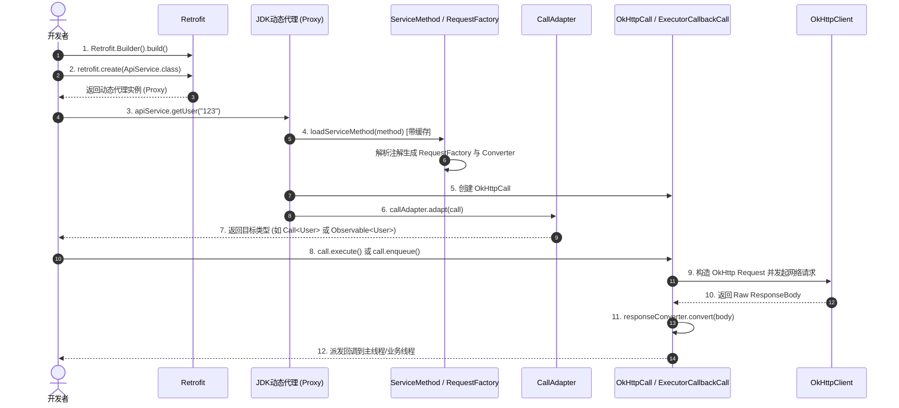

# 🎓 Retrofit 源码与设计模式实战精读指南
> **面向初级 Java 开发者的项目架构与设计模式学习手册**

---

## 🧭 前言：为什么 Retrofit 是初学者学习设计的最佳范本？

很多初级 Java 开发者在学习设计模式时常面临两大困惑：
1. **只记八股文**：知道单例、工厂、代理的概念，但写业务代码时依然全是 `if-else`、万能 God Service 和大坨面条代码。
2. **源码太庞大**：Spring、Tomcat 代码量动辄数十万行，调用栈深不见底，容易被底层细节淹没。

**Retrofit 的优势在于：**
- **代码体量精炼**：核心代码只有 20 多个类、几千行代码，结构清晰见底。
- **模式高度浓缩**：天然融合了至少 **9 种经典 GoF 设计模式** 与 **SOLID 面向对象设计原则**。
- **架构设计优雅**：将复杂的网络通信抽象成简单的“Java 接口 + 注解”，是 API 设计（API Design）的艺术典范。

---

## 🗺️ 一、Retrofit 核心架构全景图

在深入具体设计模式前，先理解 Retrofit 做了一件什么事：
**它把开发者定义的“HTTP 接口方法调用”，转化为底层的“真实 HTTP 网络请求”。**

### 1.1 核心执行时序流程



---

## 💎 二、Retrofit 中的 9 大设计模式深度拆解

---

### 1. 动态代理模式 (Dynamic Proxy Pattern) —— Retrofit 的灵魂

* **分类**：结构型模式
* **核心类/位置**：[`Retrofit.java`](retrofit/src/main/java/retrofit2/Retrofit.java#L137-L157) 中的 `create(Class<T> service)`

#### 💡 解决的核心痛点
如果没有动态代理，要调用一个 HTTP API，你必须为每个接口手写一个实现类：
```java
// 传统繁琐写法：每个接口都要手写实现
public class UserServiceImpl implements UserService {
    public Call<User> getUser(String id) {
        // 手写拼URL、组织 OkHttp Request、发请求、解析 JSON...
    }
}
```
Retrofit 颠覆了这一方式：**只写接口 + 注解，一行实现类都不用写！**

#### 🔍 源码实战解析
```java
public <T> T create(final Class<T> service) {
  validateServiceInterface(service);
  return (T) Proxy.newProxyInstance(
      service.getClassLoader(),
      new Class<?>[] { service },
      new InvocationHandler() {
        @Override
        public @Nullable Object invoke(Object proxy, Method method, @Nullable Object[] args)
            throws Throwable {
          // 1. 如果是 Object 的方法 (如 toString, hashCode)，直接执行
          if (method.getDeclaringClass() == Object.class) {
            return method.invoke(this, args);
          }
          // 2. 如果是 Java 8 interface default 方法，特殊处理
          if (Platform.reflection.isDefaultMethod(method)) {
            return Platform.reflection.invokeDefaultMethod(method, service, proxy, args);
          }
          // 3. 核心拦截：加载缓存的方法模型并触发执行！
          return loadServiceMethod(service, method).invoke(proxy, args);
        }
      });
}
```

> [!NOTE]
> **初级开发者启示**：
> 动态代理的本质是**方法拦截与行为重定向**。Spring 中的 `@Transactional` 事务拦截、Spring Data JPA 仅写 Interface 就能查数据库、MyBatis 的 Mapper 接口，底层底层全部是动态代理！

---

### 2. 建造者模式 (Builder Pattern) —— 复杂对象的解耦组装

* **分类**：创建型模式
* **核心类/位置**：
  * [`Retrofit.Builder`](retrofit/src/main/java/retrofit2/Retrofit.java#L484-L635)
  * [`RequestFactory.Builder`](retrofit/src/main/java/retrofit2/RequestFactory.java)
  * [`RequestBuilder`](retrofit/src/main/java/retrofit2/RequestBuilder.java)

#### 💡 解决的核心痛点
构造一个 `Retrofit` 实例需要指定：`callFactory`、`baseUrl`、多个 `converterFactories`、多个 `callAdapterFactories`、`callbackExecutor`、校验标记等。如果用构造器重载（Telescoping Constructor），会有几十个参数，代码极其容易传错且不可读。

#### 🔍 源码亮点
1. **链式调用（Fluent API）**：清晰流畅地组装依赖项。
2. **防御性拷贝与不变性（Immutability）**：在 [`Retrofit.Builder.build()`](retrofit/src/main/java/retrofit2/Retrofit.java#L614-L634) 中，传入的 Factory 列表被放入新的 `List` 并使用 `Collections.unmodifiableList()` 包装，防止外部篡改。
3. **平台默认值注入**：如果开发者没有传 `callFactory`，自动配置默认的 `OkHttpClient`；自动添加内置的转换器与适配器。

---

### 3. 抽象工厂模式 (Abstract Factory Pattern) —— 插件化可扩展性

* **分类**：创建型模式
* **核心类/位置**：
  * [`Converter.Factory`](retrofit/src/main/java/retrofit2/Converter.java#L36-L70)
  * [`CallAdapter.Factory`](retrofit/src/main/java/retrofit2/CallAdapter.java#L60-L100)
  * `okhttp3.Call.Factory`

#### 💡 解决的核心痛点
Retrofit 本身不关心你用的是 JSON、XML 还是 Protobuf，也不关心你用的是 Gson、Jackson 还是 Moshi。如果将具体的反序列化代码写死在核心包里，代码就会高度耦合。

#### 🔍 源码实战解析
```java
public interface Converter<F, T> {
  @Nullable T convert(F value) throws IOException;

  abstract class Factory {
    // 抽象工厂方法：根据需要转换的类型和注解，生产对应的转换器
    public @Nullable Converter<ResponseBody, ?> responseBodyConverter(
        Type type, Annotation[] annotations, Retrofit retrofit) {
      return null;
    }

    public @Nullable Converter<?, RequestBody> requestBodyConverter(
        Type type, Annotation[] parameterAnnotations, Annotation[] methodAnnotations, Retrofit retrofit) {
      return null;
    }
  }
}
```

> [!TIP]
> **设计精髓**：
> 工厂只负责“创建策略对象”。如果该工厂处理不了这个类型（例如 `GsonConverterFactory` 遇到纯文本），直接返回 `null`，留给链条中的下一个工厂处理。

---

### 4. 适配器模式 (Adapter Pattern) —— 抹平不同异步编程框架的鸿沟

* **分类**：结构型模式
* **核心类/位置**：[`CallAdapter.java`](retrofit/src/main/java/retrofit2/CallAdapter.java#L28-L58)

#### 💡 解决的核心痛点
Retrofit 底层执行网络请求的结果是 `Call<R>`。但是不同的项目或开发者有不同的编程偏好：
- Android 传统代码喜欢 `Call<R>`
- 响应式编程团队喜欢 RxJava `Observable<R>` / `Single<R>`
- Java 8 开发者喜欢 `CompletableFuture<R>`
- Kotlin 开发者喜欢协程挂起函数 `suspend fun getUser(): User`

#### 🔍 源码实战解析
```java
public interface CallAdapter<R, T> {
  // 返回待转换的实际响应体类型（如 Observable<User> 里的 User）
  Type responseType();

  // 核心适配方法：将 Call<R> 适配转换为外部需要的 T 类型
  T adapt(Call<R> call);
}
```

例如在 [`CompletableFutureCallAdapterFactory.java`](retrofit/src/main/java/retrofit2/CompletableFutureCallAdapterFactory.java#L70-L100) 中：
```java
@Override public CompletableFuture<R> adapt(Call<R> call) {
  CompletableFuture<R> future = new CallCancelCompletableFuture<>(call);
  call.enqueue(new Callback<R>() {
    @Override public void onResponse(Call<R> call, Response<R> response) {
      if (response.isSuccessful()) {
        future.complete(response.body());
      } else {
        future.completeExceptionally(new HttpException(response));
      }
    }
    @Override public void onFailure(Call<R> call, Throwable t) {
      future.completeExceptionally(t);
    }
  });
  return future;
}
```
外部接口的方法返回值声明为什么，CallAdapter 就能把它适配成什么！

---

### 5. 装饰模式 (Decorator Pattern) —— 无侵入的线程调度与功能增强

* **分类**：结构型模式
* **核心类/位置**：[`DefaultCallAdapterFactory.java`](retrofit/src/main/java/retrofit2/DefaultCallAdapterFactory.java#L64-L95) 中的 `ExecutorCallbackCall`

#### 💡 解决的核心痛点
Android 开发有一条铁律：**网络请求必须在子线程，更新 UI 必须在主线程**。
如果让每个网络请求完成时都手动写 `runOnUiThread(...)` 或 `Handler.post(...)`，会产生大量重复样板代码。

#### 🔍 源码实战解析
`ExecutorCallbackCall` 实现了 `Call<T>`，并持有另一个 `delegate`（也就是真实的 `OkHttpCall`）：
```java
static final class ExecutorCallbackCall<T> implements Call<T> {
  final Executor callbackExecutor;
  final Call<T> delegate; // 被装饰的原始对象

  ExecutorCallbackCall(Executor callbackExecutor, Call<T> delegate) {
    this.callbackExecutor = callbackExecutor;
    this.delegate = delegate;
  }

  @Override public void enqueue(final Callback<T> callback) {
    delegate.enqueue(new Callback<T>() {
      @Override public void onResponse(Call<T> call, final Response<T> response) {
        // 使用装饰者附加的行为：通过线程池/主线程调度器派发回调！
        callbackExecutor.execute(() -> callback.onResponse(ExecutorCallbackCall.this, response));
      }

      @Override public void onFailure(Call<T> call, final Throwable t) {
        callbackExecutor.execute(() -> callback.onFailure(ExecutorCallbackCall.this, t));
      }
    });
  }
  
  // 其余方法如 execute(), cancel() 等直接委托给 delegate
}
```

> [!NOTE]
> **对比适配器模式与装饰模式**：
> - **适配器（Adapter）**：改变了接口，将接口 A 转为接口 B（`Call<R>` $\to$ `CompletableFuture<R>`）。
> - **装饰器（Decorator）**：保持原有接口不变（依然是 `Call<T>`），在内部动态附加新职责（线程调度）。

---

### 6. 策略模式 (Strategy Pattern) —— 消除庞大的条件分支

* **分类**：行为型模式
* **核心类/位置**：
  * [`ParameterHandler.java`](retrofit/src/main/java/retrofit2/ParameterHandler.java)
  * [`Converter.java`](retrofit/src/main/java/retrofit2/Converter.java)

#### 💡 解决的核心痛点
HTTP 方法的参数可能有多种注解：`@Path`、`@Query`、`@QueryMap`、`@Header`、`@Field`、`@Body` 等。
如果采用初学者最习惯的写法：
```java
// 反例：面条代码
for (int i = 0; i < args.length; i++) {
    if (hasPathAnnotation(i)) { ... }
    else if (hasQueryAnnotation(i)) { ... }
    else if (hasHeaderAnnotation(i)) { ... }
    // 每次方法调用都要重复判断
}
```

#### 🔍 源码实战解析
Retrofit 将每种参数注解解析成一个独立的策略对象 `ParameterHandler<?>`：
```java
abstract class ParameterHandler<T> {
  abstract void apply(RequestBuilder builder, @Nullable T value) throws IOException;

  static final class Query<T> extends ParameterHandler<T> { ... }
  static final class Path<T> extends ParameterHandler<T> { ... }
  static final class Header<T> extends ParameterHandler<T> { ... }
  static final class Body<T> extends ParameterHandler<T> { ... }
}
```
在启动时解析完毕，保存为数组 `ParameterHandler<?>[] handlers`。每次方法调用时只需一行：
```java
for (int p = 0; p < argumentCount; p++) {
  handlers[p].apply(requestBuilder, args[p]);
}
```
O(1) 策略分发，既提升了执行性能，又彻底消除了 `if-else`。

---

### 7. 外观模式 (Facade Pattern) —— 高度内聚的统一入口

* **分类**：结构型模式
* **核心类/位置**：[`Retrofit.java`](retrofit/src/main/java/retrofit2/Retrofit.java)

#### 💡 解决的核心痛点
Retrofit 内部有庞大的子系统：`RequestFactory`、`ParameterHandler`、`OkHttpClient`、`CallAdapter`、`Converter`、`Platform` 等。如果把这些细节直接暴露给使用者，心智负担极重。

#### 🔍 源码实战解析
`Retrofit` 类本身就是外观对象，对外部开发者来说，只要了解 2 个入口即可：
1. `new Retrofit.Builder()...build()`（配置子系统）
2. `retrofit.create(MyApi.class)`（使用子系统）
复杂的注解解析、HTTP 报文拼装、序列化挑选、线程转换全在内部闭环完成。

---

### 8. 责任链模式 (Chain of Responsibility) —— 灵活的协商分发

* **分类**：行为型模式
* **核心类/位置**：[`Retrofit.java`](retrofit/src/main/java/retrofit2/Retrofit.java#L328-L352) 中的 `nextCallAdapter` 与 `nextResponseBodyConverter`

#### 💡 解决的核心痛点
Retrofit 允许配置多个 ConverterFactory（例如先加 XML Converter，再加 JSON Converter）。面对一个具体的 Java 类型，应该由谁来负责转换？

#### 🔍 源码实战解析
```java
public CallAdapter<?, ?> nextCallAdapter(
    @Nullable CallAdapter.Factory skipPast, Type returnType, Annotation[] annotations) {
  int start = callAdapterFactories.indexOf(skipPast) + 1;
  // 责任链传递：依次询问每个 Factory 能否处理该请求
  for (int i = start, count = callAdapterFactories.size(); i < count; i++) {
    CallAdapter<?, ?> adapter = callAdapterFactories.get(i).get(returnType, annotations, this);
    if (adapter != null) {
      return adapter; // 找到了负责的节点，终止传递
    }
  }
  // 如果所有节点都无法处理，抛出详细异常并打印尝试过的节点列表
  throw new IllegalArgumentException(...);
}
```

> [!NOTE]
> Retrofit 依赖的底座 **OkHttp Interceptor 拦截器机制** 更是责任链模式最纯粹的经典实现（`RealInterceptorChain` 链式调用 `proceed`）。

---

### 9. 原型模式 (Prototype Pattern) —— 状态重置与重复执行

* **分类**：创建型模式
* **核心类/位置**：[`OkHttpCall.java`](retrofit/src/main/java/retrofit2/OkHttpCall.java#L68-L72) 中的 `clone()`

#### 💡 解决的核心痛点
在 OkHttp 与 Retrofit 中，一个 `Call` 代表一次 HTTP 请求生命周期，为了保证线程安全和状态机严谨，每个 `Call` 只能执行一次（内部维护 `executed` 状态）。
如果业务需要重试请求，直接再次调用 `call.execute()` 会抛出异常 `IllegalStateException("Already executed")`。

#### 🔍 源码实战解析
```java
@Override public OkHttpCall<T> clone() {
  return new OkHttpCall<>(requestFactory, instance, args, callFactory, responseConverter);
}
```
通过克隆原型，利用已有解析好的元数据快速创建一个状态崭新的 `Call` 副本，既高效又避免重复反射解析。

---

## 🏛️ 三、Retrofit 如何落地面向对象五大原则 (SOLID)

| 原则 | 核心含义 | Retrofit 中的实际体现 |
| :--- | :--- | :--- |
| **SRP (单一职责原则)** | 一个类只负责一件事 | `RequestFactory` 专职解析方法注解；`Converter` 专职数据流序列化；`CallAdapter` 专职返回类型适配；各司其职，无巨型上帝类。 |
| **OCP (开闭原则)** | 对扩展开放，对修改关闭 | 想支持一种新的序列化方式（如 Fastjson / Protobuf），只需继承 `Converter.Factory`，无需改动 Retrofit 任何核心代码。 |
| **LSP (里氏替换原则)** | 子类必须能够替换基类 | 任何 `CallAdapter.Factory` 或 `Converter.Factory` 的子类都可以无缝替换并接入 Retrofit 链条中。 |
| **ISP (接口隔离原则)** | 客户端不应依赖不需要的接口 | `Call<T>` 仅定义网络动作（`execute`, `enqueue`, `cancel`）；`Callback<T>` 仅定义结果（`onResponse`, `onFailure`），接口极简明确。 |
| **DIP (依赖倒置原则)** | 依赖抽象，不依赖具体实现 | Retrofit 并不直接依赖具体的 `OkHttpClient`，而是依赖 `okhttp3.Call.Factory` 抽象接口；不直接依赖 Gson，依赖 `Converter` 抽象。 |

---

## 🛠️ 四、动手实践：50 行代码实现一个 "Mini-Retrofit"

作为初级开发者，**最快的理解方式不是只看代码，而是亲手写一个玩具实现**。
以下是一个可以在本地直接运行的 Mini-Retrofit 核心骨架：

```java
import java.lang.annotation.*;
import java.lang.reflect.*;

// 1. 自定义注解
@Retention(RetentionPolicy.RUNTIME)
@Target(ElementType.METHOD)
@interface GET {
    String value();
}

// 2. 业务接口
interface GitHubService {
    @GET("/users/octocat")
    String getUser();
}

// 3. Mini-Retrofit 核心
public class MiniRetrofit {
    private final String baseUrl;

    public MiniRetrofit(String baseUrl) {
        this.baseUrl = baseUrl;
    }

    @SuppressWarnings("unchecked")
    public <T> T create(Class<T> service) {
        return (T) Proxy.newProxyInstance(
            service.getClassLoader(),
            new Class<?>[]{service},
            (proxy, method, args) -> {
                // 拦截方法上的 GET 注解
                GET get = method.getAnnotation(GET.class);
                if (get != null) {
                    String fullUrl = baseUrl + get.value();
                    System.out.println("🚀 [MiniRetrofit] 发起模拟 HTTP GET 请求: " + fullUrl);
                    // 模拟返回数据（真实场景下此处调用 Http 客户端并执行反序列化）
                    return "{\"login\": \"octocat\", \"url\": \"" + fullUrl + "\"}";
                }
                return method.invoke(this, args);
            }
        );
    }

    public static void main(String[] args) {
        MiniRetrofit retrofit = new MiniRetrofit("https://api.github.com");
        GitHubService service = retrofit.create(GitHubService.class);
        
        // 这一行调用，看似在调空接口，实际上已被代理拦截并发起 HTTP 请求！
        String response = service.getUser();
        System.out.println("📦 收到响应: " + response);
    }
}
```

---

## 🎯 五、初级开发者如何进阶学习？（源码断点调试路线）

建议在 IDE 中打开本项目，按照以下抓手打上断点：

1. **断点 1**：[`Retrofit.java:140`](retrofit/src/main/java/retrofit2/Retrofit.java#L140)
   * 观察 `create()` 方法如何返回 Proxy 实例。
2. **断点 2**：[`Retrofit.java:199`](retrofit/src/main/java/retrofit2/Retrofit.java#L199)
   * 观察 `loadServiceMethod()` 如何使用 `ConcurrentHashMap` 与 `synchronized` 实现线程安全的高效缓存。
3. **断点 3**：[`HttpServiceMethod.java:44`](retrofit/src/main/java/retrofit2/HttpServiceMethod.java#L44)
   * 观察 `parseAnnotations()` 如何一步步组装 `RequestFactory`、`CallAdapter` 和 `Converter`。
4. **断点 4**：[`DefaultCallAdapterFactory.java:70`](retrofit/src/main/java/retrofit2/DefaultCallAdapterFactory.java#L70)
   * 观察 `ExecutorCallbackCall` 装饰器如何在运行时接管异步回调。

---

## 📌 六、学习小结与面试加分点

1. **当面试官问**：“你在实际项目中如何理解并应用动态代理？”
   * 不要只回答“Spring AOP、日志打印”。你可以说：“在 Retrofit 中，动态代理被用来实现‘接口即实现’的设计，将所有声明式注解在运行时解析为具体的网络调用，极大精简了客户端代码。”
2. **当面试官问**：“为什么要做抽象工厂和适配器？”
   * 举 Retrofit 的例子：“通过 `CallAdapter.Factory` 和 `Converter.Factory`，Retrofit 实现了完全与底层反序列化引擎（Gson/Jackson/Proto）和异步流控框架（RxJava/Future/Coroutines）的解耦，完美践行了开闭原则（OCP）。”
